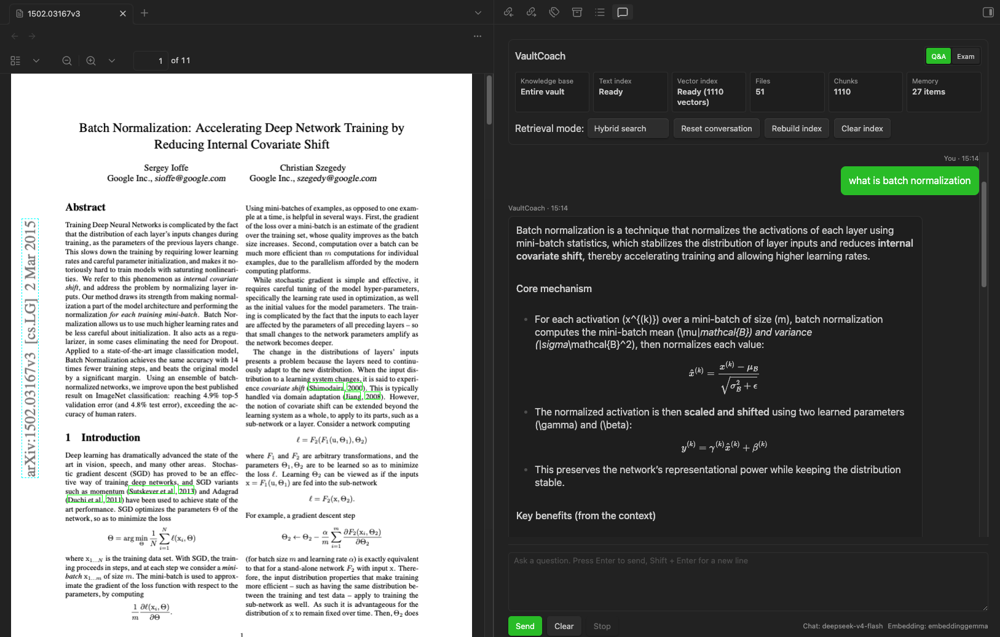
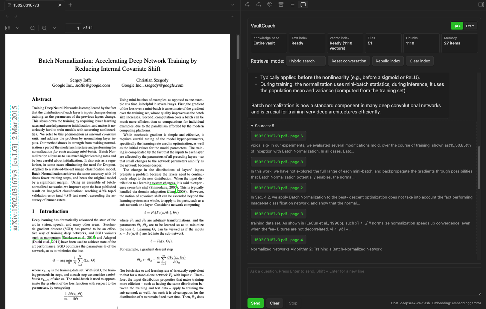
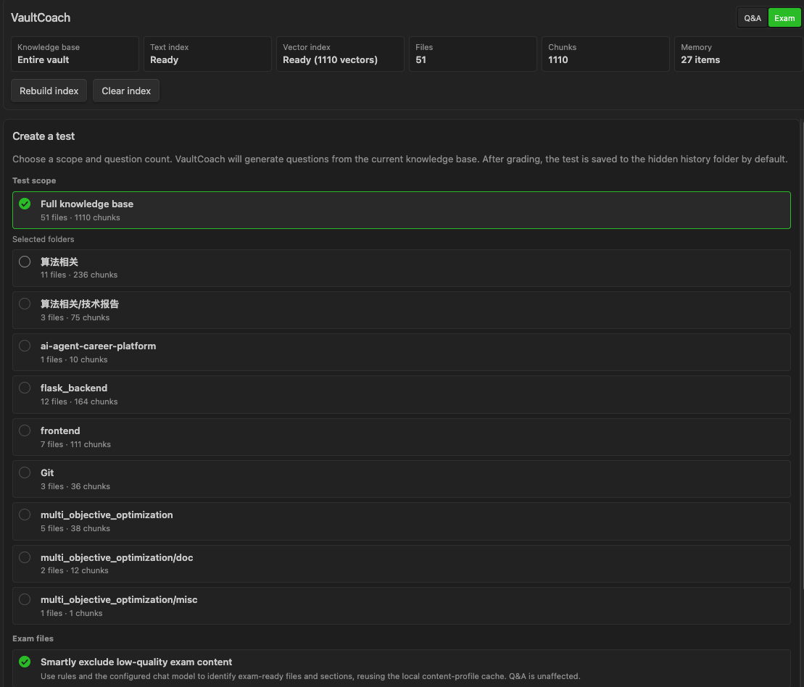
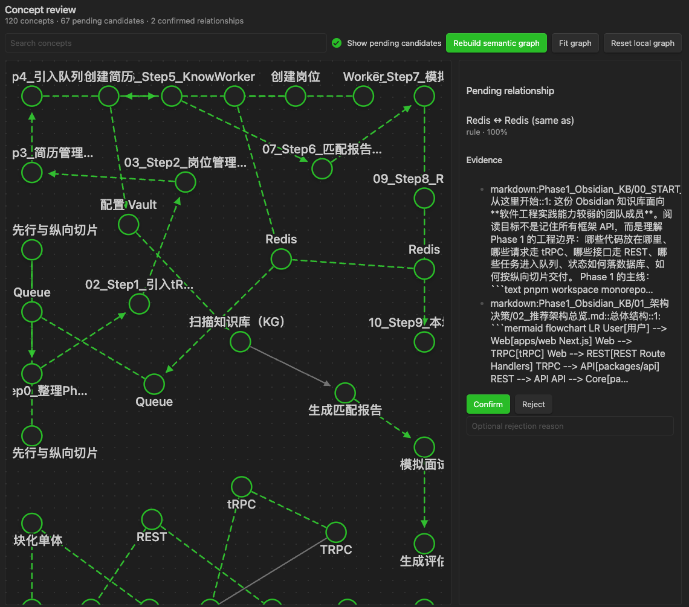
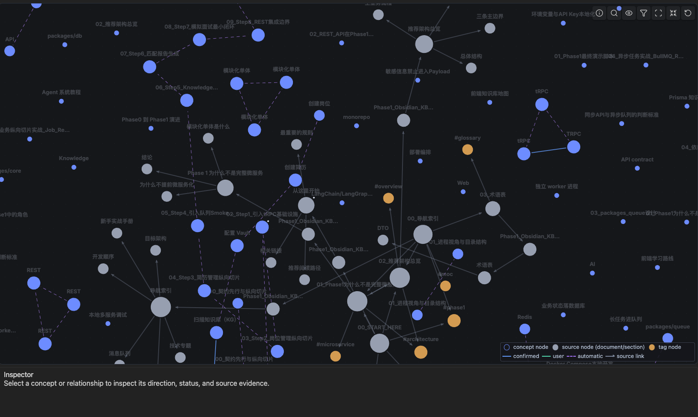
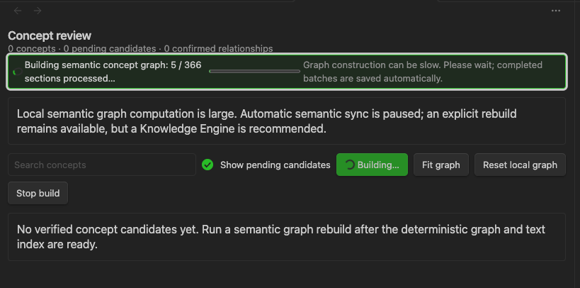
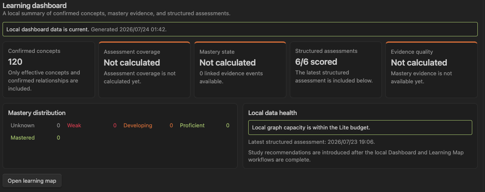
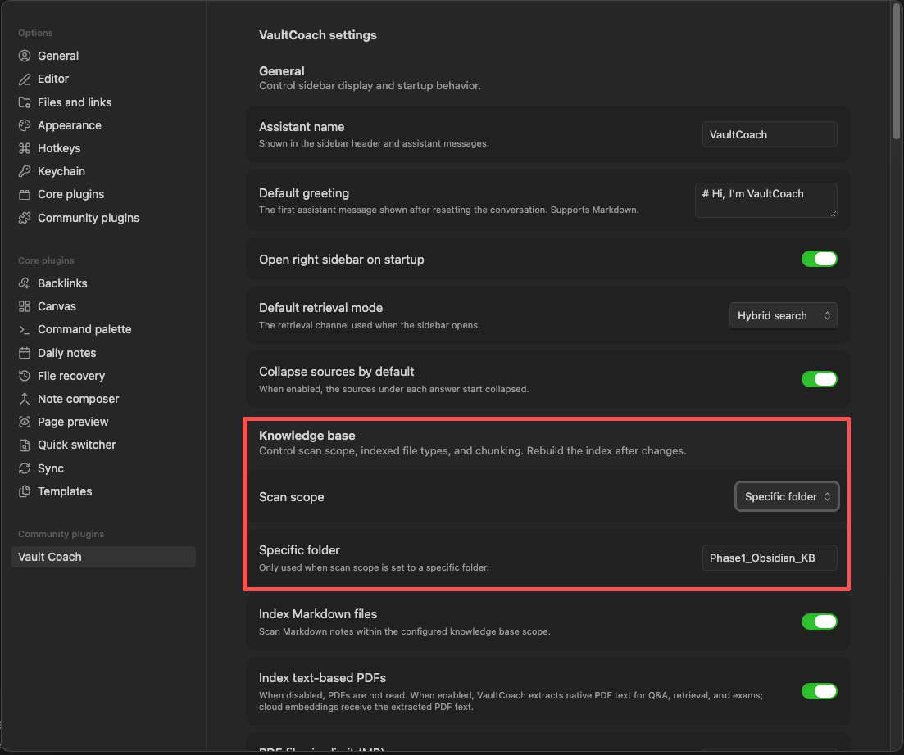
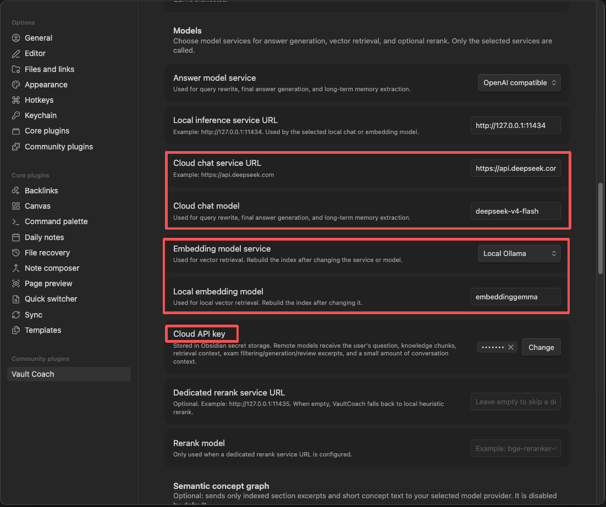

# Vault Coach

> Language: English | [中文](./README_CN.md)

**Learn from the notes you already trust.**

Ask a question, inspect the source, turn the topic into a practice exam, find the concepts that need work, and follow them back through your Learning Map.

**Cited Q&A · Practice exams · Built-in local embeddings · Learning Map · Mastery tracking · Local or cloud chat models**

**Configure one chat LLM and start learning.** Vault Coach now includes its own multilingual embedding runtime, so vector retrieval no longer requires a separate embedding service, endpoint, API key, or model name.

## New in 1.5.4: built-in multilingual embeddings with a smaller plugin download

The quickest setup now needs only the chat LLM you want to use for answers and model-assisted exams. For semantic retrieval, choose **Built-in multilingual embedding** once and let Vault Coach prepare the pinned local model. There is no embedding server to install and no embedding API to configure.

- **One less service to configure.** You do not need an Ollama embedding model, an embedding endpoint, or a second API key.
- **Local by design.** After one explicit download of about 143 MiB for the pinned runtime and model, embedding generation runs in an isolated WASM worker on your device.
- **Small release, offline runtime.** The ONNX runtime is no longer embedded in `main.js`; Vault Coach verifies it with SHA-256, caches it locally, and reuses it offline.
- **Offline after preparation.** The verified model cache can be reused without a network connection.
- **Ready for knowledge retrieval.** The built-in model powers vector and hybrid retrieval used to find source material for cited answers and practice exams.
- **Advanced choices remain available.** You can still replace it with Ollama or an OpenAI-compatible embedding service when your workflow requires another model.

## Why Vault Coach exists

A vault can hold years of useful notes and still leave a few hard questions unanswered:

- You remember learning something, but not the exact words you used when you wrote it.
- An AI answer sounds plausible, but you cannot see which note or PDF page supports it.
- Reading feels productive, yet it does not show what you can explain without looking.
- Links show that notes are connected, but not which concepts you have actually practised.

Vault Coach turns those separate activities into one evidence-backed learning loop inside Obsidian. It is built for learners, researchers, and knowledge-focused teams working with Markdown notes and text-based PDFs.

## A few things Vault Coach insists on

- **Evidence before confidence.** Answers link back to headings, excerpts, and PDF pages so you can inspect the source yourself.
- **Practice, not passive collection.** Exams, saved assessment records, mastery states, and review suggestions help turn stored notes into active learning.
- **Review before a relationship becomes fact.** Concept and relation candidates retain their evidence; you decide what to confirm, reject, merge, or undo.
- **A simpler default model setup.** Configure your preferred local or cloud chat LLM; Vault Coach can handle multilingual embeddings locally without another model service.
- **Explicit data boundaries.** Vault Coach has no hidden telemetry. Local data stays in your vault, and model calls occur only through the providers and features you enable.

## One learning loop

The main workflows are designed to lead into one another:

1. **Ask** a focused question about your Markdown notes or text-based PDFs.
2. **Inspect** the headings, excerpts, or PDF pages behind the answer.
3. **Practise** the same material with a scoped exam.
4. **Find the gap** through saved assessment evidence and mastery states.
5. **Reconnect the topic** in Concept review and Learning Map, then open the original source.

## Choose where AI runs

For the shortest path, configure a chat LLM and use Vault Coach's built-in local embedding runtime. Chat and embedding providers remain independent, so advanced users can still mix local, self-hosted, and cloud services.

| Setup | What it means |
| --- | --- |
| **Fully local with Ollama** | Run suitable chat and embedding models on your own computer. Model requests go only to the local endpoint you configure. |
| **Built-in local embedding — recommended for easy setup** | No embedding endpoint, API key, or model name to configure. Download the pinned multilingual model once, then build and query vectors locally in an isolated WASM worker. |
| **Self-hosted endpoint** | Use an OpenAI-compatible service on your own machine or private infrastructure. |
| **Cloud LLM or embedding service** | Point Vault Coach at an OpenAI-compatible provider. The provider may receive only the text required for the feature you explicitly run. |
| **Keyword-only retrieval** | Search locally without building embeddings. Answer generation, when used, still follows your configured chat provider. |

You can keep the entire workflow local, mix local and remote providers, or use cloud services. Vault Coach does not require a specific vendor. See [Privacy, storage, and network use](#privacy-storage-and-network-use) for the exact data boundary.

## What it does

### 1. Ask your notes and inspect the evidence

Choose the whole vault or one folder. Vault Coach indexes Markdown and, optionally, native-text PDFs. It chunks content for retrieval while keeping headings, file paths, excerpts, and PDF page locations for citations.

- Keyword, vector, and hybrid retrieval modes
- Optional query rewrite and reranking
- Page-aware citations for text-based PDFs
- Automatic incremental sync for normal file changes
- Configurable PDF size/page limits and chunking
- Optional local long-term memory for durable conversation facts, with a setting to disable it

<!-- Screenshot recommendation: show an answer with several expanded source cards. Include one Markdown heading source and one PDF page source if possible. -->

### 2. Turn a topic into a practice exam

Exam mode turns selected knowledge into deliberate practice instead of another chat session. You can choose the entire knowledge base, folders, or individual files; inspect and adjust the included files; generate questions; submit answers; and review scoring feedback.

- Scope exams to the material you are studying now
- Persist include/exclude choices for the session
- Filter low-value material such as TODOs, logs, link indexes, stubs, and drafts
- Choose **Simple** mode for single-choice and true/false questions with deterministic on-device 100/0 scoring
- Choose **Challenge** mode for a bounded content-aware mix of supported objective and free-response formats
- Choose an adaptive target—**Diagnostic**, **Weak review**, **Prerequisites**, or **Mixed**—to decide what to practise without changing answer format or scoring
- Analyze the selected material before generation; the preview uses only confirmed Concepts, confirmed prerequisite relations, Mastery, saved assessment evidence, and exact source chunks
- Analysis locks scope, files, question count, exam mode, and adaptive target until you select **Back to settings**; if those facts change before generation, reanalyze instead of silently changing the plan
- Fall back cleanly to a scoped exam when no traceable adaptive target is available; this flow never writes to the knowledge graph
- Save structured assessment records locally and export readable Markdown reports when needed

<!-- Screenshot recommendation: show the exam setup with scope selector, file manager, estimated capacity, and the Generate test button. -->

<!-- Screenshot recommendation: add a second exam image showing a completed result with score, feedback, and source-backed review items. This is more persuasive than another setup screenshot. -->

### 3. Review the connections the model proposes

The optional **Semantic concept graph** extracts Concepts and relationship candidates from indexed Sections. It is deliberately review-first:

- Candidates retain source evidence.
- Dashed relationships are proposals; confirmed relationships are distinct facts.
- You can confirm, reject, undo a decision, merge concepts, manage aliases, and add or remove manual relationships.
- Similarity candidates use a bounded approximate-neighbour search; similarity never auto-merges concepts.
- A model-backed semantic rebuild is always explicit. It is not silently triggered just by opening Obsidian.

<!-- Screenshot recommendation: add a Concept review screenshot. Show a readable graph with both dashed candidate edges and solid confirmed edges, a selected Concept inspector, and the confirm / reject controls. -->

### 4. Explore confirmed knowledge in Learning Map

**Learning Map** is the focused reading view of the graph. It presents confirmed and user-created relationships, with directed arrows where the relationship has direction. You can search, filter relationship types, zoom/pan, focus a neighbourhood, inspect source evidence, and jump back to the original note.

Pending or rejected candidates remain out of the Learning Map, so a visual connection is never mistaken for a confirmed learning fact. Optional high-confidence auto-relations are visually distinguished and are display-only; they do not change exams or mastery.

<!-- Screenshot recommendation: add a full-width Learning Map screenshot. Show clustered concept nodes, varied node size, directional relationship arrows, the compact upper-right controls, bottom inspector, and legend. Avoid screenshots where labels overlap. -->

### 5. See what to review next

The **Learning dashboard** summarizes confirmed concepts, assessment coverage, mastery distribution, local data health, and up to five evidence-backed next steps. Mastery is derived from saved structured exam events and confirmed Concept bindings—not from a guess that a note was merely opened.

Recommendations are deterministic local projections of confirmed source-backed Concepts, Mastery, saved assessments, and confirmed prerequisites. You can open their sources, start a source-scoped exam, complete, defer, dismiss, or restore an item, and copy the current plan as Markdown. Those actions are stored locally under `.vault-coach/recommendations/`; they never alter scores, Mastery, or graph facts. An optional Simple/Challenge suggestion is only a hint—you still choose the final mode in exam setup.

Use **Rebuild concept mastery** after taking exams or after changing the effective Concept graph. The resulting snapshot is rebuildable; saved exam sessions remain the durable learning record.

<!-- Screenshot recommendation: add a Learning dashboard screenshot with the five summary cards and mastery distribution. Use a vault with enough completed exams to make the distribution meaningful. -->

## Install

### From Obsidian Community plugins

When Vault Coach is available in the community catalog:

1. Open **Settings → Community plugins** in Obsidian.
2. Turn off Restricted mode if Obsidian asks you to do so.
3. Select **Browse**, search for **Vault Coach**, then install and enable it.

### Manual installation from a release

1. Download `main.js`, `manifest.json`, and `styles.css` from the matching [GitHub release](https://github.com/Wanjin5508/vault-coach/releases).
2. Create `<your-vault>/.obsidian/plugins/vault-coach/`.
3. Put the three files in that folder.
4. Reload Obsidian, then enable **Vault Coach** in **Settings → Community plugins**.

Do not install a source-code ZIP as a plugin release unless you build it first.

## Quick start

### 1. Install and open Vault Coach

1. Install and enable Vault Coach in Obsidian.
2. Open it from the ribbon or run **Open VaultCoach in the right sidebar** from the Command palette.
3. Open **Settings → Vault Coach**.

<!-- Screenshot recommendation: add a settings overview screenshot. Highlight Knowledge base, Models, Semantic concept graph, and Learning Map automatic relations rather than exposing credentials. -->

### 2. Choose the knowledge you want to train on

Under **Knowledge base**:

1. Choose **Entire vault** or **Specific folder**.
2. Enable Markdown indexing and, if needed, text-based PDF indexing.
3. Set sensible PDF limits and chunk settings for the size of your vault.
4. Select **Rebuild index** in the sidebar.

When the build finishes, ask a question to verify that the sources match the intended notes.

### 3. Configure your chat LLM

Choose the local, self-hosted, or cloud chat LLM that should generate answers and model-assisted exams. For the recommended setup, use the built-in multilingual embedding runtime for retrieval; it requires no separate embedding service configuration.

| Chat LLM option | When to choose it |
| --- | --- |
| Local Ollama | You want answer generation and model-assisted exams to stay on your own computer. |
| OpenAI-compatible endpoint | You use a cloud provider, a self-hosted gateway, or another compatible chat service. Configure its URL, chat model, and API key explicitly. |

Ollama is an optional privacy-oriented deployment path, not a requirement. If you use it, the typical base URL is `http://127.0.0.1:11434`; do not append `/api/chat`, `/api/embed`, or `/api/embeddings`.

Once the chat LLM is configured, expand **Advanced settings → Embedding and semantic retrieval**, choose the recommended **Built-in multilingual embedding**, then select **Download and load**. This is a one-time runtime and model preparation action: there is no endpoint, model ID, or embedding API key to enter. Vault Coach pins the ONNX runtime version and model revision, verifies every required asset with SHA-256, and stores them in local browser caches. Rebuild the knowledge index, and that single chat LLM configuration is enough for cited retrieval and exam workflows. The model is the ONNX conversion of [multilingual-e5-small](https://huggingface.co/Xenova/multilingual-e5-small); the upstream model is published under the MIT license.

### 4. Start a study cycle

1. Ask a cited question to refresh a topic.
2. Switch to **Exam mode** and create a short, scoped test.
3. Submit answers and review feedback.
4. Open **Concept review** to confirm or correct important relationships.
5. Open **Learning Map** and **Learning dashboard** to inspect the confirmed structure and mastery evidence.

This loop works well for interview preparation, certification study, course review, research reading, and project onboarding.

## How to use each workflow

### Ask questions with traceable sources

1. Select **Q&A** in the sidebar.
2. Choose Keyword, Vector, or Hybrid retrieval.
3. Ask a focused question.
4. Expand a source beneath the answer to inspect its excerpt, heading, or PDF page.
5. Use the source link to open the underlying note.

Tips:

- Start with a narrow question when a vault covers several domains.
- Use a folder-specific knowledge scope when a project needs isolation.
- Enable vector retrieval after preparing the built-in embedding model, or after configuring an external embedding provider, then rebuild the index.

### Create, take, and review an exam

1. Switch to **Exam mode**.
2. Choose the full knowledge base, one or more folders, or a source-scoped exam started from Learning Map.
3. Select **Manage files** to include/exclude individual files, then choose an adaptive target, **Simple** or **Challenge** mode, and a question count.
4. Select **Analyze exam scope** to inspect eligible material and the source-backed adaptive plan. Once analysis completes, the scope, files, question count, smart-filter setting, exam mode, and adaptive target are locked.
5. Select **Generate test**. To change the target, mode, or setup instead, select **Back to settings** first; this discards the completed analysis. If the vault facts change, analyze again rather than reusing the plan.
6. Submit answers, review the result, then use **Save result** or **Export**. Simple-mode answers are scored locally from their answer key; free-response answers retain the configured model-based evaluation path.

Saved assessment facts live in `.vault-coach/assessments/`. They are local vault data and are kept when you rebuild an index or refresh a graph.

### Build and review the semantic graph

1. In settings, enable **Semantic concept graph** and review the selected model provider.
2. Rebuild the normal knowledge index first.
3. Run **Rebuild semantic concept graph** from the Command palette.
4. Run **Open concept review**.
5. Review candidates using their evidence; confirm, reject, merge, or create a manual relationship where appropriate.
6. Use **Open learning map** to explore the confirmed result.

Use semantic graph rebuilding deliberately: it may send indexed Section excerpts to your chosen chat model and short concept text to your selected embedding provider. The exact destination depends on your provider settings.

### Large vaults and Knowledge Engine Local

Lite keeps semantic work bounded: a vault with up to 400 semantic input windows can build locally without a capacity prompt; 401–650 requires an acknowledgement before a manual rebuild; above 650, Lite keeps existing facts readable but does not start a new local semantic rebuild. Automatic semantic sync pauses above 400 windows. These are model-extraction windows, not file-count limits. Indexing, Ask, exams, saved assessments, Learning Map, and recommendations remain available.

For larger workloads, **Knowledge Engine Local** is the planned optional Docker service. This release contains only its offline compatibility seam: it makes no Engine network request, sends no Vault data, and requires no Docker. A future Engine connection will be explicit, loopback-only, version-negotiated, and limited to user-authorized revisioned data. See [Knowledge Engine requirements](./kb/knowledge-engine/01-需求规格.md) and [architecture](./kb/knowledge-engine/02-架构设计.md).

### Work with Learning Map and dashboard

1. Run **Open learning map**.
2. Search or filter relationships, then select a node or edge.
3. Use **Focus neighbourhood** for a local view; use **Reset exploration** to return to the broader projection.
4. Use **Show source structure** only when you need document/Section/tag context.
5. Run **Open learning dashboard** to check assessment coverage and mastery distribution.
6. Run **Rebuild concept mastery** after new exams or major Concept-review changes.

### When your vault changes outside Obsidian

Vault Coach records a lightweight source inventory with each successful index. If files were added, removed, replaced, or the configured scope changed while the plugin was closed, it will not reuse an old index, graph, or mastery snapshot as if it were current.

1. The sidebar, Learning Map, and dashboard show an update-required message.
2. Select **Rebuild index**.
3. For a substantial domain replacement, optionally run **Reset semantic graph decisions** after reviewing its impact count.
4. Use **Show VaultCoach derived storage usage** to inspect the local footprint by category.

Rebuilding never deletes original notes, saved assessment sessions, or exported reports. It replaces only rebuildable derived data such as indexes, vectors, graph snapshots, and mastery snapshots.

## Command palette reference

| Command | Purpose |
| --- | --- |
| **Rebuild knowledge index** | Re-scan the current knowledge scope and rebuild retrieval data. |
| **Clear knowledge index** | Clear rebuildable index and graph data; saved assessments remain. |
| **Rebuild semantic concept graph** | Explicitly run model-backed Concept/relationship extraction. |
| **Open concept review** | Review concept candidates and make reversible governance decisions. |
| **Open learning map** | Explore the confirmed knowledge graph. |
| **Open learning dashboard** | Inspect concept, assessment, and mastery summaries. |
| **Rebuild concept mastery** | Recalculate the local mastery read model from assessment evidence. |
| **Reset semantic graph decisions** | Clear manual semantic decisions after a deliberate review. |
| **Show VaultCoach derived storage usage** | Read-only breakdown of VaultCoach-managed local data. |
| **Download and load the built-in embedding model** | Explicitly download or warm-load the pinned runtime and local embedding model. |
| **Clear the built-in embedding model cache** | Release the runtime and remove its runtime/model caches without deleting notes or indexes. |

## Privacy, storage, and network use

Vault Coach has no hidden telemetry. It writes its working data inside the current vault, primarily under `.vault-coach/` and the plugin configuration directory.

| Data | Why it is stored | What happens on index rebuild |
| --- | --- | --- |
| Text/vector indexes and graph snapshots | Fast retrieval and graph rendering | Rebuilt from the current knowledge scope |
| Semantic candidates, embeddings, and review decisions | Concept review and Learning Map | Stale source-derived records are reconciled; manual decisions require an explicit reset |
| Mastery snapshot | Fast dashboard reads | Rebuildable from assessment evidence and the effective Concept graph |
| Assessment sessions and exported reports | Your learning history | Preserved |

Network behavior is controlled by your model settings:

- A local Ollama configuration keeps model requests on the local endpoint you configure.
- The built-in embedding option contacts the version-pinned npm CDN for ONNX Runtime and Hugging Face for fixed model assets only after you explicitly prepare it. Every asset is SHA-256 verified; note text is not uploaded. Embedding inference then runs locally in a WASM worker and can use the verified caches offline.
- An OpenAI-compatible provider may receive the text required for the feature you explicitly run: for example, retrieved context for Q&A, Challenge-mode exam generation or free-response scoring, or Section excerpts for semantic extraction. Simple-mode objective scoring is local.
- The deterministic structural graph and source-inventory comparison do not call a model or network service.

Treat `.vault-coach/` as private vault data. It can include note excerpts, filenames, headings, answers, feedback, graph evidence, and model metadata. Do not commit it to a public repository unless you have reviewed its contents.

## Current limits

- PDF support is for PDFs with a native text layer. OCR for scanned PDFs is not included.
- Complex PDF tables, diagrams, formulas, and multi-column layouts may need manual verification.
- Challenge-mode generation and free-response scoring are study aids produced by your configured model, not authoritative grading. Simple-mode objective scoring is deterministic from the generated answer key, so answer-key quality still depends on the source material and generation step.
- Concept extraction quality depends on the source material and selected model; review is intentional, not a failure mode.
- Large knowledge bases may pause new local semantic work to protect the Obsidian UI. Existing indexing, Q&A, exams, and confirmed graph reads remain available.

## Contributing

Issues and pull requests are welcome. For a bug report, include reproduction steps, Obsidian and plugin versions, provider/model details, relevant non-secret settings, and console errors or screenshots.

Before changing source comments, read the [code commenting guidelines](./docs/code-commenting-guidelines.md). Explanatory comments are written in Chinese and focus on responsibilities, invariants, failure behavior, compatibility, and architectural boundaries; identifiers and standard API names remain unchanged.

## License

[MIT License](./LICENSE)
