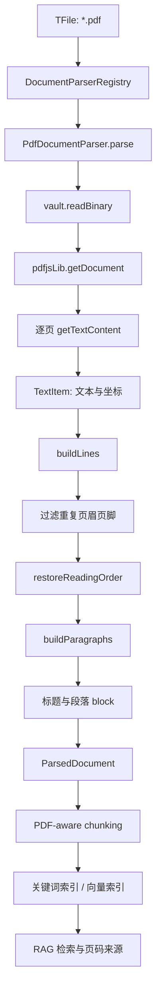
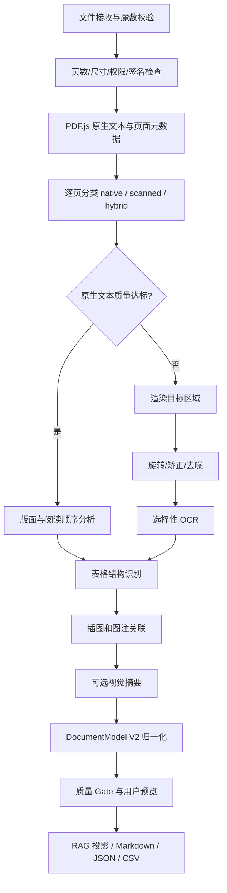

# Vault Coach PDF 信息提取：当前实现与演进架构

## 1. 文档目的

本文供准备维护或扩展 Vault Coach PDF 能力的开发者使用。它回答四个问题：

1. 当前 1.5.2 版本如何读取文本型 PDF；
2. 为什么从 PDF 中“读到字符”不等于恢复了文档结构；
3. 如何逐步扩展到表格、插图、扫描件和混合型 PDF；
4. 哪些能力适合留在 Obsidian 插件，哪些适合放进可选的本地或远程 Knowledge Engine。

本文描述的是架构边界和研发路线。开始开发前，应重新核对实际依赖版本、目标 Obsidian/Electron 版本以及真实设备表现。

### 1.1 状态标记

| 标记 | 含义 |
| --- | --- |
| **已实现** | 当前源码中已有运行路径 |
| **已有契约** | 类型或接口已预留，但运行路径尚未实现 |
| **建议方案** | 本文提出的后续设计，需要通过 ADR 和基准测试确认 |
| **暂不支持** | 当前产品不能向用户承诺的能力 |

## 2. 先理解 PDF：它不是 HTML 或 Markdown

PDF 主要描述一页内容应在什么坐标绘制。一个看起来完整的段落，在文件内部可能只是许多分散的字形绘制指令；表格可能只有文字和线条，没有“行”“列”“单元格”这些语义；扫描件甚至只有整页图片。

因此 PDF 信息提取至少包含五个不同问题：

1. **容器解析**：读取页、对象、字体、图片、注释、表单和权限；
2. **文字恢复**：把字形或文本项组合成词、行和段落；
3. **版面分析**：识别标题、正文、多栏、页眉页脚、表格、插图和阅读顺序；
4. **视觉识别**：对扫描图、图中标签、公式或图表运行 OCR/视觉模型；
5. **语义归一化**：把结果变成可检索、可引用、可导出且保留来源坐标的结构。

当前 Vault Coach 已完成文本型 PDF 的轻量文字恢复和 RAG 接入，尚未完成完整文档理解。

## 3. 当前 1.5.2 版本的 PDF 解析方案

### 3.1 当前能力边界

| 能力 | 状态 | 说明 |
| --- | --- | --- |
| 读取 Vault 内 PDF | **已实现** | 通过 `vault.readBinary()` 读取二进制内容 |
| 提取原生文本层 | **已实现** | 使用 `pdfjs-dist` 4.2.67 锁文件版本的 `getTextContent()` |
| 行、段落和简单标题恢复 | **已实现** | 基于坐标、间距、缩进和字号的启发式规则 |
| 重复页眉页脚过滤 | **已实现** | 检测每页边缘重复文本 |
| 双栏顺序改善 | **已实现但有限** | 启发式分左右栏，同时降低质量分 |
| 页码级来源引用 | **已实现** | chunk 保存 `PdfLocator`，界面可跳回 PDF 页 |
| 扫描件 OCR | **暂不支持** | 只产生低质量或疑似扫描警告 |
| 表格单元格结构 | **暂不支持** | 当前可能被恢复为普通段落 |
| 插图提取与图注关联 | **暂不支持** | 没有图像资产和关系模型 |
| 公式、图表语义理解 | **暂不支持** | 没有视觉或专用识别模型 |
| 密码输入与加密 PDF UX | **暂不支持** | 类型中有警告值，尚无完整交互流程 |

### 3.2 默认设置与安全边界

当前默认配置为：

| 设置 | 默认值 | 目的 |
| --- | ---: | --- |
| `enablePdfIndexing` | `false` | 不在用户未开启时读取 PDF |
| `maxPdfFileSizeMb` | 50 MB | 限制一般 PDF 解析的文件大小 |
| `maxPdfPageCount` | 300 页 | 限制解析工作量 |
| `chunkSize` | 600 字符 | 控制索引块大小 |
| `chunkOverlap` | 120 字符 | 保留相邻上下文 |

另有一个独立规则：Lite 语义图谱默认拦截超过 20 MB 的 PDF。这个 20 MB 阈值只保护需要模型抽取的语义图谱流程，不是一般 PDF parser 的上限，也不是知识库文件数量限制。两条保护线不能合并解释。

PDF.js 解析本身在插件内完成。若用户另外选择云端 embedding 或云端聊天 provider，提取后的 PDF 文本 chunk 或检索上下文可能按对应功能发送到该服务；当前路径不会把 PDF 二进制自动发送给云端。未来接入远程 PDF extraction provider 时，必须单独说明会上传原文件还是页面裁剪，并重新取得显式授权。

### 3.3 端到端数据流



关键源码：

| 文件 | 当前职责 |
| --- | --- |
| `src/document-parser.ts` | `DocumentParser`、注册表和内容哈希 |
| `src/pdf-document-parser.ts` | PDF.js 加载、文本重建、质量评估和 block 输出 |
| `src/domain/documents/document-types.ts` | 文档、block、locator、chunk 和提取报告契约 |
| `src/knowledge-base.ts` | 选择 parser、统一分块、索引和增量失效 |
| `src/constants.ts` | PDF 大小、页数、chunk 默认值 |
| `src/exam/exam-scope-service.ts` | 在考试范围中排除质量分低于 0.35 的 PDF |
| `src/presentation/components/source-list.ts` | 显示 PDF 页码来源 |
| `esbuild.config.mjs` | 针对当前 PDF.js 构建产物的兼容补丁 |

### 3.4 `DocumentParser` 是扩展入口

当前解析器遵循统一端口：

```ts
export interface DocumentParser {
    supports(file: TFile): boolean;
    parse(file: TFile, context: DocumentParseContext): Promise<ParsedDocument>;
}
```

知识库层只依赖 `ParsedDocument`，因此 PDF 的 OCR、表格或插图实现不应侵入 RAG UI。新的解析策略仍应输出统一文档模型，并通过 `parserVersion` 触发索引失效。

### 3.5 PDF.js 文本项如何变成段落

`getTextContent()` 返回带 `str`、`transform`、宽高等信息的文本项。当前实现依次执行：

1. 从 `transform` 读取 x、y 和字号近似值；
2. 按 y 接近程度把文本项聚成行；
3. 行内按 x 排序，根据横向间距补空格；
4. 统计各页顶部和底部的重复文本，过滤可能的页眉页脚；
5. 对普通页面按上到下排序；对疑似双栏页面按跨栏、左栏、右栏排序；
6. 根据纵向间距、缩进和标点把行合并为段落；
7. 根据编号模式和相对字号推断标题；
8. 为每个 block 保留页码 locator 和提取质量。

这套规则服务于 RAG，不负责复刻原排版。复杂论文、脚注穿插、浮动图表和三栏页面仍可能出现阅读顺序错误。

### 3.6 当前质量评估

当前 parser 用每页 40 个字符作为“有足够原生文本”的启发式阈值，并汇总：

- `nativeTextPages`：达到阈值的页面；
- `lowTextPages`：有少量文本但低于阈值的页面；
- `emptyPages`：没有提取文本的页面；
- `likelyScanned`：有足够文本的页面少于总页数的 25%；
- `likelyMultiColumn`：至少一页疑似多栏；
- `qualityScore`：文本覆盖率，若疑似多栏再减 0.12，最终限制在 0.05 到 1。

当前可能输出 `likely-scanned`、`layout-order-uncertain` 和 `partially-parsed`。这是粗粒度的文档级分数，不能替代未来的页级、区域级置信度。

### 3.7 来源、分块与索引

PDF block 使用页码定位：

```ts
interface PdfLocator {
    type: "pdf";
    filePath: string;
    pageStart: number;
    pageEnd?: number;
}
```

分块时最多合并相邻两页的 block，随后进入与 Markdown 相同的关键词、向量、混合召回和 rerank 链路。文件记录保存 `contentHash`、`parserVersion`、`chunkerVersion`、`extractionQuality` 和 chunk IDs，用于增量更新与删除旧索引。

### 3.8 PDF.js 的 Obsidian 兼容处理

当前版本懒加载 `pdfjs-dist` 主模块和 worker 模块，并使用同线程 `PdfJsLoopbackPort` 模拟消息端口。这样可以避开 Obsidian 插件打包和 CSP 下的 worker 文件定位问题，但解析工作仍可能占用主线程，未来叠加页面渲染、OCR 或版面模型时会放大 UI 卡顿风险。

`esbuild.config.mjs` 还会替换 PDF.js 4.2.67 构建文件中的特定源码片段，以处理 top-level await 和全局变量污染。这个补丁与上游产物形态耦合：

- `package.json` 当前使用 `^4.2.67`，锁文件实际为 4.2.67；
- 升级依赖前必须先在独立 PR 中验证补丁仍能匹配；
- 更稳妥的正式策略是固定精确版本，并为补丁增加构建夹具或显式失败测试；
- 升级成功只说明能打包，仍需在真实 Obsidian 中验证加载、解析、卸载与移动端。

### 3.9 当前方案的优点和技术债

**优点**：

- 默认关闭 PDF 索引，符合本地优先和显式授权；
- 无需外部服务即可解析普通文本 PDF；
- 保留页码来源，回答可以追溯；
- parser 与知识库通过统一领域模型解耦；
- 低质量文档不会悄悄伪装成高质量输入；
- 大小、页数、取消信号和资源销毁已有基本保护。

**技术债**：

- 同线程 loopback 无法承载重型视觉管线；
- 文档级质量分过粗，混合页面会被平均值掩盖；
- 没有区域边界框和阅读顺序证据，调试困难；
- `table`、`caption`、`ocr-text`、`visual-summary` 已在类型中预留，但当前 parser 只产生 `heading` 和 `paragraph`；
- 未发现专门覆盖 PDF 版面规则的单元测试和黄金样本集；
- 加密、损坏、超大页面和取消时机的用户反馈尚不完整。

## 4. 未来目标：从文本提取升级为文档理解

未来实现不应直接把 OCR 字符串或表格 Markdown 塞回当前 `ParsedDocumentBlock.text`。需要先建立更丰富、可追溯的中间文档模型，再从它投影出 RAG 文本、预览和导出格式。

### 4.1 建议的中间模型 V2

以下是建议契约，名称需要在 ADR 中确认：

```ts
type PdfElementKind =
    | "heading"
    | "paragraph"
    | "list"
    | "table"
    | "figure"
    | "caption"
    | "formula"
    | "header"
    | "footer"
    | "footnote";

interface NormalizedBox {
    x: number;      // 0..1
    y: number;      // 0..1
    width: number;  // 0..1
    height: number; // 0..1
}

interface PdfContentElement {
    id: string;
    pageNumber: number;
    kind: PdfElementKind;
    readingOrder: number;
    bbox: NormalizedBox;
    text?: string;
    extractionMethod: "native" | "ocr" | "layout-model" | "vision-model";
    confidence?: number;
    assetRef?: string;
    table?: {
        rows: number;
        columns: number;
        cells: Array<{
            row: number;
            column: number;
            rowSpan: number;
            columnSpan: number;
            text: string;
            bbox?: NormalizedBox;
        }>;
    };
    relatedElementIds?: string[];
    warnings: string[];
}

interface PdfPageModel {
    pageNumber: number;
    width: number;
    height: number;
    classification: "native" | "scanned" | "hybrid";
    elements: PdfContentElement[];
    quality: {
        textCoverage: number;
        readingOrderConfidence?: number;
        ocrConfidence?: number;
    };
}
```

设计理由：

- `bbox` 和页码让任何文字、单元格或插图都能回到原文；
- `extractionMethod` 防止模型生成摘要被误当成原文；
- `confidence` 和 warnings 支持 Gate、UI 提示与后续重跑；
- 表格保留 cell 和合并关系，Markdown/CSV/HTML 只是不同导出视图；
- 图像以 `assetRef` 引用缓存，不把大二进制塞进索引快照；
- page classification 允许同一 PDF 的不同页面走不同处理路径。

### 4.2 Provider 边界

建议把提取能力封装成端口，插件不直接依赖 Docling、PaddleOCR 或云厂商类型：

```ts
interface PdfExtractionCapabilities {
    nativeText: boolean;
    ocr: boolean;
    layout: boolean;
    tables: boolean;
    figures: boolean;
    formulas: boolean;
}

interface PdfExtractionProvider {
    readonly id: string;
    getCapabilities(): PdfExtractionCapabilities;
    inspect(input: PdfInput, signal?: AbortSignal): Promise<PdfInspection>;
    extract(input: PdfInput, options: PdfExtractionOptions): Promise<PdfDocumentModel>;
}
```

首批 adapter 可以是：

- `PdfJsNativeExtractionProvider`：当前轻量本地路径；
- `LocalOcrExtractionProvider`：浏览器端小规模 OCR 实验；
- `KnowledgeEnginePdfProvider`：可选本地 Docker 或用户显式选择的远程服务。

RAG 只消费规范化后的文档模型。切换 provider 不应改变 UI、索引和引用协议。

## 5. 建议的混合解析管线



核心原则是**先利用可信原生文本，只对缺失或低质量区域做 OCR**。对混合页面整页强制 OCR 会造成重复文字、精度下降和成本增加。

### 5.1 页级路由建议

每页先计算：

- 原生字符数与文本覆盖区域；
- 字体映射异常数量；
- 图片覆盖率；
- 文本项是否只有隐藏层或乱码；
- 阅读顺序置信度；
- 页面旋转和尺寸。

建议决策：

| 页面类型 | 处理策略 |
| --- | --- |
| 原生文本清晰 | 使用 native text，加轻量 layout |
| 原生文本少、整页为图 | 渲染后全页 OCR |
| 正文原生、图内有文字 | 正文使用 native text，只 OCR 图像区域 |
| 原生层乱码 | 保留异常证据，运行 OCR 后去重 |
| 原生与扫描页混合 | 每页独立路由，不按整个文件统一处理 |

去重时必须结合文字、bbox 重叠和来源方法，不能只按字符串去重。

## 6. 文本型 PDF 的表格结构化提取

### 6.1 为什么不能只导出 Markdown 表格

Markdown 无法完整表达合并单元格、嵌套表头、脚注、跨页表格和单元格坐标。如果内部只保存 Markdown，后续 CSV、HTML、Excel 或准确引用都会丢失信息。

内部应保存：

- 表格在页上的 bbox；
- 行、列、单元格及 `rowSpan`/`columnSpan`；
- 单元格文字、bbox、提取方法和置信度；
- 表题、脚注、单位和跨页关系；
- 原始表格区域截图，用于核对；
- 可搜索的线性序列化，例如“列名: 值”。

### 6.2 两条提取路径

**规则路径**适合线条清晰、原生文本坐标可靠的表格：

1. 从 PDF 操作或渲染结果检测横竖线；
2. 聚类行列边界；
3. 根据 bbox 把文字项分配进单元格；
4. 合并跨行跨列区域；
5. 验证每个文字项是否唯一归属。

**模型路径**适合无线框、复杂表头、扫描表格：

1. layout 模型定位 table region；
2. table structure 模型预测行、列和 cell 关系；
3. native text 或 OCR 填充单元格；
4. 将结构和文字置信度分别保存；
5. 用规则校验行列数、重叠和空洞。

第一版不要同时引入多套重型框架。用项目真实样本比较 Docling 与 PP-StructureV3，选择一个主 provider，另一个保留为实验 adapter。

## 7. 插图、图注与图表提取

### 7.1 结构化输出

单个插图至少需要：

- 页码和 bbox；
- 原始嵌入图像或高质量页面裁剪；
- 图注文字与对应关系；
- 图内 OCR 文字；
- 可选视觉摘要及其模型、版本、prompt 指纹；
- 对原图的稳定 `assetRef`；
- 是否允许进入向量索引。

PDF 内的“图片对象”不总等于用户看到的一张图：一张图可能由多个 raster、矢量线条和文字叠加而成。因此可靠的默认策略是先用 layout 检测得到可见区域，再决定提取嵌入对象还是页面裁剪。

### 7.2 图注关联

先使用可解释规则：

- “Figure/Fig./图/表”等编号模式；
- 图注与图片区的垂直距离；
- 左右边界重叠；
- 编号连续性；
- 跨栏与跨页限制。

模型可以修正候选关系，但关系结果必须保存置信度。视觉模型生成的摘要属于 `visual-summary`，不能冒充 PDF 原文，也不能覆盖图注。

### 7.3 隐私边界

如果视觉摘要由远程模型生成，设置页必须提前说明会发送哪些页面或裁剪图，默认关闭并要求用户显式选择 provider。日志、trace 和错误报告不得包含页面图像、OCR 全文或用户文件名。

## 8. 扫描型 PDF 与 OCR

### 8.1 基本流程

```text
PDF page
→ 受限分辨率渲染
→ 方向检测
→ 去倾斜、去噪、对比度与二值化（按需）
→ layout region detection
→ OCR detection + recognition
→ bbox 坐标映射回 PDF page
→ 阅读顺序与结构恢复
→ 质量报告
```

OCR 必须让用户选择或自动探测语言，但自动探测失败时要能手动覆盖。中文、英文、德文混排应作为 Vault Coach 的基础测试集。

### 8.2 Tesseract.js 适合什么

Tesseract.js 是 Tesseract 的 JavaScript/WebAssembly 端口，适合浏览器或 Electron 中的小规模 OCR 验证。它不直接读取 PDF；必须先用 PDF.js 把页面渲染为图片，再交给 OCR。语言数据、worker 和 WASM 资产也需要单独缓存与发布验证。

它适合作为“小页数、用户主动执行、可取消”的本地 spike，不适合作为未经基准测试就默认处理 300 页扫描件的正式方案。手写内容也不应承诺可靠识别。

### 8.3 质量报告应升级到页和区域

未来报告至少增加：

- `pageClassification`；
- OCR 平均/最低置信度；
- 文字覆盖率；
- 无法确定阅读顺序的区域；
- 表格和插图数量；
- 跳过原因与超时页面；
- provider、模型、模型 revision、语言和预处理配置；
- 处理耗时和峰值内存；
- 是否存在原生/OCR 重复冲突。

低置信页面应在用户预览中高亮，并允许只重跑选定页面。

## 9. 技术栈分层建议

### 9.1 插件内 Lite 层

| 技术 | 用途 | 结论 |
| --- | --- | --- |
| PDF.js | 原生文本、页面元数据、渲染、结构树 | 保留为快速路径 |
| Web Worker | 页面渲染、图像预处理和 OCR 隔离 | 在正式 OCR 前先解决打包和卸载 |
| OffscreenCanvas/Canvas | 页面或区域渲染 | 必须限制像素和并发 |
| Tesseract.js | 小规模本地 OCR spike | 通过性能 Gate 后再决定产品化 |
| IndexedDB/插件数据目录 | 小型模型和派生资产缓存 | 需要 manifest、版本、配额和清理 |

插件层负责轻量、即时、离线的能力。它不应在 `onload` 下载模型，也不应在主线程串行处理大量页面。

### 9.2 可选 Knowledge Engine 服务层

| 候选技术 | 适合能力 | 注意事项 |
| --- | --- | --- |
| Docling | 统一文档树、OCR、layout、表格结构、Markdown/JSON 导出 | 适合作为第一条服务端 PoC；用真实语料评估中文和复杂表格 |
| PaddleOCR PP-StructureV3 | 文档预处理、layout、OCR、表格、公式和图表 | 模型较多，部署和硬件组合必须基准化 |
| RapidOCR/Tesseract | OCR engine 备选 | 语言、速度、模型大小分别测量 |
| Python + FastAPI | provider API 和任务状态 | API 只暴露项目领域契约，不泄漏框架对象 |
| Docker | 本地服务可复现部署 | 模型应固定 revision，并支持离线预取 |

Knowledge Engine 可以由用户本地 Docker 运行，也可以连接用户明确选择的远程服务。插件必须保留 PDF.js Lite 路径，不能把云服务变成基本 PDF 检索的强制依赖。

### 9.3 为什么暂不直接选一个“万能库”

Docling 和 PP-StructureV3 都提供丰富管线，但它们的质量、速度、模型下载、CPU/GPU 要求和许可证组合会随版本变化。正式选型应基于 Vault Coach 的真实语料，而不是功能清单：

1. 固定候选版本和模型 revision；
2. 使用同一脱敏 benchmark corpus；
3. 比较结构精度、OCR、延迟、内存、镜像体积和冷启动；
4. 记录失败类型，而不只记录平均分；
5. 通过 ADR 选一个默认 provider；
6. 其他 provider 只保留接口兼容，不同时承担维护成本。

## 10. 缓存、版本与索引失效

解析结果是派生数据，必须能由原文件重建。建议缓存指纹包含：

```text
schemaVersion
+ parserVersion
+ providerId/providerVersion
+ modelId/modelRevision
+ extractionOptionsHash
+ sourceContentHash
```

以下变化必须使对应派生结果失效：

- PDF 内容或修改时间变化；
- parser、layout、OCR 或表格模型变化；
- 语言、DPI、预处理、表格模式变化；
- 文档模型 schema 变化；
- RAG 投影或 chunker 变化。

失效不等于自动进行昂贵重建。UI 应告诉用户预计页数、模式和本地/远程 provider，让用户主动确认大型 OCR 任务。

缓存建议分层：

| 缓存 | 内容 | 清理策略 |
| --- | --- | --- |
| inspection | 页数、类型、权限、页面分类 | 源文件变化即失效 |
| extraction | 结构化 page/element JSON | 按完整指纹失效 |
| assets | 页面缩略图、表格/插图裁剪 | 引用计数或 LRU |
| index projection | RAG 文本和 chunk | parser/chunker 变化失效 |
| model artifacts | OCR/layout 模型 | 显式版本、配额和用户清理 |

## 11. 性能与安全设计

### 11.1 资源预算

不要只限制文件字节和页数。解压后的单页像素可能非常大。至少限制：

- 单页最大渲染像素；
- 同时渲染/OCR 的页面数；
- 单文档和单页超时；
- 派生图片总字节；
- OCR/layout 模型内存；
- 缓存配额；
- 可取消点和 unload 清理时间。

### 11.2 不可信 PDF

把 PDF 当作不可信输入：

- 校验文件魔数，不只相信扩展名；
- 检查加密、权限、嵌入文件、JavaScript/action、外部引用和异常对象数量；
- 对损坏文件、解压炸弹、极端页面尺寸和递归对象设置限制；
- 服务端 worker 默认无外网、只读基础镜像、临时目录隔离并设置 CPU/内存/时间限制；
- 处理完成后清理临时文件；
- 不在日志或 trace 中记录原文、OCR 文字、图片和密码。

密码只用于当前任务的内存解密，不进入设置、日志、任务元数据或长期缓存。

## 12. 测试语料和评价指标

### 12.1 最小黄金语料

每个样本都应有合法来源、可提交的脱敏内容和人工标注：

| 类别 | 必备样本 |
| --- | --- |
| 文本型 | 单栏、多栏、脚注、连字符断行、CJK、RTL 可后续 |
| 混合型 | 原生正文加扫描页、正文加图内文字 |
| 扫描型 | 中/英/德、旋转、倾斜、低对比度、噪声 |
| 表格 | 有线/无线、合并单元格、多级表头、跨页 |
| 插图 | 单图多图、图注上下位置、矢量图、图中标签 |
| 异常 | 加密、损坏、空白页、超大页面、表单、签名 |

### 12.2 指标

| 能力 | 建议指标 |
| --- | --- |
| OCR | CER/WER、字符覆盖率、语言分组 |
| 阅读顺序 | block 顺序准确率或人工 pairwise accuracy |
| 表格 | cell text accuracy、结构 exact match、TEDS |
| 图注关系 | precision、recall、F1 |
| RAG | Recall@K、引用页准确率、无依据回答率 |
| 性能 | P50/P95 每页耗时、首结果、峰值内存、缓存字节 |
| 稳定性 | 取消延迟、超时恢复、失败后可重试、卸载资源 |

不要只用 OCR 字符准确率决定是否发布。对 Vault Coach 而言，检索召回和引用页是否正确同样关键。

### 12.3 每次实验的证据文件

建议每次基准输出：

```text
benchmark-results/pdf/<date>-<provider>/
  environment.json
  policy.json
  summary.json
  failures.jsonl
  sample-manifest.json
  GO-NO-GO.md
```

只提交脱敏汇总和允许进入仓库的小型样本。用户 Vault 原文、绝对路径、密码和完整页面图不进入 Git。

## 13. 分阶段实现指南

### 阶段 0：建立语料、模型和基线

- **内部依赖**：当前 `PdfDocumentParser`、`ParsedDocument`、来源展示、索引重建流程。
- **外部依赖**：可再分发的 PDF fixtures；PDF.js 当前固定版本。
- **工作**：给现有 parser 建立独立单测、黄金输出和性能基线；记录当前误序、表格扁平化和扫描件失败。
- **Gate**：每类样本都能重现问题；测试不依赖私人 Vault；当前行为有稳定 snapshot。
- **失败恢复**：删除实验输出不会影响用户索引；不修改产品默认值。

### 阶段 1：引入 DocumentModel V2 和兼容投影

- **内部依赖**：领域层、知识库 chunker、缓存指纹。
- **外部依赖**：无新增运行时依赖。
- **工作**：增加 page/element/bbox/provenance 契约；编写 V2 → 当前 `ParsedDocumentBlock` adapter；旧索引可读，新解析显式重建。
- **Gate**：Markdown 和当前 PDF 检索结果无非预期回归；schema 和 parser version 能正确失效。
- **失败恢复**：feature flag 回退 V1 projection，原 PDF 始终不修改。

### 阶段 2：页级检查、渲染和分类

- **内部依赖**：V2、任务取消、进度 UI、缓存 adapter。
- **外部依赖**：PDF.js render API；Worker/Canvas 能力。
- **工作**：实现 native/scanned/hybrid 分类、受限 DPI 渲染、页面缩略图和质量预览。
- **Gate**：目标桌面和移动端有像素、内存、耗时数据；取消和卸载无残留 worker。
- **失败恢复**：不能渲染时仍保留当前 native text 路径。

### 阶段 3：选择性 OCR

- **内部依赖**：页级路由、asset cache、语言设置、可观测任务。
- **外部依赖**：先做 Tesseract.js spike；重型路径使用选定 Knowledge Engine provider。
- **工作**：只处理低质量页/区域，坐标回映射，native/OCR 去重，输出 `ocr-text`。
- **Gate**：中英德扫描集达到预登记质量；UI 不冻结；远程路径有明确授权。
- **失败恢复**：OCR 失败只标记页面，不删除可用 native text；允许逐页重试。

### 阶段 4：表格结构

- **内部依赖**：element schema、bbox、导出 adapter、RAG 序列化。
- **外部依赖**：Docling 或 PP-StructureV3 的 benchmark winner。
- **工作**：保留 cells/spans/caption/image；提供 Markdown、CSV、HTML 视图；为 RAG 生成可读序列。
- **Gate**：简单表格与合并单元格分别达标；失败时显示原区域图而非伪造结构。
- **失败恢复**：表格 provider 关闭后退回普通文本，但保留 warning。

### 阶段 5：插图与图注

- **内部依赖**：asset store、关系模型、来源预览。
- **外部依赖**：layout provider；视觉摘要模型为可选项。
- **工作**：图片区定位、裁剪、图注关联、图中 OCR；视觉摘要显式标注 provenance。
- **Gate**：图注关联有可测 precision/recall；远程图像上传默认关闭。
- **失败恢复**：视觉服务失败时仍保留图片和原图注。

### 阶段 6：本地 Docker/远程 Knowledge Engine

- **内部依赖**：`PdfExtractionProvider`、任务状态、设置迁移、secret store。
- **外部依赖**：FastAPI、容器、选定模型、可选对象传输协议。
- **工作**：版本化 API、能力协商、取消、健康检查、超时和本地/远程隐私说明。
- **Gate**：断网时 Lite 仍可用；错误不会破坏原索引；请求日志不含内容。
- **失败恢复**：provider 不可用时回到 PDF.js 或等待用户处理，不自动改用另一远程服务。

### 阶段 7：发布加固

- **内部依赖**：设置页、索引迁移、诊断包、CI/CD。
- **外部依赖**：目标 Obsidian desktop/mobile 矩阵。
- **工作**：升级指南、缓存清理、数据删除、包体检查、许可证清单和故障手册。
- **Gate**：真实安装包验证；冷/暖启动、取消、损坏缓存、离线、升级和卸载全部通过。
- **失败恢复**：保留上一 parser 版本的安全回滚路径，不修改用户原文件。

## 14. 开发规范

1. **原文件不可变**：解析、OCR、导出都生成派生数据，绝不覆盖用户 PDF。
2. **事实与推断分开**：原生文字、OCR、图注和视觉摘要必须有不同 `contentKind`/provenance。
3. **页码和 bbox 不丢失**：任何可检索内容必须能回到原页，最好能回到区域。
4. **接口先于框架**：领域层不导入 Docling、PaddleOCR、Tesseract.js 或云 SDK 类型。
5. **重任务可取消**：每页、每模型阶段都检查 `AbortSignal`；unload 必须释放 worker、canvas 和模型。
6. **默认本地和最小权限**：远程 OCR/视觉必须显式开启并解释发送内容。
7. **版本可审计**：parser、schema、模型、prompt、配置都进入指纹。
8. **部分成功可表达**：一页失败不必让整份 PDF 失败，但必须记录 skipped page 和原因。
9. **质量不静默降级**：低质量结果在 UI、索引和考试范围中有一致策略。
10. **基准驱动选型**：库的 star、宣传指标和单次 demo 不能替代项目语料证据。

## 15. 调试清单

遇到“PDF 已索引但搜不到”时按以下顺序检查：

1. `enablePdfIndexing` 是否开启；
2. 文件是否在知识库扫描范围；
3. 是否超过当前大小或页数设置；
4. parser 是否产生 block；
5. `extraction.warnings` 和 `qualityScore`；
6. file record 的 content hash、parser/chunker version；
7. chunk 是否进入关键词索引和向量 store；
8. source locator 是否保留页码；
9. 检索 Gate 是否因质量或相关性过滤；
10. 重建索引后问题是否仍能稳定复现。

不要先调大 top-k。若阅读顺序、OCR 或表格结构已经错误，提高召回数只会把更多错误内容送给模型。

## 16. 官方资料与版本核对

- [PDF.js `PDFPageProxy`](https://mozilla.github.io/pdf.js/api/draft/module-pdfjsLib-PDFPageProxy.html)：`getTextContent()`、`render()`、`getStructTree()` 等页面能力。
- [Tesseract.js FAQ](https://github.com/naptha/tesseract.js/blob/master/docs/faq.md)：WebAssembly/worker 范围，以及 PDF 需要先渲染为图片。
- [Docling CLI](https://docling-project.github.io/docling/reference/cli/)：OCR 模式、layout、table structure、PDF backend 和表单提取选项。
- [Docling 模型目录](https://docling-project.github.io/docling/usage/model_catalog/)：layout、OCR、TableFormer 和视觉模型能力。
- [PaddleOCR PP-StructureV3](https://www.paddleocr.ai/latest/en/version3.x/pipeline_usage/PP-StructureV3.html)：文档预处理、layout、OCR、表格、公式和图表模块。

以上外部资料核对日期为 2026-10-22。正式实现时必须固定依赖版本和模型 revision，并使用对应版本文档重新验证。

## 17. 完成标准

完成本文学习后，新贡献者应能：

- 说明当前 PDF.js 文本提取到 RAG chunk 的完整调用链；
- 区分当前已实现能力、预留类型和未来设计；
- 解释为什么扫描、表格和插图需要页级/区域级模型；
- 设计保留 bbox、provenance 和 confidence 的中间模型；
- 为浏览器 Lite 与 Knowledge Engine 划分边界；
- 建立可重复的质量、性能、隐私和发布 Gate；
- 在不破坏原文件和现有索引的前提下逐阶段交付。
