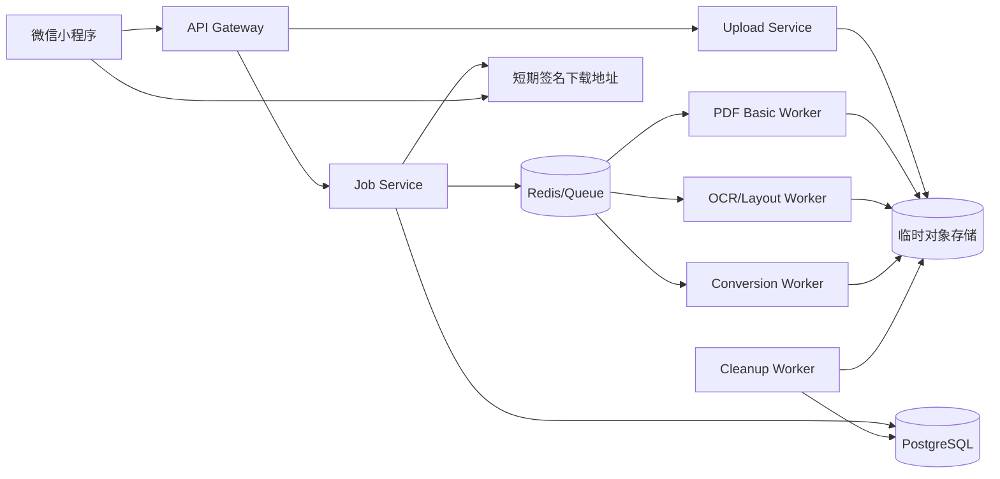

# PDF 工具箱微信小程序：需求分析与技术方案

## 1. 文档定位

本文分析一个独立于 Vault Coach 发布的微信小程序：用户在手机上选择 PDF 或图片，完成信息提取、格式转换和受控的 PDF 修改。

它可以复用 Vault Coach 在文档模型、来源定位、OCR 质量和 provider 接口上的经验，但不应直接依赖 Obsidian 插件运行时。两者的共同资产应是版本化领域协议、测试语料和提取服务，而不是互相导入源码。

本文属于需求与技术方案草案。微信基础库、接口限制、类目、备案、隐私和内容安全要求会变化，上线前必须以当时的微信官方文档和法律审查结果为准。

## 2. 产品定义

### 2.1 一句话描述

PDF 工具箱是一款移动端任务型工具，让用户用少量步骤完成 PDF 查看、页面整理、文字/OCR 提取、结构化导出、格式转换和常见修改，并能明确知道文件在哪里处理、保存多久、是否会上传。

### 2.2 目标用户

- 临时收到合同、论文、课件、扫描件，需要快速提取或整理的人；
- 需要将图片或办公文件转换为 PDF 的学生和办公用户；
- 需要拆分、合并、旋转、加水印、页码或填写表单的移动用户；
- 对隐私敏感，希望知道文件是否离开设备、何时删除的用户。

### 2.3 核心用户任务

```text
选择文件
→ 检查文件与选择操作
→ 配置少量必要参数
→ 上传/本地处理
→ 查看进度和预览
→ 下载、转发或保存结果
→ 明确删除任务文件
```

产品界面应围绕任务组织，例如“提取文字”“扫描件 OCR”“合并 PDF”，而不是让普通用户先理解 PDF 对象、OCR engine 或 content stream。

## 3. 产品原则

1. **原件永不覆盖**：所有修改都生成新文件。
2. **处理位置透明**：每个任务显示“设备内”“本地私有服务”或“云端处理”。
3. **上传前告知**：说明发送的文件、用途、保存时间和删除方式。
4. **短期存储**：默认只为任务交付保留必要时间，过期自动删除。
5. **失败可恢复**：长任务可取消、重试和继续，不让用户反复上传大文件。
6. **能力不夸大**：复杂排版恢复、手写识别和任意文字重排显示质量限制。
7. **输出可追溯**：结构化提取保留页码、区域、方法和置信度。
8. **移动端优先**：步骤少、弱网可恢复、内存可控、结果易分享。

## 4. 需求范围

### 4.1 MVP：第一版应该完成什么

| 模块 | 用户能力 | 验收重点 |
| --- | --- | --- |
| 文件接入 | 从会话或设备选择 PDF/图片 | 类型、魔数、大小、页数和加密状态检查 |
| 页面工具 | 合并、拆分、重排、旋转、删除页面 | 预览顺序正确，原文件不变 |
| 基础转换 | 图片转 PDF、PDF 转图片 | 分辨率、方向、压缩可选 |
| 文本提取 | 提取文本型 PDF 文字 | 保留页码，可导出 TXT/Markdown/JSON |
| 扫描 OCR | 对扫描 PDF 或图片识别文字 | 中英文起步，显示低置信区域 |
| 常用修改 | 水印、页码、简单覆盖文字/图片 | 明确这是覆盖层，不是正文重排 |
| 表单 | 填写已有 AcroForm 字段 | 字段预览和输出验证 |
| 任务中心 | 进度、取消、重试、结果下载、删除 | 弱网恢复、过期提示、幂等 |
| 隐私中心 | 查看处理位置和剩余保留时间 | 一键删除输入、输出和历史元数据 |

MVP 建议先打通**页面工具 + 原生文本提取 + 扫描 OCR**。格式转换和修改可以在同一任务架构上迭代，不要首版同时承诺所有格式和复杂编辑。

### 4.2 第二阶段能力

- 表格结构化为 CSV、HTML、Markdown 和 JSON；
- 插图、图注和图内文字提取；
- Word/Excel/PPT 与 PDF 的有限转换；
- 批量任务和常用预设；
- PDF 压缩、线性化、元数据清理；
- 注释、高亮、签名图片和图章；
- 可验证的真正涂黑；
- 登录后的短期跨设备任务历史。

### 4.3 首版不承诺

- 像 Word 一样任意修改已有 PDF 正文并自动重排全文；
- 法律意义上的数字证书签名、时间戳和长期验证；
- 破解未知密码或绕过内容权限；
- 对手写体、公式、复杂图表和所有表格保证完美恢复；
- 永久云盘、团队文档管理和多人实时协作；
- 在所有手机上完全离线处理大 PDF。

## 5. “直接修改 PDF”必须先分层

用户口中的“编辑 PDF”包含不同技术问题。产品和 API 需要使用明确操作名。

| 类别 | 示例 | 技术难度 | MVP |
| --- | --- | ---: | --- |
| 页面级结构 | 合并、拆分、旋转、重排、删除 | 低 | 是 |
| 覆盖层 | 水印、页码、图章、在坐标处写字/贴图 | 中 | 是 |
| 表单与注释 | 填写 AcroForm、批注、高亮 | 中 | 表单可做 |
| 内容流编辑 | 修改已有绘制指令、替换图片或局部对象 | 高 | 谨慎扩展 |
| 正文语义编辑 | 替换段落并自动重排后文 | 很高 | 否 |
| 真正涂黑 | 删除底层文字/图像并净化相关对象 | 高且安全敏感 | 后续专门实现 |

在页面上盖黑色矩形只是一层可见覆盖，底层文字可能仍能复制、搜索或从对象流恢复，因此不能称为“信息涂黑”。真正涂黑需要删除或重写目标内容并进行可验证检查。

修改已经数字签名的 PDF 通常会使签名状态发生变化。任务检查阶段应识别签名或签名字段，在执行前提示用户，并始终保留原件。

## 6. 客户端与服务端边界

### 6.1 推荐架构



### 6.2 小程序负责什么

- 文件选择与基础元数据；
- 处理位置、隐私说明和用户参数；
- 分片上传、暂停、恢复、取消和进度；
- 任务创建、轮询或事件更新；
- 页面缩略图和结果预览；
- 下载、打开、保存、转发和主动删除；
- 不包含文档原文的客户端诊断信息。

### 6.3 服务端负责什么

- 文件魔数、结构、权限、签名和风险检查；
- 大文件 PDF 解析、渲染、OCR、layout、表格和格式转换；
- 页面重排、合并、拆分、覆盖层和表单操作；
- 任务调度、幂等、取消、配额和故障隔离；
- 输入输出的加密临时存储和到期清理；
- 结构化结果、预览和 provenance manifest。

### 6.4 为什么首版不把完整引擎塞进小程序

完整 PDF 引擎、WASM、OCR 语言包和 layout 模型会增加代码包、内存和设备兼容风险。大文件还需要稳定的 worker、临时存储和长任务机制。首版把小程序作为受控任务客户端，重型处理放到隔离 worker，能更快获得稳定质量和可观测性。

未来可以评估 `WXWebAssembly` 或轻量本地能力，但必须在目标基础库和真机上验证包体、worker、文件系统、WASM SIMD/线程、内存峰值和后台中断。不能把浏览器 demo 等同于微信小程序可用。

## 7. 技术栈选择

### 7.1 小程序前端

**建议首版：原生微信小程序 + TypeScript。**

理由：

- 文件选择、临时文件、上传、下载和打开文档都依赖平台 API；
- 原生路径减少 Taro/uni-app 等兼容层对低层文件行为的影响；
- 首版页面数量有限，跨平台收益暂时小于调试成本；
- 可直接使用官方 typings，并在真机记录基础库差异。

UI 组件可评估 WeUI 或 TDesign MiniProgram，但引入前先检查代码包增量、可访问性和维护状态。

### 7.2 API 与任务编排

| 技术 | 建议用途 | 选择理由 |
| --- | --- | --- |
| Python + FastAPI | 版本化 REST API、校验、任务控制 | 与主流 PDF/OCR Python 生态衔接自然 |
| Pydantic | 请求、响应和 operation schema | 明确校验和 OpenAPI |
| PostgreSQL | Job、artifact、审计和保留策略元数据 | 事务、查询和生命周期清晰 |
| Redis | 队列、短期锁、速率限制和进度缓存 | 适合短期协调，不存文档真相 |
| Dramatiq/Celery/RQ | 后台 worker | 通过 PoC 比较取消、重试和运维复杂度后选一个 |
| S3 兼容对象存储 | 临时输入、输出、预览和结构化结果 | 适合生命周期策略和签名 URL |
| Docker | 隔离 worker 和固定工具版本 | 本地、测试和生产保持同一运行形态 |

不要在 MVP 同时引入多个队列。先用一个最小方案验证任务状态、幂等、取消和清理，再根据吞吐量决定是否拆服务。

### 7.3 PDF 基础操作

| 技术 | 推荐职责 | 边界 |
| --- | --- | --- |
| pypdf | 简单合并、拆分、旋转、表单、元数据和水印组合 | 纯 Python，适合高层常用任务 |
| pikepdf + qpdf | 结构检查、修复、加密、线性化、对象级操作和内容保留变换 | 低层能力强，需要理解 PDF 内部结构 |
| pdf-lib | JavaScript 端表单、绘制文字/图片和简单修改的 PoC | 不把它定位成任意正文重排编辑器 |
| PDFium/pypdfium2 | 服务端页面渲染与缩略图 | 版本、平台 wheel 和许可证需固定核对 |

建议 MVP 后端以 `pypdf + pikepdf/qpdf` 为基础操作层，以 PDFium 类 renderer 负责页面图像。不要用同一个库勉强承担解析、渲染、OCR、编辑和转换全部职责。

### 7.4 OCR、版面和结构化提取

优先建立统一 `DocumentExtractionProvider`，然后比较：

- **Docling**：统一文档模型、OCR、版面、表格和多格式导出，适合作为第一条端到端 PoC；
- **PaddleOCR PP-StructureV3**：OCR、文档预处理、layout、表格、公式和图表模块更细，适合需要单模块调优的路线；
- **Tesseract/RapidOCR**：作为明确的 OCR engine，而不是完整文档结构方案。

主 provider 只能由真实中英德扫描件、论文、合同、课件和表格基准决定。首版选一个主 provider，避免两套大模型管线同时进入生产。

### 7.5 格式转换

| 转换 | 建议实现 | 产品说明 |
| --- | --- | --- |
| 图片 → PDF | renderer + PDF writer | 可控、适合 MVP |
| PDF → 图片 | PDFium 类 renderer | 允许 DPI/格式/页范围 |
| PDF → TXT/Markdown/JSON | extraction provider + exporter | Markdown 是导出视图，不是唯一真相 |
| 表格 → CSV/HTML | 结构化 cell model + exporter | 复杂表格显示质量提示 |
| Office → PDF | 隔离的 LibreOffice headless worker | 字体和版式兼容需要真实样本 Gate |
| PDF → Office | 专门产品阶段 | 结构恢复困难，不能简单承诺高保真 |
| HTML/Markdown → PDF | Chromium/Playwright 或 WeasyPrint 等隔离 worker | 字体、分页、外部资源和安全策略需固定 |

每个 converter 都应是独立 operation adapter，不能在 API handler 内直接启动外部进程。

## 8. 统一任务 API

### 8.1 任务模型

```ts
type JobState =
    | "uploaded"
    | "queued"
    | "running"
    | "succeeded"
    | "failed"
    | "cancelled"
    | "expired";

interface PdfJob {
    id: string;
    operation: string;
    state: JobState;
    progress: number;
    stage?: string;
    inputObjectIds: string[];
    outputArtifactIds: string[];
    createdAt: string;
    expiresAt: string;
    error?: {
        code: string;
        retryable: boolean;
        userMessage: string;
        traceId: string;
    };
}
```

### 8.2 建议端点

```text
POST   /v1/uploads/init
PUT    /v1/uploads/{uploadId}/parts/{partNumber}
POST   /v1/uploads/{uploadId}/complete
POST   /v1/jobs
GET    /v1/jobs/{jobId}
POST   /v1/jobs/{jobId}/cancel
POST   /v1/jobs/{jobId}/retry
GET    /v1/jobs/{jobId}/artifacts
DELETE /v1/jobs/{jobId}
```

`POST /v1/jobs` 应接受 `Idempotency-Key`。同一用户、同一 key 和同一请求体只能创建一个任务，防止弱网重试产生重复收费或重复处理。

### 8.3 Operation 契约示例

```json
{
  "operation": "pdf.extract",
  "version": 1,
  "inputObjectIds": ["obj_..."],
  "options": {
    "mode": "auto",
    "languages": ["zh-Hans", "en"],
    "includeTables": true,
    "includeFigures": false,
    "outputs": ["markdown", "json"]
  }
}
```

Operation 必须有独立 JSON Schema、资源预算、可重试规则和 output manifest。不要使用一个包含几十个可选字段的万能请求。

### 8.4 结果 manifest

每个输出文件附带机器可读 manifest：

```json
{
  "jobId": "job_...",
  "operation": "pdf.extract@1",
  "sourceSha256": "...",
  "artifacts": [
    {"kind": "markdown", "objectId": "...", "sha256": "..."},
    {"kind": "document-json", "objectId": "...", "sha256": "..."}
  ],
  "provenance": {
    "provider": "...",
    "providerVersion": "...",
    "modelRevisions": [],
    "warnings": []
  }
}
```

哈希用于完整性和任务内幂等，不应默认用于跨用户永久去重。

## 9. 大文件与弱网

微信官方团队曾提供分片上传示例，用于规避 `wx.uploadFile` 的单次大小限制，并通过 `FileSystemManager.readFile` 实现分块、暂停、恢复和重试；该仓库已归档，因此只能作为设计参考，不能当成当前平台契约。

实施时应：

1. 重新核对当前 `wx.chooseMessageFile`、`wx.uploadFile`、`FileSystemManager`、`wx.downloadFile` 和 `wx.openDocument` 文档；
2. 固定最低基础库并在代码中做 capability check；
3. 使用 2–5 MB 量级分片起步，通过真机测试调整；
4. 服务端记录分片校验和、序号和过期时间；
5. 完成时校验总大小和完整文件 SHA-256；
6. 支持暂停、继续、取消和过期清理；
7. 限制并发，避免小程序内存峰值和弱网拥塞；
8. 不把旧示例中的 MD5 当作安全完整性校验。

网络域名、HTTPS、下载域名、超时和并发限制也必须以发布时官方文档为准。

## 10. 数据模型

### 10.1 核心实体

| 实体 | 关键字段 | 说明 |
| --- | --- | --- |
| `Job` | operation、state、progress、owner、expiresAt | 任务生命周期 |
| `InputObject` | objectKey、size、mime、sha256、inspection | 临时输入，不保存正文到数据库 |
| `OutputArtifact` | kind、objectKey、sha256、expiresAt | 输出、预览或结构化结果 |
| `OperationSpec` | name、version、schema、budget | 可执行能力的稳定契约 |
| `RetentionPolicy` | inputTtl、outputTtl、metadataTtl | 明确删除时间 |
| `ProvenanceManifest` | tool/model/version/options/warnings | 可审计处理过程 |
| `DeletionReceipt` | jobId、deletedAt、remainingMetadata | 用户可见删除结果 |

### 10.2 匿名与登录

首版不应为了单次 PDF 操作强制登录。可以给匿名任务发放短期、不可猜测的 job access token。登录只在确有价值时用于：

- 跨设备查看未过期任务；
- 恢复上传；
- 管理配额或付费权益；
- 用户主动保存的短期历史。

登录身份、文件内容和产品分析数据应分开存储。不得因为登录就默认延长文档保留时间。

## 11. 隐私、安全与合规

### 11.1 数据最小化

- 对象存储保存二进制，数据库只保存必要元数据；
- 文件名可在 UI 临时显示，但日志使用随机 object/job ID；
- 默认不把内容用于训练、人工查看或产品分析；
- 不采集 PDF 正文、OCR 文本、表格内容、页面图和密码到日志/trace；
- 分析事件只记录 operation、文件大小分桶、页数分桶、耗时和错误码；
- 用户可主动删除，后台有可核对的 cleanup 任务。

建议把输入和输出的默认保留时间设为很短的产品参数，例如 1 小时起步，再通过真实下载失败率决定；这不是已经确认的合规结论。元数据也需要单独 TTL，不能只删除对象文件。

### 11.2 上传与访问控制

- 上传会话绑定用户或匿名 job token；
- 对象 key 不使用原文件名；
- 下载采用短时签名 URL 或受控流式端点；
- bucket 禁止公开读；
- 每个 job 校验 owner，防止水平越权；
- 限制 MIME、魔数、字节、页数、像素和压缩后展开量；
- URL 导入若后续开放，需要独立 SSRF 防护和域名/IP 策略。

### 11.3 Worker 沙箱

- 每个任务使用受限容器或进程；
- 默认禁止外网；
- 只读镜像，临时目录有配额；
- 限制 CPU、内存、进程数、输出字节和执行时间；
- 外部转换程序不接受拼接 shell 字符串；
- 清理 JavaScript、action、嵌入文件和外部引用时使用明确策略；
- 失败、取消和超时都进入清理队列。

### 11.4 合规待办

上线前需要专业核对：

- 微信小程序主体、类目、备案和隐私保护指引；
- 个人信息处理目的、同意、删除和投诉渠道；
- 数据存储地域与跨境传输；
- 第三方 OCR、对象存储、监控和 CDN 的处理者关系；
- 内容安全接口适用范围与错误处置；
- 付费、自动续费、发票和未成年人要求；
- 开源依赖、模型和字体许可证。

本文不替代法律意见。

## 12. 可观测性与审计

每个 job 生成 `traceId`，建议 span：

```text
job.create
upload.init
upload.part
upload.complete
pdf.inspect
pdf.parse
page.render
page.ocr
layout.detect
table.extract
pdf.transform
artifact.export
artifact.deliver
job.cleanup
```

span 属性只包含：

- job/operation/provider 的非内容标识；
- 大小、页数、像素和耗时分桶；
- engine/model 的版本；
- retry、timeout、cancel 和 error code；
- 输入输出字节数。

关键指标：

- 各 operation 成功率和 P50/P95/P99；
- 上传恢复率、任务排队时间和取消延迟；
- OCR 每页耗时、峰值内存和低置信页比例；
- worker OOM/timeout/crash；
- 输出下载成功率；
- 到期对象和清理积压；
- 每成功任务的存储、CPU/GPU 和流量成本。

审计日志记录谁在何时创建、下载和删除任务，不记录文档内容。

## 13. 错误模型与恢复

稳定错误码示例：

| 错误码 | 用户提示 | 可重试 |
| --- | --- | --- |
| `PDF_PASSWORD_REQUIRED` | 文件需要密码 | 用户输入后新建任务 |
| `PDF_INVALID_OR_CORRUPT` | 文件无法读取或已损坏 | 否，除非选择修复 |
| `PDF_PAGE_LIMIT_EXCEEDED` | 页数超过当前限制 | 否，可选择页范围 |
| `UPLOAD_INCOMPLETE` | 文件上传未完成 | 是，从缺失分片继续 |
| `OCR_LANGUAGE_UNSUPPORTED` | 当前不支持所选语言 | 修改参数后重试 |
| `WORKER_TIMEOUT` | 处理超时 | 条件性，降低范围/质量 |
| `OUTPUT_TOO_LARGE` | 输出超过交付限制 | 修改 DPI/格式后重试 |
| `SIGNED_PDF_MODIFICATION_BLOCKED` | 文件含签名，需确认生成修改副本 | 用户确认后继续 |

服务端内部堆栈不直接返回给用户。UI 显示稳定错误码、可操作建议和 `traceId`，供客服或开发定位。

## 14. 测试策略

### 14.1 自动测试

- Operation schema 和状态机单测；
- page reorder、split、merge、rotate 的黄金文件测试；
- 输出 PDF 可重新打开、页数和尺寸正确；
- 分片乱序、重复、缺失和过期测试；
- job 幂等、取消、重试和 cleanup 测试；
- owner/job token 越权测试；
- 不可信文件、极端对象和资源预算测试；
- exporter 对 table spans、Unicode 和换行的测试。

### 14.2 真机与端到端矩阵

- iOS/Android、低中高内存设备；
- Wi-Fi、4G/5G、弱网、切后台和网络中断；
- 小/中/接近上限 PDF；
- 文本型、扫描型、混合型、加密、签名和损坏 PDF；
- 中文、英文、德文及混排；
- 上传、取消、恢复、处理、下载、打开和删除全链路。

### 14.3 PDF 修改验收

输出至少用两个独立 reader/renderer 验证：

- 可打开且语法检查通过；
- 页数、旋转、尺寸和顺序符合预期；
- 书签、链接、表单和元数据是否保留符合 operation 契约；
- 水印和覆盖层位置正确；
- 真正涂黑用文字提取、对象检查和视觉渲染同时验证；
- 对签名状态的变化有明确提示。

## 15. 研发里程碑

### M0：产品发现、平台和法律验证

- **目标**：定义前三个高频任务、文件限制和数据保留策略。
- **内部依赖**：用户访谈、operation 草案、风险登记。
- **外部依赖**：微信当前官方文档、类目/备案/隐私咨询。
- **交付物**：PRD、低保真流程、API 草案、威胁模型、黄金语料、成本假设。
- **Gate**：处理位置与保留策略可向用户一句话解释；MVP 范围没有“万能编辑器”。

### M1：页面工具 MVP

- **目标**：完成上传、inspect、合并、拆分、重排、旋转、结果交付和删除。
- **内部依赖**：Job API、对象存储、队列、cleanup、trace。
- **外部依赖**：pypdf、pikepdf/qpdf、renderer。
- **Gate**：弱网可恢复；输出跨 reader 验证；原件不变；过期文件按策略删除。

### M2：文本提取与扫描 OCR

- **目标**：支持 native/scanned/hybrid 路由和 TXT/Markdown/JSON 输出。
- **内部依赖**：DocumentModel、provider、页码/bbox、质量 UI。
- **外部依赖**：Docling 或 PP-StructureV3 benchmark winner、OCR 模型。
- **Gate**：中英德语料达到预登记 CER/WER 和引用页准确率；低质量结果不静默。

### M3：结构化表格、插图和更多转换

- **目标**：表格 CSV/HTML、插图和图注、图片/PDF/Office 有限转换。
- **内部依赖**：asset/provenance、export adapters、转换 worker。
- **外部依赖**：table/layout models、LibreOffice 或选定 converter。
- **Gate**：格式、字体和复杂表格失败有明确矩阵；成本在预算内。

### M4：安全编辑

- **目标**：水印、页码、表单、注释、对象级修改和真正涂黑。
- **内部依赖**：编辑 operation 契约、坐标系统、签名检测、审计。
- **外部依赖**：pikepdf/qpdf 和必要的内容流工具。
- **Gate**：红线测试证明底层敏感内容不可恢复；签名变化清晰；不使用“编辑”笼统掩盖能力边界。

### M5：生产加固与商业验证

- **目标**：配额、成本、客服、SLO、灾备和可选付费。
- **内部依赖**：真实使用指标、成本 attribution、runbook。
- **外部依赖**：支付和运营合规。
- **Gate**：单位经济可计算；删除、故障和数据事件有演练；用户在购买前看见限制。

## 16. 风险登记

| 风险 | 后果 | 缓解 |
| --- | --- | --- |
| 小程序文件/包体限制变化 | 上传或本地能力失效 | capability check、分片、服务端处理、发布前复核 |
| OCR/表格质量不稳定 | 错误结果损害信任 | 基准、置信度、预览、局部重跑 |
| 大 PDF 造成 OOM/超时 | 任务失败和成本失控 | 页/像素/时间/内存预算，按页流式 |
| 临时文件未删除 | 隐私和合规事故 | 生命周期规则、cleanup 队列、删除指标和告警 |
| “编辑”预期过高 | 用户投诉 | 任务名明确、预览、首版范围控制 |
| 签名或涂黑处理错误 | 法律和信息泄露风险 | 签名检测、专门 Gate、第三方工具验证 |
| 依赖许可证不兼容 | 无法商业发布 | 每个镜像生成 SBOM，法务审查 |
| OCR/GPU 成本过高 | 单位经济失效 | 页级路由、缓存、CPU/GPU 基准、配额 |
| 第三方服务不可用 | 任务中断 | provider 端口、超时、可重试、明确降级 |

## 17. 成本模型

每类 operation 都要记录：

```text
cost/job = upload ingress
         + temporary storage × retention
         + CPU seconds
         + GPU seconds
         + output storage
         + download egress
         + observability and security overhead
```

不要在没有真实 benchmark 前决定免费额度。先测量 10、50、100 页在不同模式下的 P50/P95 成本，再决定页数、文件大小、并发和保留时间。

## 18. 与 Vault Coach 的复用边界

适合复用：

- `DocumentModel`、locator、bbox、provenance 和质量报告的协议思想；
- PDF benchmark corpus、评价脚本和失败分类；
- Knowledge Engine 的提取 provider 与容器；
- trace/span 命名、错误码和隐私规则；
- Markdown/JSON/CSV exporter。

不适合直接复用：

- Obsidian `TFile`、Vault API、设置页和插件生命周期；
- Vault Coach 的 RAG chunk、embedding 和考试业务；
- 面向单用户本地 vault 的索引存储；
- Obsidian 内的 PDF.js loopback worker 兼容补丁。

建议把共享协议放进独立、版本化的包或 OpenAPI/JSON Schema 仓库，由两端生成类型。不要复制粘贴后让两个项目各自演化。

## 19. 决策清单

进入编码前，产品和技术负责人需要留下 ADR：

- [ ] MVP 前三个 operation 及明确排除项；
- [ ] 匿名使用、登录和历史策略；
- [ ] 输入、输出和元数据 TTL；
- [ ] 主部署地域和第三方处理者；
- [ ] 小程序最低基础库与真机矩阵；
- [ ] 分片协议、完整性哈希和幂等策略；
- [ ] pypdf/pikepdf/qpdf/renderer 的固定版本；
- [ ] Docling 与 PP-StructureV3 benchmark 结论；
- [ ] OCR 语言和质量 Gate；
- [ ] 签名、涂黑和密码处理政策；
- [ ] worker 沙箱和资源预算；
- [ ] 删除证明、日志字段和告警阈值；
- [ ] SBOM、模型和字体许可证清单；
- [ ] 单任务成本和免费额度依据。

## 20. 官方资料与版本核对

- [微信小程序大文件上传参考仓库](https://github.com/wechat-miniprogram/miniprogram-file-uploader)：分片读取、并发上传、暂停、恢复和重试思路；仓库已归档，限制数字必须重新核对。
- [微信 `wx.chooseMessageFile`](https://developers.weixin.qq.com/miniprogram/dev/api/media/image/wx.chooseMessageFile.html)、[`wx.uploadFile`](https://developers.weixin.qq.com/miniprogram/dev/api/network/upload/wx.uploadFile.html)、[`FileSystemManager`](https://developers.weixin.qq.com/miniprogram/dev/api/file/wx.getFileSystemManager.html) 和 [`wx.openDocument`](https://developers.weixin.qq.com/miniprogram/dev/api/file/wx.openDocument.html)：实施时核对最低基础库、文件、网络和临时路径限制。
- [pypdf 官方文档](https://pypdf.readthedocs.io/en/stable/)与[表单文档](https://pypdf.readthedocs.io/en/stable/user/forms.html)：拆分、合并、页面变换、文字/元数据、密码与 AcroForm 读写。
- [pikepdf 文档](https://pikepdf.readthedocs.io/en/stable/)：基于 qpdf 的 PDF 创建、修改、修复、加密、线性化和结构操作。
- [qpdf 官方站](https://qpdf.sourceforge.io/)：内容保留式 PDF 变换、拆分合并、加密和线性化，同时明确它不负责渲染和文本提取。
- [pdf-lib 官方说明](https://github.com/Hopding/pdf-lib/blob/master/README.md)：JavaScript 中绘制文字/图片、修改文档和填写表单。
- [Docling CLI](https://docling-project.github.io/docling/reference/cli/)：OCR、layout、table structure 和 PDF backend。
- [PaddleOCR PP-StructureV3](https://www.paddleocr.ai/latest/en/version3.x/pipeline_usage/PP-StructureV3.html)：OCR、版面、表格、公式和图表模块。

以上外部资料核对日期为 2026-10-22。微信 API 限制、依赖版本和许可证在实施、提审和每次大版本升级前重新确认。

## 21. 完成标准

读完本文后，开发者应能：

- 把“PDF 编辑”拆成页面、覆盖层、表单、内容流、重排和涂黑；
- 解释为什么微信小程序首版采用轻客户端加异步 worker；
- 设计可恢复、幂等、有保留期的文件任务；
- 为 OCR、转换和修改选择职责清晰的库；
- 设计不记录正文的 trace、日志和审计；
- 识别签名、涂黑、密码、临时存储和越权风险；
- 按 M0–M5 交付并用 Gate 阻止未经验证的能力进入生产。
