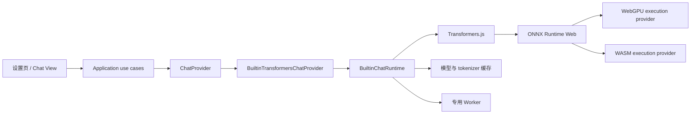

# 以 Vault Coach 内置 LLM 为例：WebGPU、WASM、量化与模型缓存教程

## 1. 这套教程解决什么问题

里程碑 2 已确认 Transformers.js 能运行文本生成模型，但“浏览器示例能生成一句话”和“Obsidian 社区插件可以稳定提供内置聊天模型”之间还有一整套工程问题：

- 模型为什么要先转换为 ONNX？
- WebGPU 和 WASM 分别执行什么，为什么需要回退？
- q4、q8、fp16 到底压缩了什么，会牺牲哪些能力？
- `localModelPath` 是操作系统目录，还是浏览器可以访问的 URL？
- 模型下载后放在哪里，断网后为什么有时仍然不能启动？
- 为什么模型文件缓存、内存中的 pipeline、KV cache 和知识库索引不能混为一谈？
- 如何把第三方 runtime 接到 Vault Coach 的 `ChatProvider`，而不让 UI、RAG 或考试模块依赖 Transformers.js 类型？
- 如何验证取消、卸载、Worker、缓存损坏和 WebGPU 回退？

本教程以一个**仅供技术验证的 Built-in Chat Spike** 为贯穿项目。学习完成后，你应能独立搭建、调试和评审这类浏览器端模型运行时，而不是只会复制一段 `pipeline()` 示例。

## 2. 当前项目事实

截至 2026-10-18，当前仓库的实际状态是：

| 项目事实 | 当前状态 | 教程中的含义 |
| --- | --- | --- |
| 插件版本 | `manifest.json` 为 1.5.1 | 教程属于后续研发材料，不代表 1.5.1 已提供 Built-in Chat |
| Obsidian 最低版本 | 1.11.4 | 不能只在最新 Electron/Chromium 上验证 |
| 移动端 | `isDesktopOnly: false` | 正式能力必须有移动端结论或清晰的能力限制 |
| 构建 | esbuild、CommonJS、`target: es2018`、单入口 `src/main.ts` | Worker、WASM 和动态资源必须验证最终 `main.js` 形态 |
| 聊天端口 | `src/domain/model/chat-provider.ts` | Built-in adapter 应实现这个端口或它后续的稳定版本 |
| 当前聊天实现 | `LocalModelClient` 调用 Ollama/OpenAI-compatible HTTP API | Built-in adapter 尚未实现 |
| Transformers.js 依赖 | 尚未安装 | 安装、版本固定和包体积变化必须在 spike 分支记录 |
| 发布资产 | `main.js`、`manifest.json`、可选 `styles.css` | 不能假设额外 Worker/WASM 文件会自动随社区安装出现 |

### 2.1 教程与正式产品的边界

教程中的模型 ID、dtype 和参数用于学习与技术验证，不构成产品默认值。正式启用 Built-in Chat 前仍需单独通过：

- 中文、英文、德文引用问答质量；
- 结构化 JSON 输出；
- 长上下文和引用忠实度；
- 冷启动、首 token、tokens/s、峰值内存和发热；
- Desktop WebGPU、Desktop WASM、实际移动设备；
- 模型许可证、不可变 revision 和供应链检查；
- 断网暖启动、缓存损坏和清除；
- Worker、取消、卸载与发布资产验证。

只有这些证据通过项目预先登记的 Gate，设置页才能出现 Built-in Chat 选项。

## 3. 贯穿项目

### 3.1 项目目标

创建一个隔离的技术原型，使 Vault Coach 能：

1. 由用户主动执行“准备内置聊天模型”；
2. 下载并缓存固定 revision 的教学模型；
3. 优先尝试 WebGPU；
4. WebGPU 初始化或 warm-up 失败时回退一次 WASM；
5. 通过 `ChatProvider` 流式返回文本；
6. 支持取消、释放、断网暖启动和清理目标缓存；
7. 记录设备、dtype、缓存状态和性能指标；
8. 不在普通 PR CI 下载真实模型。

### 3.2 教学模型

示例使用 Hugging Face 官方 Transformers.js 文档演示过的模型系列：

```ts
const TEACHING_POLICY = {
  modelId: "onnx-community/Qwen2.5-0.5B-Instruct",
  revision: "<在实验 ADR 中填写不可变 Hub commit>",
  dtype: "q4",
  task: "text-generation",
} as const;
```

选择它只是因为官方文档提供了 `text-generation + q4 + WebGPU` 示例，能减少 API 学习的不确定性。正式候选必须重新评估模型质量、许可证、语言覆盖、上下文、包体和内存。

不要在实现中保留 `<...>` 占位符。开始真实下载前先把 revision 固定为模型仓库的 commit hash，并把许可证与模型卡快照写入 ADR。

## 4. 端到端技术地图



每层只承担一种职责：

| 层 | 职责 | 不应知道 |
| --- | --- | --- |
| UI | 显示状态、进度和用户动作 | Transformers pipeline、Cache API 细节 |
| Application | prepare/generate/cancel/clear 的用例和状态机 | ONNX tensor、DOM |
| `ChatProvider` | Vault Coach 所需聊天语义 | WebGPU/WASM、模型下载路径 |
| Built-in adapter | 把项目请求映射成 runtime 调用 | 设置页元素、Notice |
| Runtime/loader | pipeline 生命周期、设备选择、streaming、dispose | RAG 业务决策 |
| Cache adapter | 文件命中、完整性、清除范围 | 聊天 prompt |
| Worker client | 版本化消息、请求关联、取消和崩溃 | 用户界面文案 |

## 5. 学习顺序

| 顺序 | 文档 | 你要回答的问题 | 主要产出 |
| ---: | --- | --- | --- |
| 1 | [[01-推理栈-WebGPU-WASM与ONNX]] | 一次生成请求如何落到 GPU 或 CPU？ | runtime 架构图、能力探测实验 |
| 2 | [[02-模型量化-内存与质量取舍]] | q4 为什么更小，为什么不一定更快或更好？ | dtype 对照实验、内存预算 |
| 3 | [[03-模型路径-下载与缓存设计]] | 远程模型、本地模型和缓存路径有什么区别？ | cache manifest、离线测试 |
| 4 | [[04-VaultCoach内置LLM最小原型]] | 如何接入当前 `ChatProvider`？ | spike 模块、状态机和流式输出 |
| 5 | [[05-Worker调试测试与CICD门禁]] | 如何证明它不会卡 UI、泄漏或在发布后失效？ | fake tests、trace、GO/NO-GO 报告 |

建议按顺序完成。量化、缓存和 Worker 的设计都依赖你先理解推理栈。

## 6. 推荐分支与实验目录

不要直接在功能分支中把真实模型 runtime 接进设置页。先创建 spike：

```bash
git status --short
git switch -c spike/v1.5-builtin-chat-runtime
npm ci
npm test -- --run
npm run build
```

建议的实验结构：

```text
scripts/spikes/builtin-chat/
  README.md
  policy.ts
  smoke.ts
  benchmark.ts
  fixtures/
    prompts.zh.jsonl
    prompts.en.jsonl
    prompts.de.jsonl
src/infrastructure/chat/spikes/
  transformers-chat-loader.ts
  builtin-chat-smoke-service.ts
benchmark-results/builtin-chat/
  .gitkeep
kb/.../
  ADR-内置Chat模型与运行时.md
```

`benchmark-results` 中只提交脱敏汇总和小型可审计结果。大模型文件、Cache Storage、用户 Vault 内容、完整私人 prompt 和设备上的绝对路径不进入 Git。

## 7. 学习过程中的证据等级

| 等级 | 例子 | 可以得出的结论 |
| --- | --- | --- |
| 文档事实 | 官方 API 支持 `device`、`dtype`、cache 配置 | API 存在 |
| 静态构建 | TypeScript、esbuild 成功 | 代码可编译和打包 |
| Node/浏览器 smoke | 示例 prompt 得到输出 | 特定环境可以运行一次 |
| Obsidian 桌面实测 | 插件中下载、暖启动和生成成功 | 该桌面组合可运行 |
| 移动端实测 | 真机在预算内成功 | 该移动设备组合可运行 |
| 质量与故障矩阵 | 多语言、引用、JSON、损坏恢复通过 | 才能进入产品 Gate |

不要把较低等级证据提升为较高等级结论。例如，`npm run build` 通过不能证明 WASM 文件在社区安装后存在；`navigator.gpu` 存在不能证明目标模型能在 WebGPU 完整运行。

## 8. 统一术语

| 术语 | 本教程中的含义 |
| --- | --- |
| ONNX | 可由 ONNX Runtime 执行的模型图和权重格式 |
| execution provider | ONNX Runtime 把算子交给某种后端执行的适配层 |
| WebGPU | 浏览器/Electron 中面向现代 GPU 的计算与图形 API |
| WASM | 浏览器中执行编译后代码的可移植二进制格式；本项目主要用作 CPU 推理后端 |
| dtype | 模型文件或模块使用的数据类型/量化形式，如 fp32、fp16、q8、q4 |
| artifact cache | 持久化的模型、tokenizer、配置和 WASM 文件缓存 |
| pipeline | 已加载 tokenizer、模型和前后处理的运行对象 |
| KV cache | 自回归生成过程中保存注意力 Key/Value 的会话内内存 |
| knowledge index | Vault Coach 从笔记构建的文字、向量或图谱索引 |
| cold start | 本机没有完整缓存时的下载与首次初始化 |
| warm start | 模型文件已缓存后的再次初始化 |
| fingerprint | model、revision、dtype、runtime 和实现策略的稳定身份 |

## 9. 官方依据

- [Transformers.js 总览](https://huggingface.co/docs/transformers.js/index)：pipeline、浏览器 CPU/WASM、WebGPU 与量化入口。
- [Transformers.js pipeline](https://huggingface.co/docs/transformers.js/en/pipelines)：首次下载、浏览器缓存、文本生成和 `TextStreamer`。
- [WebGPU 指南](https://huggingface.co/docs/transformers.js/guides/webgpu)：使用 `device: "webgpu"`。
- [量化 dtype 指南](https://huggingface.co/docs/transformers.js/en/guides/dtypes)：fp32、fp16、q8、q4 和模型可用 dtype。
- [Transformers.js env](https://huggingface.co/docs/transformers.js/api/env)：远程/本地模型、文件系统缓存、浏览器缓存、自定义缓存和 WASM 缓存。
- [ONNX Runtime Web 部署](https://onnxruntime.ai/docs/tutorials/web/deploy.html)：WASM、Worker、模型资产、路径和部署约束。
- [ONNX Runtime WebGPU](https://onnxruntime.ai/docs/tutorials/web/ep-webgpu.html)：WebGPU execution provider 的工作方式。
- [Transformers.js Electron 教程](https://huggingface.co/docs/transformers.js/tutorials/electron)：官方当前仍主要指向示例工程，因此 Obsidian 必须单独验证。

外部文档会变化。正式实现时记录实际安装版本，并使用对应版本文档，不直接把本文的 API 片段当作未来版本契约。

## 10. 教程完成标准

- [ ] 能画出 Vault Coach → Transformers.js → ONNX Runtime → WebGPU/WASM 的调用链；
- [ ] 能解释 WebGPU 能力探测与真实模型 warm-up 的区别；
- [ ] 能计算权重下限和 KV cache 近似预算；
- [ ] 能说明 q4 不保证质量、速度和兼容性同时更好；
- [ ] 能区分远程模型源、本地模型源、artifact cache、pipeline 和 KV cache；
- [ ] 能实现一个不泄漏第三方类型的 loader facade；
- [ ] 能通过同一 `ChatProvider` 切换 HTTP adapter 与 Built-in adapter；
- [ ] 能用 fake loader/cache/worker 做确定性单测；
- [ ] 能在真实 Obsidian 中验证冷启动、暖启动、断网、清缓存、回退、取消和卸载；
- [ ] 能根据预登记 Gate 写 GO/NO-GO，而不是根据一次 demo 成功直接发布。

