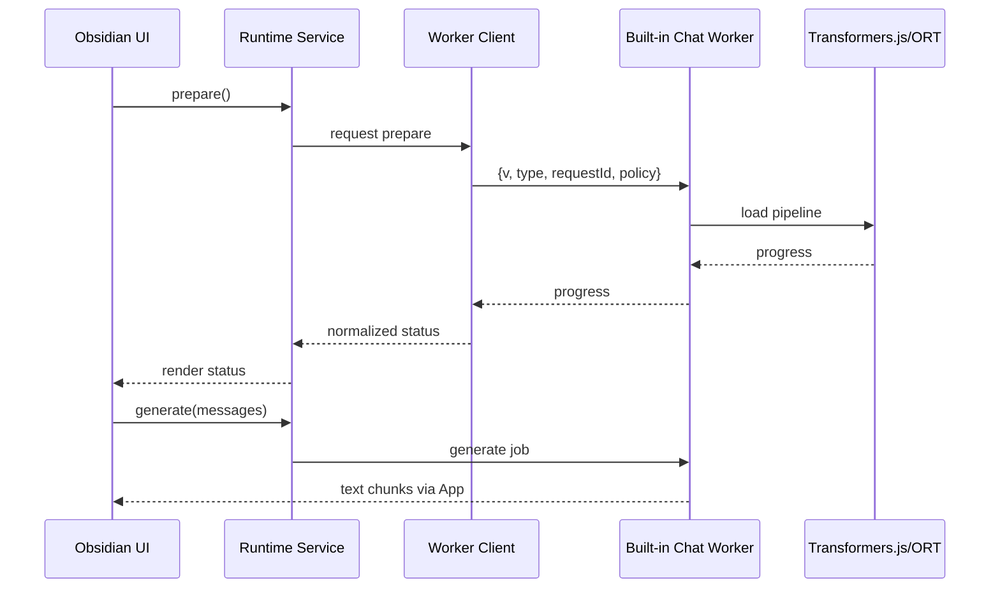

# 05：Worker、调试、测试与 CI/CD 门禁

## 1. 学习目标

完成本章后，你应能：

1. 把模型 runtime 从 UI 主线程迁入 Worker；
2. 设计有版本、可取消、可恢复的消息协议；
3. 用 fake loader/cache/worker 完成稳定的 PR 自动测试；
4. 用真实 Obsidian 做性能、内存、缓存和发布验证；
5. 写出有证据的 Built-in Chat GO/NO-GO 决策。

## 2. 为什么要用 Worker

即使推理使用 WebGPU，以下工作仍可能占用主线程：

- 动态 import 和 runtime 初始化；
- tokenizer 读取与解析；
- prompt tokenization；
- 输出 token 解码；
- WASM CPU 推理；
- 大对象构造与垃圾回收；
- Cache response 处理；
- 进度事件和流式文本更新。

Obsidian UI 与插件共享 renderer。持续 long task 会影响编辑、滚动和命令操作。因此正式实现应让专用 Worker 持有 pipeline，主线程只发送命令和接收状态/文本。

Worker 不是自动性能优化。消息复制、过多 token 事件、Blob Worker、CSP、WASM 资产路径和 WebGPU Worker 支持都要实测。

## 3. Worker 边界



Worker 内可以知道 Transformers.js 类型；主线程协议不能传 pipeline、tensor、Response、Error 或函数。

## 4. 协议设计

### 4.1 请求

```ts
type ChatWorkerRequest =
  | {
      v: 1;
      type: "prepare";
      requestId: string;
      policy: SerializedBuiltinChatPolicy;
      preferredDevice: "auto" | "webgpu" | "wasm";
    }
  | {
      v: 1;
      type: "generate";
      requestId: string;
      jobId: string;
      messages: SerializedChatMessage[];
      generation: SerializedGenerationOptions;
    }
  | {
      v: 1;
      type: "cancel";
      requestId: string;
      jobId: string;
    }
  | {
      v: 1;
      type: "dispose";
      requestId: string;
    };
```

### 4.2 响应

```ts
type ChatWorkerResponse =
  | { v: 1; type: "progress"; requestId: string; progress: ModelLoadProgress }
  | { v: 1; type: "ready"; requestId: string; status: SerializedReadyStatus }
  | { v: 1; type: "text"; requestId: string; jobId: string; text: string }
  | { v: 1; type: "complete"; requestId: string; jobId: string; text: string }
  | { v: 1; type: "cancelled"; requestId: string; jobId: string }
  | { v: 1; type: "disposed"; requestId: string }
  | { v: 1; type: "error"; requestId: string; jobId?: string; error: SerializedRuntimeError };
```

### 4.3 校验

两端都必须从 `unknown` 校验：

- `v` 是否支持；
- `type` 是否已知；
- request/job ID 是否为非空字符串；
- messages 数量、角色和字符数是否在界限内；
- generation 参数是否在 policy 上限内；
- error 是否只含允许字段；
- 迟到响应是否仍属于当前 job。

不要把整个 `VaultCoachSettings` 发送进 Worker。只传模型 policy 和本次生成所需参数。

## 5. 取消语义

### 5.1 软取消

主线程发送 `cancel(jobId)`，Worker 调用 `InterruptableStoppingCriteria.interrupt()`。生成循环在下一检查点停止，保留已加载 pipeline。

优点：下次生成无需重新加载。限制：当前 GPU/WASM 调用可能不会立即停止。

### 5.2 硬取消

当软取消超时或 Worker 无响应：

```text
terminate Worker
  → 拒绝全部 pending promise
  → runtime 状态 crashed/cancelled
  → 清理 listener 与 Blob URL
  → 下次显式 prepare 创建新 Worker
```

硬取消会丢失 pipeline 内存状态，但不应自动删除 artifact cache。

### 5.3 视图关闭与插件卸载

- Chat View 关闭：应用拥有的生成可按产品规则继续或取消，不能因为 DOM 消失导致 promise 悬空；
- Plugin unload：必须取消、terminate、释放 URL 和 listener；
- Obsidian 退出：无法保证所有异步 cleanup 完成，下一次启动靠 cache inspect 恢复。

## 6. Worker 打包

当前 `esbuild.config.mjs` 只有 `src/main.ts` 一个入口，输出一个 CommonJS `main.js`。常见选择：

| 方案 | 优点 | 风险 |
| --- | --- | --- |
| 单独 worker asset | 实现直接、调试容易 | 社区安装是否携带额外文件需要改变发布契约 |
| 构建时内联 worker source + Blob URL | 保持单 `main.js` | bundle 大、CSP/Blob/WebGPU/WASM 路径需验证 |
| data URL worker | 单文件 | 大体积、URL/CSP/调试和浏览器限制 |
| 主线程运行 | 最简单 | UI long task，不能作为正式方案 |

M4/M6 已要求验证 inline Worker/Blob。不要手写复制 Worker 源码字符串；应让 esbuild 对 Worker entry 单独构建，再把产物以受控方式注入主 bundle。

构建后检查：

```bash
npm run build
rg -n "file://|/Users/|node_modules/.+wasm|https://.+\.wasm|worker\.js" main.js
```

搜索结果需要人工解释。存在 URL 字符串不必然代表运行时请求，但任何开发绝对路径或未发布 worker asset 都是阻断项。

ONNX Runtime 官方文档说明 proxy worker 与 WebGPU 有限制，自定义 Worker 中使用 WebGPU 需要单独加载 runtime；不能简单打开一个 flag 就假设两种后端都可用。[ORT env flags](https://onnxruntime.ai/docs/tutorials/web/env-flags-and-session-options.html)

## 7. 流式消息的背压

TextStreamer 可能产生很多小文本片段。如果每个片段都立即：

```text
Worker postMessage
  → Application state update
  → Markdown render
  → DOM layout
```

UI 仍可能卡顿。可以在 Worker client 或 presentation 层按时间片合并文本：

```ts
class TextChunkBuffer {
  private pending = "";
  private scheduled = false;

  push(text: string): void {
    this.pending += text;
    if (this.scheduled) return;
    this.scheduled = true;
    requestAnimationFrame(() => this.flush());
  }
}
```

完整结果仍以 `complete.text` 为准。批量显示不能丢字符、乱序或在 cancel 后继续刷新。

## 8. 自动测试金字塔

### 8.1 纯函数测试

- policy/fingerprint；
- progress event 映射；
- protocol validator；
- error classification；
- capability resolution；
- cache manifest validation；
- context/token budget 裁剪。

### 8.2 fake adapter 测试

- WebGPU load 失败 → WASM ready；
- WebGPU warm-up 失败 → dispose → WASM；
- WASM 也失败 → error；
- 两个 prepare 去重；
- stale progress 被忽略；
- cancel 后迟到 text 被忽略；
- dispose 幂等；
- clear 顺序正确；
- cache partial/corrupt/missing；
- unsupported capability 不调用模型。

### 8.3 fake Worker 测试

- request/response correlation；
- 两个请求乱序；
- unknown version/type；
- `onerror` / `onmessageerror`；
- terminate 拒绝全部 pending；
- timeout 清理 listener；
- dispose 后拒绝新请求；
- 旧 job complete 不覆盖新 job。

### 8.4 构建测试

- `main.js` 可构建；
- 不引用缺失 Worker/WASM 文件；
- bundle size 增量记录；
- release 目录只保留允许资产时 smoke 可运行；
- 插件卸载后无 Worker/interval/listener 泄漏。

普通 PR CI 不下载真实模型，因为网络、Hub、GPU 和大缓存会让测试缓慢且不稳定。

## 9. 真实模型测试

用手动脚本或 `workflow_dispatch`：

```text
固定 runner / 实机
固定 model revision 和 dtype
固定 prompt fixture
保存原始 JSON
保存 package lock hash 和 commit
保存环境信息
```

真实 GPU benchmark 不能代替单元测试；单元测试也不能证明真实模型能运行。

## 10. 调试方法

### 10.1 日志字段

```ts
interface BuiltinChatDiagnosticEvent {
  requestId: string;
  jobId?: string;
  phase: string;
  policyId: string;
  requestedDevice: string;
  actualDevice?: string;
  cacheState?: string;
  elapsedMs?: number;
  errorCode?: string;
}
```

不得记录：

- 用户 prompt；
- 检索到的笔记正文；
- 完整生成结果；
- API key/Secret；
- 绝对路径；
- Vault 名称。

### 10.2 DevTools

| 工具 | 看什么 |
| --- | --- |
| Network | 模型/WASM 是否意外请求网络、是否命中 cache |
| Application/Storage | Cache namespace 与清除结果 |
| Performance | 主线程 long task、GC、渲染频率 |
| Memory | prepare/generate/dispose 前后对象和 Worker |
| Worker debugger | 协议、loader、streamer、stopping criteria |
| Console | 结构化错误和 uncaught rejection |

### 10.3 二分定位

```text
模型无法加载
  → URL/revision/dtype 文件存在？
  → Cache adapter 返回有效 Response？
  → WASM 资产路径正确？
  → WebGPU session 创建失败还是 warm-up 失败？
  → Worker 与主线程是否使用同一 origin/cache？
  → 构建后 URL 是否被改写？
```

不要一遇到错误就同时修改模型、dtype、device、cache 和 bundler。每次只改变一个变量。

## 11. 性能实验

### 11.1 计时点

```text
prepare-click
download-start / download-complete
pipeline-load-start / pipeline-load-complete
warmup-start / warmup-complete
generation-start
first-text
generation-complete
dispose-start / dispose-complete
```

推导：

```text
cold prepare = warmup-complete - prepare-click
warm init = warmup-complete - pipeline-load-start（cache 已存在）
first token = first-text - generation-start
generation rate = generated tokens / active generation seconds
cancel latency = cancelled - cancel-click
```

### 11.2 场景

| 场景 | 变量 |
| --- | --- |
| 冷启动 | 清目标 cache、联网 |
| 暖启动 | cache 完整、联网 |
| 离线暖启动 | cache 完整、断网 |
| WebGPU | 同模型、dtype、prompt |
| WASM | 同模型、dtype、prompt |
| 短上下文 | 固定少量 evidence |
| 长上下文 | 接近 policy token 上限 |
| cancel | 首 token 前、生成中 |
| unload | prepare 中、generation 中 |

报告 p50/p95 或至少多次原始结果，不只挑最快一次。

## 12. 手工验证矩阵

| 平台 | WebGPU | WASM | 冷/暖 | 断网 | 清除 | cancel | unload |
| --- | --- | --- | --- | --- | --- | --- | --- |
| Windows Desktop |  |  |  |  |  |  |  |
| macOS Desktop |  |  |  |  |  |  |  |
| Linux Desktop |  |  |  |  |  |  |  |
| Android Obsidian |  |  |  |  |  |  |  |
| iOS Obsidian |  |  |  |  |  |  |  |

项目不一定要求所有平台都支持 Built-in Chat，但每个目标平台必须有“通过”“明确不支持”或“未验证”的诚实结论。

## 13. CI 流程

### 13.1 PR CI

使用现有命令：

```bash
npm ci
npm run lint
npm test -- --run
npm run build
git diff --check
```

新增门禁：

- policy 中 revision 不是 `main/latest`；
- 不存在真实模型文件提交；
- 测试不访问网络；
- build artifact 不含绝对开发路径；
- Worker protocol validator 有未知版本测试；
- bundle size 与基线比较并记录阈值。

### 13.2 手动 benchmark workflow

```text
workflow_dispatch inputs:
  model_policy_id
  device
  dtype
  benchmark_suite_version
```

输出：

- 原始 JSON；
- 汇总 Markdown；
- commit/lockfile hash；
- runner 规格；
- cache cold/warm 标记；
- 失败日志的脱敏版本。

共享 CI GPU 结果不能代替用户目标设备，但可用于回归趋势。

### 13.3 Release Gate

从 release asset 新建干净 Vault：

1. 安装 `main.js`、`manifest.json`、`styles.css`；
2. 不保留源码、node_modules 或开发缓存；
3. 启用插件；
4. 用户显式 prepare；
5. 验证 runtime/WASM/Worker 资产；
6. 重启并断网暖启动；
7. Ask 流式回答；
8. 取消、清除、重载；
9. 检查 Console 和存储残留。

开发 checkout 可运行而 release 安装失败时，Gate 必须失败。

## 14. GO/NO-GO 模板

```md
# ADR：Vault Coach Built-in Chat runtime

## 决策
GO / CONDITIONAL GO / NO-GO

## 固定输入
- commit：
- Transformers.js：
- model/revision/license：
- dtype/device：
- benchmark suite：

## 质量
- 中文：
- 英文：
- 德文：
- 引用忠实度：
- JSON schema：
- 未通过 capability：

## 性能与资源
- 下载/cache：
- cold/warm：
- first token / tokens/s：
- peak memory：
- cancel：

## 平台
- Desktop WebGPU：
- Desktop WASM：
- Android：
- iOS：

## 工程
- Worker/release asset：
- offline：
- cache clear/corruption：
- unload：

## 风险与回滚
- ...
```

`CONDITIONAL GO` 必须写清可见范围，例如只对已验证 desktop 提供实验开关。缺少移动端证据不能写“全平台支持”。

## 15. NO-GO 后仍有价值的结果

如果小型内置聊天模型未通过质量或性能门：

- 保留 `ChatProvider` 解耦；
- 保留 benchmark fixture 与报告工具；
- 保留 loader/cache/Worker 的通用知识供 embedding 使用；
- 设置页继续提供 Ollama 和云端 LLM；
- README 不宣称 Built-in Chat；
- ADR 记录阻断证据和未来重试条件。

技术验证的目标是降低决策风险，不是强迫功能上线。

## 16. 本章练习

1. 实现 protocol validator 并故意发送未知 `v: 99`；
2. fake Worker 将两个 generate 结果乱序返回，确认旧结果不覆盖新会话；
3. 生成中发送 cancel，确认迟到 text 不渲染；
4. 终止 Worker，确认全部 pending promise 得到结构化错误；
5. 采集一次主线程 Performance trace，标记 long task；
6. 从生产构建创建干净 Vault，验证没有 node_modules 也能加载 runtime；
7. 先写 Gate 门槛，再运行 q4/WebGPU 和 q4/WASM 实验；
8. 写一份 NO-GO 示例，说明失败证据和可复用产出。

## 17. 教程项目最终完成标准

- [ ] pipeline 位于 Worker 或有明确、带证据的替代决定；
- [ ] 协议有版本、runtime validator、request/job ID；
- [ ] 软取消、硬取消、crash 和 unload 语义明确；
- [ ] PR 测试使用 fake，不下载真实模型；
- [ ] 真实模型测试保存环境、revision、dtype 和原始结果；
- [ ] Desktop WebGPU 与 WASM 均有结论；
- [ ] Mobile 有真机结论或明确 unsupported/unverified；
- [ ] 冷、暖、离线、partial、corrupt、clear 均验证；
- [ ] release asset 干净安装通过；
- [ ] 日志不含 prompt、笔记、Secret、输出正文和绝对路径；
- [ ] ADR 按预登记门槛给出 GO/NO-GO；
- [ ] 未通过 Gate 时不在用户设置页展示 Built-in Chat。

## 18. 官方参考

- [Transformers.js pipeline 与 streaming](https://huggingface.co/docs/transformers.js/en/pipelines)
- [Transformers.js stopping criteria](https://huggingface.co/docs/transformers.js/api/generation/stopping_criteria)
- [Transformers.js env 与缓存](https://huggingface.co/docs/transformers.js/api/env)
- [ONNX Runtime WebGPU](https://onnxruntime.ai/docs/tutorials/web/ep-webgpu.html)
- [ONNX Runtime Web env 与 session options](https://onnxruntime.ai/docs/tutorials/web/env-flags-and-session-options.html)
- [ONNX Runtime Web 部署、Worker 与 WASM 资产](https://onnxruntime.ai/docs/tutorials/web/deploy.html)
