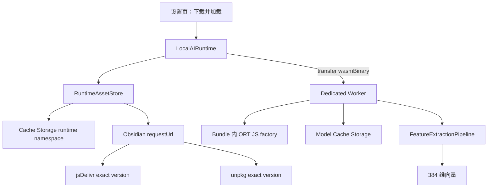
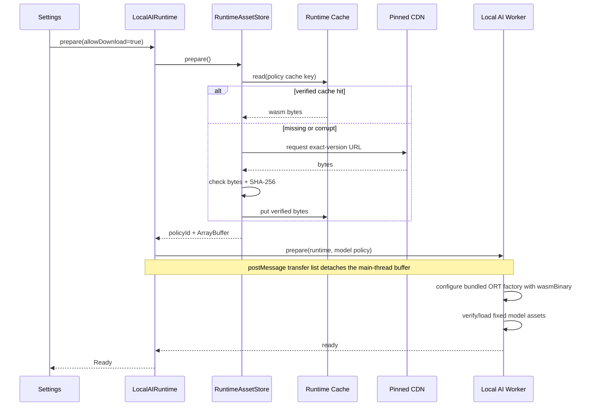

# 07：1.5.4 实现解剖——Embedding 运行时按需交付

## 1. 本章的证据边界

本章记录 Vault Coach 1.5.4 当前工作树的真实实现，不是候选方案。已实现：

- Built-in Embedding provider；
- Transformers.js + ONNX Runtime Web/WASM；
- Dedicated Worker；
- runtime/model 分离缓存；
- exact-version runtime policy；
- 字节数与 SHA-256 校验；
- 主/备两个固定 CDN 来源；
- 断网暖缓存路径；
- bundle size Gate 和真实 Chrome Worker smoke。

未由本实现证明：

- Built-in Chat/Utility SLM/Reranker；
- WebGPU 生产后端；
- 所有 Windows、Android 和 iOS 设备组合；
- Community Directory 对当前候选 commit 的最终审核结果。

## 2. 从 1.5.3 故障推导出的产品契约

1.5.3 将 `ort-wasm-simd-threaded.wasm` 转换为 Base64，再把整个 Worker 字符串注入 `main.js`。结果：

```text
ORT WASM                         14,264,838 bytes
1.5.3 main.js                   21,886,715 bytes
Community Directory             > 5 MB warning
```

用户所需的“内置 Embedding”契约实际是：

1. 不需安装 Ollama Embedding；
2. 不需填 endpoint、model name 或 API key；
3. 插件管理模型和 runtime 版本；
4. 首次准备后可离线运行；
5. 失败时可回退关键词检索；
6. 可显式清理缓存。

这个契约不要求 WASM 位于 Release。

## 3. 目标架构



资产边界：

| 资产 | 交付方式 | 原因 |
| --- | --- | --- |
| Vault Coach 业务代码 | `main.js` | 社区插件标准资产 |
| Worker RPC 与模型 orchestration | Worker bundle 后注入 `main.js` | 受版本控制，不需额外 Worker 文件 |
| ONNX Runtime JavaScript factory | Worker bundle | 不执行远程 JavaScript，编译时审查 |
| ONNX Runtime WASM | 首次显式准备时下载 | 移除 14 MB 二进制和 Base64 膨胀 |
| 模型 config/tokenizer/ONNX | 固定 Hugging Face revision | 模型数据大，需本地缓存 |

## 4. runtime policy 如何生成

生成脚本：

```text
scripts/generate-local-ai-runtime-policy.mjs
```

它不手写 ORT 版本。步骤是：

1. 从实际安装的 `@huggingface/transformers` 解析它使用的 `onnxruntime-web/wasm`；
2. 定位该 npm package 的 `dist/ort-wasm-simd-threaded.wasm`；
3. 读取 package exact version；
4. 计算文件字节数和 SHA-256；
5. 生成 jsDelivr/unpkg exact-version URL；
6. 写入 `src/app/local-ai/runtime-registry.ts`。

当前 policy：

```text
id: onnxruntime-web-1.31.0-dev.20260914-8d85527a0-wasm-v1
file: ort-wasm-simd-threaded.wasm
bytes: 14,264,838
sha256: 06ba057753da3847e4c24f02d91ab133455b0817c69a44993a9a53a2146df9e3
cache: vault-coach-local-ai-runtime-v1
```

`predev`、`prebuild`、`pretest` 和 `prelint` 都会重新生成 policy。如果 lockfile 改变 ORT，diff 会把 runtime identity 变化显示给评审者。

## 5. 核心端口

### 5.1 Domain 端口

`src/domain/local-ai/local-ai-runtime-assets.ts`：

```ts
export interface RuntimeAssetStore {
  prepare(options: {
    allowDownload: boolean;
    signal?: AbortSignal;
    onProgress?: (progress: RuntimeAssetProgress) => void;
  }): Promise<PreparedRuntimeAssets>;
  clear(): Promise<void>;
}

export interface PreparedRuntimeAssets {
  policyId: string;
  wasmBinary: ArrayBuffer;
  source: "cache" | "download";
}
```

该端口不导入 Obsidian、CDN 或 Cache Storage，因此 LocalAIRuntime 可在单元测试中使用 fake store。

### 5.2 Infrastructure adapter

| 类 | 职责 |
| --- | --- |
| `CacheStorageRuntimeBinaryCache` | 只读写 `vault-coach-local-ai-runtime-v1` |
| `ObsidianRuntimeAssetDownloader` | 通过 `requestUrl` 下载 policy URL，处理 HTTP status |
| `VerifiedRuntimeAssetStore` | 缓存检查、完整性校验、主/备源、写缓存和清理 |

## 6. 准备时序



### 6.1 暖缓存断网路径

`prepare(false)` 禁止下载。runtime cache 和模型 cache 都完整时，Worker 可重新建立 pipeline。runtime 缓存每次命中仍会重算 SHA-256，“存在 Cache entry”不等于可执行。

### 6.2 损坏恢复

- 字节数错误或 SHA-256 错误：删除 runtime cache entry；
- 允许下载：从固定源重新获取；
- 禁止下载/断网：返回稳定 not-cached 错误；
- 不存在“hash 失败但继续执行”的降级。

## 7. Worker 初始化

Worker 不接收 URL，只接收主线程已校验的字节：

```ts
const wasmBackend = env.backends.onnx.wasm;
wasmBackend.numThreads = 1;
wasmBackend.proxy = false;
wasmBackend.wasmPaths = undefined;
wasmBackend.wasmBinary = runtime.wasmBinary;
```

关键点：

- `numThreads = 1`：不假设 Obsidian 有 cross-origin isolation；
- `proxy = false`：项目已有自己的 Dedicated Worker；
- `wasmPaths = undefined`：禁止 ORT 再根据路径请求 runtime；
- `wasmBinary`：复用 bundle 内 JavaScript factory，二进制来自受控 transfer；
- esbuild 定义 `process: undefined`：避免 Electron Worker 误选 Node/`worker_threads` 分支。

Worker 还会比对 `policyId` 和 WASM byte length，防止主线程与 Worker bundle 版本错配。SHA-256 信任检查在进入 Worker 前完成。

## 8. 为什么只下载 WASM，不下载 `.mjs`

Smart Related Notes 的实现证明了“小插件 + 首次下载 runtime + 本地缓存”可行。Vault Coach 在此基础上收窄了边界：

- `.mjs` factory 在构建时编译进 Worker；
- CDN 只提供 WASM 二进制；
- 不需创建远程 JavaScript Blob；
- 不需在运行时 patch 下载的 glue；
- 审核者可从 lockfile 和 Worker bundle 检查全部 JavaScript 代码。

这个设计的代价是 JavaScript factory 仍会占用一部分 `main.js`，但实际生产 bundle 只有 2.87 MB，低于 4.5 MB 项目预算。

## 9. 缓存和升级兼容

| 数据 | namespace/位置 | 1.5.4 的处理 |
| --- | --- | --- |
| ORT WASM | `vault-coach-local-ai-runtime-v1` | 新增；第一次需联网准备 |
| Embedding 模型 | `vault-coach-local-ai-v1` | 保留 1.5.3 缓存 |
| 用户设置 | Obsidian `loadData/saveData` | 不改变 provider 偏好 |
| Embedding fingerprint | 向量索引 metadata | 模型/revision/dtype 未变，旧向量可继续使用 |
| 知识索引 | Vault Coach 派生数据 | 清 runtime/model cache 不删除索引 |

旧用户更新后，如果模型已缓存但 runtime 尚未缓存，只需额外准备 ORT WASM，不应重下模型或重建向量。

## 10. 发布门禁

`scripts/verify-release-assets.mjs` 检查：

```text
main.js <= 4,500,000 bytes
main.js 不含 __VAULT_COACH_ORT_WASM_BASE64__
main.js 含 runtime policy marker
main.js / manifest.json / styles.css 存在
package.json version == manifest.json version
versions.json[version] == manifest.minAppVersion
```

Release workflow 在 tag 触发后还会：

1. `npm ci`；
2. lint；
3. 276 个单元/集成测试；
4. 生产构建与体积 Gate；
5. 生成 GitHub artifact attestations；
6. 使用 `--generate-notes` 创建非空 Release notes；
7. 上传三个标准资产。

## 11. 测试证据

### 11.1 自动测试

`runtime-asset-store.test.ts` 覆盖：

- 暖缓存不访问网络；
- 冷缓存下载并写入；
- 损坏缓存在断网时被拒绝；
- 损坏缓存在联网时恢复；
- 主 CDN 失败后备用源成功；
- 相同字节数但 hash 错误；
- 清理 runtime namespace；
- 已取消任务不进入网络。

`local-ai-runtime.test.ts` 覆盖：

- runtime prepare 早于 Worker prepare；
- WASM 位于 transfer list；
- 两个并发 prepare 合并为一个任务；
- 取消后不发送 embedding 请求；
- 错误状态传播；
- clear 同时清理模型和 runtime。

### 11.2 真实 Worker smoke

```bash
npm run m4:smoke:browser-runtime
```

脚本使用与生产相同的 Worker entry、esbuild browser conditions 和 ORT alias，把已验证的模型 fixture 填入浏览器 Cache Storage，再将外置 WASM transfer 给 Worker。当前快照：

```text
PASS|dimension=384|finite=true|transferred=true
```

该证据能阻止以下回归：

- `worker_threads` 解析错误；
- `no available backend found`；
- ORT JavaScript/WASM ABI 不匹配；
- 传入 WASM 但 session 无法建立；
- 输出维度或数值异常。

## 12. 手工验证

### 12.1 候选版本必做

1. 复制生产 `main.js`、`manifest.json`、`styles.css` 到干净测试 Vault；
2. 确认启动插件不会自动下载 runtime/模型；
3. 选择 Built-in Embedding，点击 **下载并加载**；
4. 确认只请求 policy 中的 ORT URL 和固定 Hugging Face revision；
5. 建立向量索引并执行中英文检索；
6. 完全退出 Obsidian；
7. 断网重启，再次执行 query embedding 和 RAG；
8. 清理内置模型缓存，确认笔记和索引没有删除；
9. 断网准备应失败并回退 keyword；
10. 恢复网络后准备成功。

### 12.2 发布前证据

- macOS Desktop；
- Windows Desktop；
- Android/iOS 分别标记 PASS、FAIL 或 pending；
- 1.5.3 用户设置、模型 cache 和向量索引升级；
- Community Directory branch preview；
- 实际 GitHub Release 的字节数、notes 和 attestations。

## 13. 向后续模型扩展的规则

Reranker 或 Utility SLM 可复用：

- runtime policy 生成机制；
- Cache Storage adapter；
- 用户显式准备；
- Worker client 生命周期；
- bundle size Gate；
- 完整性、断网和损坏恢复测试。

不能无条件复用：

- Embedding 的 384 维输出协议；
- `FeatureExtractionPipeline`；
- uint8 和 mean pooling；
- 模型 fingerprint；
- WASM 单线程一定满足 Chat 性能的假设；
- 当前简化的 request/response 协议。

每种模型职责都需要独立的 policy ID、资产清单、输入输出验证、性能预算、质量 Gate 和回滚策略。

## 14. 快速命令

```bash
# 切换到项目要求的 Node LTS
nvm use 20

# 生成/检查 runtime policy
npm run local-ai:runtime-policy

# 常规门禁
npm run lint
npm test
npm run build
npm run release:verify

# 需要 Chrome 和已准备 M4 模型 fixture
npm run m4:smoke:browser-runtime
```

## 15. 当前快照

```text
Node / npm:                  20.20.2 / 10.8.2
Transformers.js:            4.3.1
ONNX Runtime Web:           1.31.0-dev.20260914-8d85527a0
runtime WASM:               14,264,838 bytes
1.5.3 main.js:              21,886,715 bytes
1.5.4 main.js:               2,872,234 bytes
bundle budget:               4,500,000 bytes
tests:                      66 files / 276 tests
browser Worker smoke:       PASS
Community branch preview:   pending
final release:              pending
```
