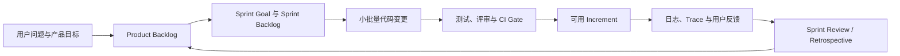

# Vault Coach 敏捷开发、日志与 Trace/Span 教程

## 1. 为什么把这三部分放在同一套教程中

现代软件工程不只要求“把功能写出来”，还要求团队持续回答三个问题：

1. **现在最值得交付什么？** Agile 和 Scrum 用短反馈周期、透明工件和固定检查点管理不确定性。
2. **这次交付是否真的可用？** 测试、CI、代码评审和 Definition of Done 提供可重复的质量证据。
3. **运行时究竟发生了什么？** 结构化日志与 trace/span 把一次用户动作的关键路径、耗时、降级和错误关联起来。

这三部分共同形成一个反馈闭环：



Agile 负责缩短**产品反馈周期**，trace/span 负责缩短**技术诊断周期**。两者都遵循同一个思路：建立可观察的边界，用事实检查结果，再调整下一步。

## 2. 适用读者

这套教程面向：

- 第一次参与现代 TypeScript 项目的新人；
- 熟悉写功能，但不熟悉 Backlog、Sprint、评审和复盘的开发者；
- 会用 `console.log`，但不知道怎样设计结构化日志和调用链追踪的开发者；
- 准备为 Vault Coach 增加功能、修复问题或维护发布流程的贡献者。

读完后，你应能把一个模糊需求转成可验收的 Sprint 工作，并能为一次 RAG、索引或考试流程设计安全、可测试的 trace。

## 3. 当前项目事实与教程边界

截至 2026-10-20，仓库当前事实如下：

| 项目事实 | 当前状态 | 对教程的影响 |
| --- | --- | --- |
| 插件版本 | `manifest.json` 为 1.5.2 | 本教程是后续工程指南，不表示 1.5.2 已内置统一 tracer |
| 分层 | `domain`、`app`、`infrastructure`、`presentation` | 观测能力必须遵守现有依赖方向 |
| 组合根 | `src/app/application-container.ts` | logger/tracer 应在组合根创建和注入 |
| 应用事件 | `src/app/application-events.ts` | 现有事件只通知读取模型失效，不承担日志职责 |
| 运行日志 | 23 个 TypeScript 文件中存在 73 次 `console.*` 调用 | 需要渐进迁移，不能一次机械替换 |
| 持久事实 | Assessment、考试历史、掌握度、`ReviewActionEvent` 等 | 不能因“统一日志”而降级为可清理的遥测数据 |
| 远程服务 | `KnowledgeEngineClient` 当前装配 Lite 实现 | 分布式 trace 只作为未来可信边界内的扩展 |
| 隐私基线 | 本地优先、远程能力显式选择 | 默认不得上传日志、Vault 内容、文件名或 prompt |

上表中的调用次数是仓库快照，后续会变化。它用于说明迁移规模，不是质量评分。

## 4. 学习顺序

| 顺序 | 文档 | 核心问题 | 练习产出 |
| ---: | --- | --- | --- |
| 1 | [[01-现代软件工程与Agile基础]] | Agile 解决什么，哪些做法是假敏捷？ | 将一个模糊需求改写成价值假设和反馈循环 |
| 2 | [[02-Scrum框架与小团队实践]] | Scrum 的角色、事件、工件和承诺如何协作？ | 一份可执行的 Sprint Goal、Backlog 和 DoD |
| 3 | [[03-VaultCoach敏捷转型方案]] | 当前项目如何逐步转为敏捷工作方式？ | 首个两周 Sprint 计划和团队工作约定 |
| 4 | [[04-日志系统原理与工程规范]] | 为什么需要日志，怎样记录才可搜索且安全？ | 日志事件目录和脱敏策略 |
| 5 | [[05-OpenTelemetry-Trace-Span与Context]] | 一次操作如何由 span 组成 trace？ | 为索引重建画 trace 树并定义 context |
| 6 | [[06-VaultCoach可观测性架构与接口]] | logger/tracer 应放在哪一层，接口长什么样？ | 端口、适配器、事件字段和数据生命周期设计 |
| 7 | [[07-分阶段实现-测试调试与CICD]] | 新人怎样按风险顺序实现并验收？ | 8 个实施步骤、测试矩阵和 CI Gate |
| 8 | [[08-团队协作模板与新人训练]] | Story、PR、Review、复盘怎样与 trace 证据结合？ | 可直接复制的协作模板和四周训练计划 |

请按顺序学习。直接从 OpenTelemetry SDK 开始，容易得到一套与产品目标、隐私边界和现有架构脱节的埋点。

## 5. 贯穿案例：索引重建

教程用“用户选择 **Rebuild index**”作为贯穿案例。一次成功执行可能包含：

```text
index.rebuild                         root span
├── documents.scan                   child span
├── documents.parse                  child span
├── retrieval.keyword_index.build    child span
├── embedding.batch                  child span
├── retrieval.vector_index.persist   child span
└── graph.rebuild                    child span
```

这个例子能同时训练：

- 如何把能力拆成一个有用户价值的纵向切片；
- 如何定义 Sprint 验收标准；
- 如何区分根 span、子 span、span event 和普通日志；
- 如何记录耗时、数量、结果与降级，而不记录笔记正文和绝对路径；
- 如何用 fake clock、内存 sink 和失败注入做确定性测试；
- 如何在 Sprint Review 中展示可运行增量与诊断证据。

## 6. 四种记录必须分开

| 类型 | 目的 | 生命周期 | 例子 |
| --- | --- | --- | --- |
| Scrum 工件 | 管理产品工作和团队承诺 | 随产品持续演进 | Product Backlog、Sprint Goal、DoD |
| 应用失效事件 | 通知界面重新读取状态 | 内存内、短生命周期 | `index-state-changed` |
| 日志与 trace | 调试、性能分析、故障关联 | 有界、可清理、默认本地 | `index.rebuild.failed`、`traceId` |
| 领域与审计事实 | 保存用户业务历史和可追溯事实 | 按数据契约长期保存 | Assessment Session、`ReviewActionEvent` |

将这些记录混在一起会产生严重后果。例如，若考试结果被当作日志环形缓冲区内容，它可能被自动覆盖；若 UI 失效事件承载完整状态，它会让展示层和领域层重新耦合。

## 7. 学习方式：每章都产生证据

每章完成后不要只勾选“已阅读”。应保留至少一种可审查产出：

- 架构图或时序图；
- Story 与验收标准；
- 接口草案；
- 自动化测试结果；
- Obsidian 中的手工验证记录；
- Sprint Review 或 Retrospective 记录。

证据等级也要明确：

| 证据 | 能证明 | 不能证明 |
| --- | --- | --- |
| 文档评审 | 设计边界可理解 | 实现能运行 |
| TypeScript 与构建通过 | 类型和打包链可用 | 真实 Obsidian 行为正确 |
| 单元测试通过 | 已覆盖的契约成立 | 未覆盖设备和数据规模正常 |
| Obsidian 桌面实测 | 指定环境的真实流程可用 | 移动端或所有 Vault 可用 |
| 脱敏导出检查 | 样本没有发现敏感字段 | 所有未来字段天然安全 |

## 8. 教程完成 Gate

- [ ] 能用自己的话解释 Agile 的价值取向，而不是把它等同于“赶进度”；
- [ ] 能正确说出 Scrum 的三类 accountabilities、五个 events、三个 artifacts 及对应 commitments；
- [ ] 能为 Vault Coach 写出有单一目标的 Sprint Goal；
- [ ] 能区分日志、trace、metric、应用事件和领域事实；
- [ ] 能画出一次 RAG 或索引操作的 parent/child span 树；
- [ ] 能说明为什么 span 名称必须稳定、低基数；
- [ ] 能设计默认本地、容量有界、可脱敏导出的日志方案；
- [ ] 能通过依赖注入让 Domain 不依赖日志实现；
- [ ] 能为 context 传播、异常、取消、降级和 sink 故障写测试；
- [ ] 能把测试、文档、隐私检查和手工验证纳入 Definition of Done。

## 9. 官方依据

- [Manifesto for Agile Software Development](https://agilemanifesto.org/)
- [Principles behind the Agile Manifesto](https://agilemanifesto.org/principles.html)
- [The Scrum Guide, November 2020](https://scrumguides.org/docs/scrumguide/v2020/2020-Scrum-Guide-US.pdf)
- [OpenTelemetry concepts](https://opentelemetry.io/docs/concepts/)
- [OpenTelemetry traces](https://opentelemetry.io/docs/concepts/signals/traces/)
- [OpenTelemetry logs](https://opentelemetry.io/docs/concepts/signals/logs/)
- [OpenTelemetry Context specification](https://opentelemetry.io/docs/specs/otel/context/)
- [W3C Trace Context](https://www.w3.org/TR/trace-context/)

官方资料会更新。实施时固定实际依赖版本，并重新核对对应版本的 API、兼容性和发布体积。
