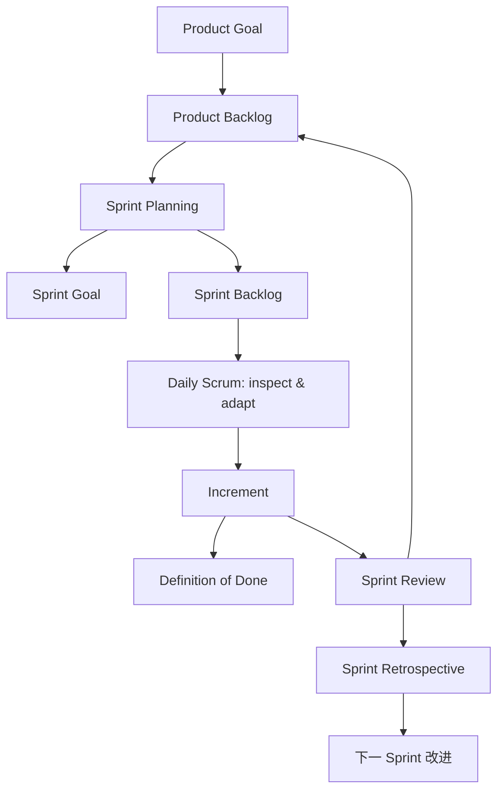

# Scrum 框架与小团队实践

## 1. Scrum 的位置

Agile 提供价值取向和原则，Scrum 提供一个用于复杂工作的轻量框架。2020 版 [Scrum Guide](https://scrumguides.org/docs/scrumguide/v2020/2020-Scrum-Guide-US.pdf) 以经验主义和精益思想为基础，通过透明、检查、调整来控制风险。

Scrum 有意保持不完整。工程团队仍需自己选择需求分析、架构、测试、CI/CD、可观测性和发布实践。

## 2. Scrum 的完整结构



### 2.1 三类 accountabilities

Scrum Guide 使用 accountability，强调对结果负责，不只是职位名称。

| Accountability | 对什么负责 | 在 Vault Coach 中的典型工作 |
| --- | --- | --- |
| Product Owner | 最大化产品价值并有效管理 Product Backlog | 明确本地优先目标、排序用户问题、说明验收价值 |
| Scrum Master | 建立 Scrum、提升团队有效性、帮助移除障碍 | 保持事件有效、推动复盘行动、暴露流程阻塞 |
| Developers | 每个 Sprint 创建满足 DoD 的可用 Increment | 设计、编码、测试、文档、诊断、发布准备 |

一个人维护开源项目时，可以同时承担三个责任视角，但要在决策时明确“我现在以哪个视角判断”。例如：PO 决定“诊断索引失败”是否优先；Developer 决定怎样实现；Scrum Master 检查工作是否被过多并行任务阻塞。

### 2.2 五个 events

| Event | 核心目的 | 小团队建议时长 | 需要产生的结果 |
| --- | --- | ---: | --- |
| Sprint | 容纳其他事件并产生价值 | 1–2 周 | 满足 DoD 的 Increment |
| Sprint Planning | 回答为什么有价值、做什么、怎样做 | 60–120 分钟 | Sprint Goal、选定 PBI、初始计划 |
| Daily Scrum | 检查对 Sprint Goal 的进展并调整计划 | 每工作日 15 分钟以内 | 下一工作日的可执行计划 |
| Sprint Review | 与利益相关者检查结果并调整未来方向 | 30–60 分钟 | 反馈与重新排序的 Backlog |
| Sprint Retrospective | 改进质量和团队有效性 | 30–45 分钟 | 1 个有负责人和验证方式的改进行动 |

短项目可以异步记录 Daily，但必须保留其目的：检查目标进展、暴露障碍和调整计划。它不能退化为给管理者汇报工时。

### 2.3 三个 artifacts 与 commitments

| Artifact | 表示什么 | 对应 commitment | 本项目示例 |
| --- | --- | --- | --- |
| Product Backlog | 产品所需工作的有序列表 | Product Goal | “形成可信、本地优先的个人知识学习助手” |
| Sprint Backlog | Sprint Goal、选定 PBI 和执行计划 | Sprint Goal | “本地诊断能定位索引重建失败阶段” |
| Increment | 本 Sprint 新增且可用的产品价值 | Definition of Done | 可工作的 trace 纵向切片及验证证据 |

Commitment 让工件有焦点。只有任务列表而没有 Sprint Goal，团队很容易同时做许多互不相关的修改。

## 3. Vault Coach 推荐节奏

### 3.1 两周 Sprint 示例

| 时间 | 活动 | 输出 |
| --- | --- | --- |
| 第 1 天 | Planning | 单一 Sprint Goal、容量、风险和初始计划 |
| 每个工作日 | Daily 检查 | 昨日证据、今日最小动作、阻塞项 |
| 第 3–8 天 | 开发与持续集成 | 小 PR、测试、文档、手工验证逐步通过 |
| 第 5 天 | Backlog refinement | 下一 Sprint 的 PBI 清晰度与依赖 |
| 第 9 天 | 稳定、真实环境验证 | Obsidian 检查、隐私检查、发布影响 |
| 第 10 天 | Review + Retro | 演示、反馈、一个流程改进行动 |

如果只有一名维护者，保留相同检查点但缩短会议，用 Markdown 模板记录。不要省掉 Review 和 Retro；它们分别检查产品方向与工作方式。

### 3.2 推荐 WIP 规则

WIP 限制是实用补充，不是 Scrum Guide 的必备元素：

- 同时最多 1 个主要功能 PBI 处于开发中；
- 等待评审或验证的工作先完成，再开始新功能；
- 紧急缺陷进入 Sprint 前，先判断是否威胁 Sprint Goal；
- 大型研究工作使用有时限的 spike，并以证据报告结束。

## 4. Product Backlog Item 的最低质量

进入 Planning 前，一个 PBI 至少要说明：

- 用户或维护者问题；
- 预期价值；
- 验收标准；
- 影响模块和关键依赖；
- 数据与隐私边界；
- 失败、降级和恢复行为；
- 自动化与手工验证方式；
- 仍然未知的风险。

团队可以把它称为 Definition of Ready，但要知道这属于团队工作约定，不是 Scrum Guide 的正式 commitment。

## 5. Vault Coach Definition of Done

建议把下面内容作为仓库级基线，并按 PBI 增补专用验收项：

### 5.1 行为与架构

- [ ] 验收标准全部满足；
- [ ] Domain 保持纯 TypeScript，不依赖 Obsidian、DOM 或遥测实现；
- [ ] Application 只依赖端口，Infrastructure 实现适配器；
- [ ] 组合根集中装配有状态服务；
- [ ] 降级、取消、重试与错误边界明确。

### 5.2 数据、隐私和兼容

- [ ] 不记录笔记正文、prompt、回答、API key、绝对路径和未脱敏文件名；
- [ ] 新远程请求有明确用户价值、披露和显式选择；
- [ ] 设置迁移保护已有用户偏好和未知字段；
- [ ] 持久化 schema 和恢复路径已测试；
- [ ] 桌面/移动支持结论与 `manifest.json` 相符。

### 5.3 工程质量

```bash
npm run lint
npm test
npm run build
git diff --check
```

- [ ] 必要测试覆盖成功、失败、取消和降级；
- [ ] 真实 Obsidian 手工场景已记录；
- [ ] 文档和接口说明同步；
- [ ] PR 可独立评审，提交信息说明意图；
- [ ] 没有把调试代码、敏感样本或生成缓存提交到 Git。

## 6. 一个完整 Sprint 示例

### Sprint Goal

> 维护者能在本地诊断一次索引重建的关键阶段，并确定失败发生在扫描、解析、向量构建还是持久化。

### 选定 PBI

1. 建立最小 trace/span 端口与有界内存 sink；
2. 为 `index.rebuild` 建立第一条纵向 trace；
3. 提供只读诊断快照和手动复制的脱敏 JSON；
4. 为关联、容量、脱敏和 sink 失败添加测试。

### 明确不进入本 Sprint

- 全量替换 73 个 `console.*`；
- 接入远程 OTLP Collector；
- 建立长期性能指标平台；
- 为每个函数创建 span；
- 上传用户日志。

### Review 演示

1. 运行一次成功的索引重建；
2. 展示根 span 与子 span 的层级、耗时和结果；
3. 注入向量持久化失败；
4. 展示 error status、错误码和既有降级；
5. 搜索导出内容，确认没有敏感字段；
6. 展示自动化 Gate 结果。

### Retro 问题

- 哪个依赖在 Planning 时没有识别？
- 哪个测试最早暴露了设计问题？
- 哪段 instrumentation 侵入业务逻辑过多？
- 下个 Sprint 只改变哪一项工作方式？

## 7. 指标怎样使用才不会伤害团队

可以观察：

- Sprint Goal 达成率；
- 从开始到合并的周期时间；
- PR 等待评审时间；
- 发布后缺陷与恢复时间；
- Retrospective 行动项完成率。

不要用 story points、提交数、代码行数或日志数量评价个人。这些数字容易被优化，且不能直接表示用户价值或工程质量。

运行时 trace 也不能用于监控贡献者。它描述软件执行路径，不描述人的绩效。

## 8. 新人练习与 Gate

为下一 Sprint 写一页计划，必须包含：

1. Product Goal 关联；
2. 一句话 Sprint Goal；
3. 1–3 个 PBI；
4. 每个 PBI 的验收标准；
5. DoD 增补项；
6. 容量、依赖和已知风险；
7. Review 演示脚本；
8. Retro 的时间和记录位置。

### 完成 Gate

- [ ] Sprint Goal 表达结果，而非任务清单；
- [ ] 选定工作能形成一个可用 Increment；
- [ ] 已明确暂不进入本 Sprint 的范围；
- [ ] Review 包含工作软件和证据；
- [ ] Retro 行动项有负责人、期限和验证方式。

下一章：[[03-VaultCoach敏捷转型方案]]
