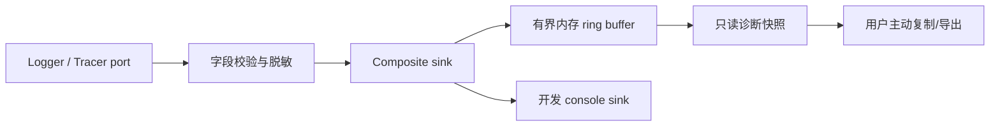

# 日志系统原理与工程规范

## 1. 为什么现代软件需要日志

测试发生在受控场景中，真实软件运行在不同设备、Vault 规模、模型服务、设置组合和故障条件中。当用户只说“索引失败了”时，调用栈可能已经消失，开发者也不能要求用户提供私人笔记。

日志系统的作用是留下**足够诊断、最少敏感**的运行事实，帮助回答：

- 哪个稳定事件发生了？
- 发生在什么组件和版本？
- 属于哪一次用户操作或后台任务？
- 结果是成功、取消、降级还是失败？
- 花了多长时间，处理了多少非敏感对象？
- 错误属于哪个稳定错误码？
- 还能否继续提供基本功能？

[OpenTelemetry logs](https://opentelemetry.io/docs/concepts/signals/logs/) 将日志定义为带时间戳、可附带元数据的记录，并推荐结构化形式。结构化的关键是稳定 schema 和字段语义，不是简单调用 `JSON.stringify`。

## 2. `console.log` 与日志系统的区别

| 维度 | 临时 `console.*` | 工程化日志系统 |
| --- | --- | --- |
| 字段 | 自由文本 | 稳定、类型化 schema |
| 关联 | 靠人工猜测顺序 | `traceId` / `spanId` / operation ID |
| 过滤 | 字符串搜索 | 按 level、event、component、outcome 查询 |
| 隐私 | 由每个调用者临时判断 | 中央 allowlist、脱敏和导出策略 |
| 输出 | 浏览器控制台 | 可替换 sink：console、内存、手动导出 |
| 测试 | 很难断言 | fake/in-memory sink 可确定性测试 |
| 容量 | 不受项目控制 | 环形缓冲、条数和字节预算 |
| 故障 | 输出异常可能干扰业务 | sink 失败不得破坏产品主流程 |

Vault Coach 当前 23 个 TypeScript 文件中有 73 次 `console.*` 调用。这说明系统已经有诊断需要，但事件命名、字段、关联和隐私控制尚未统一。

## 3. 日志、Trace、Metric、事件和审计事实

| 概念 | 适合回答 | Vault Coach 示例 |
| --- | --- | --- |
| Log | 某个时间点发生了什么细节？ | `retrieval.vector.fallback` |
| Trace | 一次端到端操作经过了哪些阶段？ | 一次 `ask.turn` 或 `index.rebuild` |
| Span | 一个有开始和结束的工作单元怎样执行？ | `embedding.batch` |
| Metric | 一段时间的趋势或分布如何？ | 本地重建耗时分布、错误计数 |
| Span event | span 内某个有意义的瞬间何时发生？ | `fallback.activated` |
| Application event | 哪个读取模型需要刷新？ | `index-state-changed` |
| Domain/audit fact | 用户业务历史和治理决策是什么？ | Assessment、`ReviewActionEvent` |

关键边界：日志和 trace 是可清理的运行诊断数据；领域事实不能放进环形缓冲，也不能因为“日志过期”而丢失。

## 4. 先定义诊断问题，再写日志

不要因为“这里有函数”就写日志。先列出运维问题：

| 诊断问题 | 最小证据 | 信号 |
| --- | --- | --- |
| 索引为什么失败？ | 阶段、结果、错误码、降级 | trace + error log |
| 向量检索是否回退？ | 请求模式、实际模式、原因 | span event / info log |
| 模型调用慢在哪里？ | 网络调用 span、首 token、总耗时 | child spans + attributes |
| 考试题为什么变少？ | 候选数、过滤数、最终数、验证失败类别 | span attributes / debug logs |
| 用户是否主动取消？ | cancellation outcome | span attribute + info log |
| 本地存储是否损坏并恢复？ | 读取结果、恢复来源、稳定错误码 | warn/error log |

如果一条记录不能回答实际问题，也没有审计或安全价值，它通常不值得长期保留。

## 5. 推荐日志契约

以下是项目级设计草案，实施时放在应用端口层，而不是直接暴露第三方 SDK 类型：

```ts
export type LogSeverity = "debug" | "info" | "warn" | "error";

export type SafeLogValue = string | number | boolean | null;

export interface LogRecord {
    timestamp: number;
    severity: LogSeverity;
    eventName: string;
    component: string;
    message?: string;
    traceId?: string;
    spanId?: string;
    outcome?: "ok" | "cancelled" | "degraded" | "error";
    errorCode?: string;
    attributes: Readonly<Record<string, SafeLogValue>>;
}

export interface Logger {
    emit(record: Omit<LogRecord, "timestamp">): void;
    child(component: string): Logger;
}
```

`message` 面向人阅读；`eventName`、`outcome`、`errorCode` 和 `attributes` 面向稳定查询。业务判断不得解析 `message`。

## 6. 命名规范

### 6.1 eventName

使用稳定、小写、点分层级：

```text
index.rebuild.started
index.rebuild.completed
index.rebuild.failed
retrieval.vector.fallback
model.chat.request.failed
storage.snapshot.recovered
```

不允许：

```text
index.rebuild.user-notes/private/2026.failed
request.7f4b9a...
模型又失败了！！！
```

事件名称描述类别，动态值放进受控 attributes。

### 6.2 errorCode

错误码应稳定、低基数、与本地化文案分离：

```text
VC_INDEX_SCAN_FAILED
VC_VECTOR_DIMENSION_MISMATCH
VC_MODEL_TIMEOUT
VC_STORAGE_CORRUPT_SNAPSHOT
```

不要把原始异常文本当错误码。

### 6.3 component

使用架构职责，而不是类的完整导入路径：

```text
index
retrieval
model
exam
semantic_graph
storage
presentation
```

## 7. Level 的项目语义

| Level | 使用条件 | 示例 | 默认用户诊断缓冲 |
| --- | --- | --- | --- |
| `debug` | 开发细节，默认可关闭 | 候选数量、批次边界 | 关闭或短保留 |
| `info` | 正常但值得理解的状态变化 | 重建完成、主动取消、启用降级 | 保留 |
| `warn` | 功能仍可用，但发生降级或可恢复异常 | 向量失败后使用关键词 | 保留 |
| `error` | 当前操作失败或数据完整性面临风险 | 无法恢复快照 | 保留 |

不要把所有 catch 都记为 `error`。如果预期降级成功，顶层结果可为 `degraded`，具体失败子 span 为 error，并用 `warn` 说明降级已启用。

## 8. 隐私：默认使用字段 allowlist

### 8.1 默认禁止记录

- 笔记正文、chunk 文本、prompt 和模型回答；
- API key、Authorization header、cookie；
- 绝对文件路径、Vault 名称、用户目录；
- 默认情况下的文件名、标题、标签和搜索原文；
- 完整 URL 查询参数；
- Assessment 答案和自由文本反馈；
- 可反推出个人身份的设备或账户标识。

### 8.2 通常可记录

- 插件版本、schema 版本、provider 类别；
- 本地生成的随机 trace/span ID；
- 耗时、批次数、文件数、chunk 数；
- 布尔能力标记；
- 稳定结果、阶段和错误码；
- 受控枚举，如 `keyword | vector | hybrid`；
- 不可逆且有明确用途的聚合值。

### 8.3 为什么不能先全收集再脱敏

敏感数据一旦进入 sink、错误报告或用户复制内容，就已经扩大暴露面。应在 `Logger`/`Tracer` 入口接受安全类型和 allowlist 字段，导出层再做第二道防线。

## 9. 错误归一化

原始 `Error` 可能包含 URL、路径或服务响应。不要直接序列化整个对象。

```ts
export interface SafeErrorDescriptor {
    code: string;
    category: "cancelled" | "timeout" | "network" | "storage" | "validation" | "unknown";
    retryable: boolean;
    safeMessage?: string;
}
```

归一化流程：

1. 先识别 `AbortError`/取消；
2. 将已知错误映射到稳定 code/category；
3. 丢弃 header、请求体、响应体和路径；
4. 未知错误使用 `VC_UNKNOWN`，原始对象只在本地开发控制台按明确策略处理；
5. 测试异常消息中含 token、路径和笔记片段时仍不会泄漏。

## 10. Sink 和生命周期

推荐默认组合：



### 默认规则

- 默认不联网；
- 内存缓冲按条数和估算字节双重限制；
- 覆盖最旧记录，并维护 dropped count；
- 插件卸载时停止接收并释放引用；
- sink 自身异常被隔离，不能让聊天、索引或考试失败；
- 持久化诊断若未来引入，必须显式开启、限定位置、大小和清理策略；
- 远程 exporter 另做产品、隐私和信任边界评审。

## 11. 反模式与评审问题

| 反模式 | 评审时追问 |
| --- | --- |
| `logger.info("done")` | 什么完成了？如何关联到一次操作？ |
| 动态 span/log 名称含路径 | 是否产生高基数并泄漏隐私？ |
| 每个循环项都写日志 | 在大 Vault 中的容量和性能是多少？ |
| catch 后只写日志 | 调用者怎样知道操作失败或降级？ |
| 记录整个 settings 对象 | 是否包含 API key 或未来新增敏感字段？ |
| logger 单例遍布 Domain | 测试和依赖方向是否被破坏？ |
| 远程自动上报默认开启 | 用户是否明确选择并知道发送内容？ |
| 把业务历史写进日志 | 清理日志时会不会丢失用户事实？ |

## 12. 新人练习与 Gate

从当前 `console.*` 中选择五处，建立迁移表：

| 当前位置 | 诊断问题 | eventName | level | attributes | trace 关系 | 是否保留 |
| --- | --- | --- | --- | --- | --- | --- |
| 示例：向量召回 catch | 是否发生回退及原因 | `retrieval.vector.fallback` | warn | mode、errorCode | `retrieval.search` span event | 是 |

### 完成 Gate

- [ ] 每条日志都能回答一个明确问题；
- [ ] eventName 和错误码稳定且低基数；
- [ ] attributes 使用 allowlist；
- [ ] 没有原文、凭据、路径或完整配置；
- [ ] 明确记录后是继续、降级、取消还是失败；
- [ ] 识别出应改为 span/span event 或应删除的记录。

下一章：[[05-OpenTelemetry-Trace-Span与Context]]
