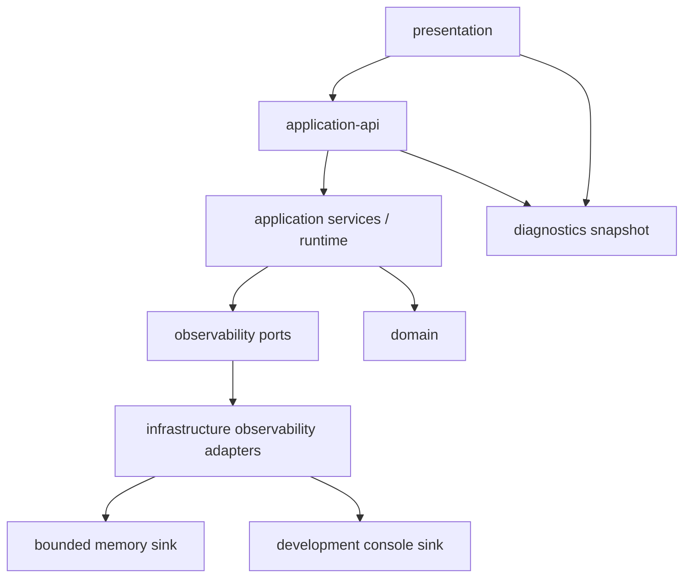

# Vault Coach 可观测性架构与接口

## 1. 设计目标

本章是建议架构，不表示仓库已经实现这些文件。目标是让后续实现同时满足：

1. 默认本地、无隐藏遥测；
2. Domain 不依赖 Obsidian、DOM、console 或 OTel SDK；
3. 业务流程不依赖 sink 是否正常；
4. logger 与 tracer 共享 context；
5. 输出容量有界并可安全清理；
6. 接口可用 fake/in-memory 实现做确定性测试；
7. 将来可以适配 OTel SDK/OTLP，而不改业务用例；
8. 移动端和 bundle 体积在引入第三方 runtime 前可独立评估。

## 2. 现有架构中的位置



依赖规则：

- `domain/**` 不导入 observability；纯规则返回值中可以包含已有 diagnostics DTO，但不产生副作用日志；
- `app/**` 定义端口、operation 边界和安全事件；
- `infrastructure/**` 实现 clock、ID generator、sinks 和未来 exporter；
- `presentation/**` 只读取诊断快照、切换明确设置、执行复制/导出；
- `application-container.ts` 创建实例并控制生命周期。

## 3. 建议目录

```text
src/app/observability/
  observability-types.ts
  logger.ts
  tracer.ts
  diagnostics-reader.ts
  safe-error.ts
  event-catalog.ts

src/infrastructure/observability/
  system-clock.ts
  random-id-generator.ts
  bounded-diagnostic-buffer.ts
  console-log-sink.ts
  composite-sink.ts
  local-tracer.ts
  diagnostic-exporter.ts

src/presentation/observability/
  diagnostics-controller.ts
  diagnostics-modal.ts

tests/app/observability/
tests/infrastructure/observability/
tests/presentation/observability/
```

第三方 OpenTelemetry adapter 以后可放在 `src/infrastructure/observability/otel/`，不能让 `@opentelemetry/*` 类型穿过应用端口。

## 4. 核心类型契约

### 4.1 安全属性

```ts
export type TelemetryScalar = string | number | boolean;
export type TelemetryValue = TelemetryScalar | readonly TelemetryScalar[];
export type TelemetryAttributes = Readonly<Record<string, TelemetryValue>>;
```

不接受任意 object、`Error`、settings 或业务 DTO，避免意外深度序列化敏感字段。

### 4.2 TraceContext

```ts
export interface TraceContext {
    readonly traceId: string;
    readonly spanId: string;
    readonly traceFlags: number;
}
```

context 对调用者只读。创建子 span 时生成新对象，不能修改父 context。

### 4.3 Span API

```ts
export type SpanKind = "internal" | "client" | "server" | "producer" | "consumer";
export type SpanStatus = "unset" | "ok" | "error";
export type OperationOutcome = "ok" | "cancelled" | "degraded" | "error";

export interface SpanHandle {
    readonly context: TraceContext;
    setAttribute(key: string, value: TelemetryValue): void;
    addEvent(name: string, attributes?: TelemetryAttributes): void;
    setStatus(status: SpanStatus): void;
    setOutcome(outcome: OperationOutcome): void;
    recordError(error: SafeErrorDescriptor): void;
}

export interface StartSpanOptions {
    parent?: TraceContext;
    kind?: SpanKind;
    attributes?: TelemetryAttributes;
}

export interface Tracer {
    withSpan<T>(
        name: string,
        options: StartSpanOptions,
        run: (span: SpanHandle) => Promise<T>,
    ): Promise<T>;
}
```

优先提供 `withSpan`，由实现负责 `try/finally` 和恰好结束一次。若未来必须支持长生命周期任务，再增加受严格状态机约束的 `startSpan/end`。

### 4.4 Logger API

```ts
export interface LogInput {
    severity: "debug" | "info" | "warn" | "error";
    eventName: string;
    outcome?: OperationOutcome;
    errorCode?: string;
    message?: string;
    attributes?: TelemetryAttributes;
    context?: TraceContext;
}

export interface Logger {
    emit(input: LogInput): void;
    forComponent(component: string): Logger;
}
```

如果 `context` 存在，sink 输出 `traceId/spanId`。第一阶段显式传递，避免隐式全局 active span。

## 5. 内部记录模型

```ts
export interface CompletedSpanRecord {
    schemaVersion: 1;
    name: string;
    kind: SpanKind;
    traceId: string;
    spanId: string;
    parentSpanId: string | null;
    startedAt: number;
    endedAt: number;
    durationMs: number;
    status: SpanStatus;
    outcome: OperationOutcome;
    attributes: TelemetryAttributes;
    events: readonly SpanEventRecord[];
    error?: SafeErrorDescriptor;
}
```

规则：

- `durationMs = max(0, endedAt - startedAt)`；
- record 完成后冻结，不允许 sink 修改；
- span event 数量和 attributes 数量设上限；
- 超限时丢弃额外字段并增加 `droppedAttributesCount`；
- schema 版本用于导出兼容，不复用插件设置 schema。

## 6. BoundedDiagnosticBuffer

### 6.1 接口

```ts
export interface DiagnosticSnapshot {
    schemaVersion: 1;
    generatedAt: number;
    pluginVersion: string;
    records: readonly DiagnosticRecord[];
    droppedRecordCount: number;
}

export interface DiagnosticBuffer {
    append(record: DiagnosticRecord): void;
    snapshot(): DiagnosticSnapshot;
    clear(): void;
    dispose(): void;
}
```

### 6.2 约束

- 按最大记录数与估算字节数限制；
- 超限覆盖最旧记录；
- `snapshot()` 返回深只读副本，不能暴露内部数组；
- `clear()` 只清诊断数据，不清考试、掌握度、图谱或设置；
- `dispose()` 后 append 为 no-op；
- append 不抛出影响业务的异常；
- 大对象在入口拒绝，不依赖 JSON 序列化后才发现过大。

## 7. DiagnosticsReader 与展示层

把诊断读取能力加入应用 API 的独立分组：

```ts
export interface ObservabilityApi {
    getDiagnosticSnapshot(): DiagnosticSnapshot;
    clearDiagnostics(): void;
    exportSanitizedDiagnostics(): Promise<string>;
}
```

展示层可以提供：

- 当前是否启用本地诊断；
- 最近 trace 列表：开始时间、根 span、outcome、duration；
- 展开 parent/child span；
- 复制一次 trace 的脱敏 JSON；
- 清除诊断数据；
- 清楚说明“数据仅在本地，复制后由用户自行决定分享”。

诊断视图不得显示笔记内容或提供隐蔽上传按钮。

## 8. 装配与生命周期

`src/app/application-container.ts` 是组合根。建议顺序：

```text
Clock + IdGenerator
  → BoundedDiagnosticBuffer
  → Sinks
  → Logger + Tracer
  → Application services / runtime
  → VaultCoachApplication API
```

卸载顺序反向进行：

1. 停止接收新的应用任务；
2. 取消活动索引/模型操作；
3. 结束或标记取消中的 span；
4. flush 本地内存对象（若无持久 sink 则无需 I/O）；
5. dispose sinks/buffer；
6. 清理 UI 和事件监听器。

如果未来有批量 exporter，flush 必须有超时，插件卸载不能无限等待。

## 9. 第一批 instrumentation 点

先覆盖高价值应用边界，不从工具函数开始：

| 入口/模块 | Root span | 建议 child spans | 关键 outcome |
| --- | --- | --- | --- |
| `src/app/vault-coach-runtime.ts` 索引编排 | `index.rebuild` / `index.sync` | scan、parse、vector、graph、persist | ok/cancelled/degraded/error |
| `src/app/chat/chat-service.ts` | `ask.turn` | ensure index、retrieve、generate、persist | ok/cancelled/degraded/error |
| `src/rag-engine.ts` 检索流程 | `retrieval.search` | rewrite、keyword、vector、merge、rerank | actual mode、fallback |
| `src/model-client.ts` 出站请求 | `model.chat.request` / `model.embedding.request` | 单个 HTTP 请求 | provider class、timeout、error code |
| `src/exam/exam-engine.ts` | `exam.generate` | scope、blueprint、question generation、validation | counts、fallback |
| storage adapters | `storage.snapshot.read/write` | 必要的恢复步骤 | recovered/corrupt/error |

实际编码前用调用图确认没有为同一工作在新旧兼容层重复创建 root span。兼容适配器应传播 context，不应另起一条 trace。

## 10. 事件目录作为接口资产

`event-catalog.ts` 不应只是字符串集合，还要说明所有者和字段：

```ts
export const OBSERVABILITY_EVENTS = {
    INDEX_REBUILD_FAILED: "index.rebuild.failed",
    VECTOR_FALLBACK_ACTIVATED: "retrieval.vector.fallback",
    SNAPSHOT_RECOVERED: "storage.snapshot.recovered",
} as const;
```

配套文档表：

| event | owner | level | allowed attributes | 触发条件 |
| --- | --- | --- | --- | --- |
| `retrieval.vector.fallback` | retrieval | warn | requestedMode、actualMode、errorCode | 向量失败且关键词继续 |
| `storage.snapshot.recovered` | storage | warn | storeType、recoverySource | 主快照损坏且从安全副本恢复 |

删除或改名事件属于诊断契约变更，需要迁移说明。

## 11. 与现有 diagnostics 的关系

当前项目已有多种业务 diagnostics，例如考试生成统计、图谱来源诊断和 `KnowledgeEngineDiagnostics`。迁移规则：

- 用例返回的 diagnostics 若直接帮助 UI/业务决策，继续作为 typed DTO；
- 同一过程可将少量聚合字段复制到 span，但不能把整个 DTO 深度序列化；
- UI 失效事件继续只通知重新读取，不携带 trace 快照；
- Assessment、`ReviewActionEvent` 和考试历史继续使用各自持久化契约；
- 统一 diagnostics 页面可以组合只读摘要，但不改变数据所有权。

## 12. 是否立即使用 OpenTelemetry JS SDK

建议分两步决策：

### 第一步：项目内最小端口与本地实现

优点：

- 包体和移动端风险小；
- 契约由项目需要驱动；
- 容易做隐私 allowlist；
- 可以先验证 trace 粒度是否有用；
- 无网络和 Collector 依赖。

### 第二步：评估 OTel adapter

只有以下 Gate 满足后再引入：

- [ ] 有明确的远程/本地 Engine 分布式追踪场景；
- [ ] OTel JS 所需包与当前 esbuild/Electron 兼容；
- [ ] `main.js` 体积和启动开销在预算内；
- [ ] Desktop 与移动端能力矩阵完成；
- [ ] JavaScript Logs/Trace API 的实际版本与成熟度已复核；
- [ ] 用户显式选择、数据说明、endpoint 信任和清除流程明确；
- [ ] 无 SDK 时插件全部核心功能仍可用。

采用 OTel 思想不等于必须立即采用全部 OTel runtime。

## 13. 架构 Gate

- [ ] `tests/architecture/import-boundaries.test.ts` 继续通过；
- [ ] Domain 没有导入 logger/tracer/SDK；
- [ ] UI 没有直接读取 sink 内部状态；
- [ ] 组合根控制实例和 dispose；
- [ ] logger/tracer 端口不暴露第三方类型；
- [ ] sink 失败不改变业务结果；
- [ ] 清除诊断不会删除领域事实；
- [ ] 所有对外字段通过隐私 allowlist；
- [ ] 远程 exporter 默认不存在或关闭。

下一章：[[07-分阶段实现-测试调试与CICD]]
