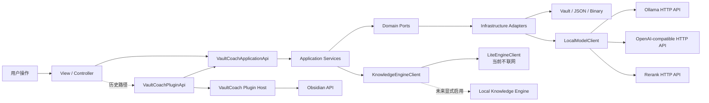
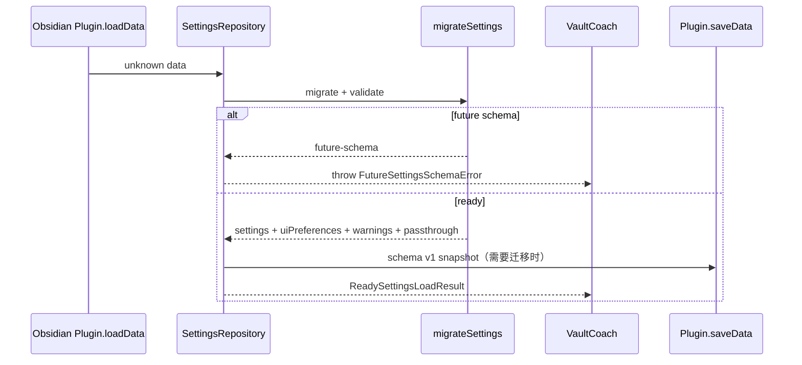
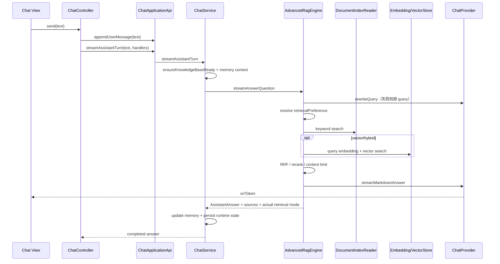
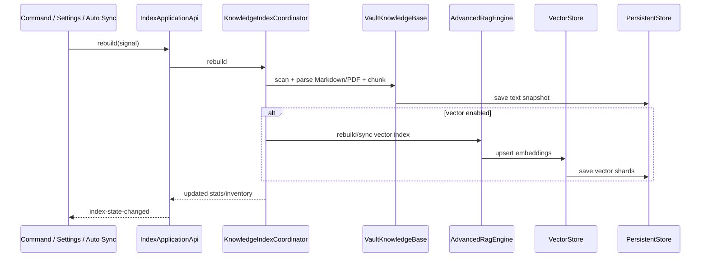

---
tags:
  - VaultCoach
  - API
  - 接口设计
  - Obsidian插件
  - RAG
  - KnowledgeEngine
status: current-implementation
updated: 2026-10-18
code-version: 1.5.1
branch: feature/v1.5
source-of-truth:
  - src/app/application-api.ts
  - src/app/application-container.ts
  - src/app/vault-coach-application.ts
  - src/presentation/plugin-api.ts
  - src/domain/model/chat-provider.ts
  - src/domain/retrieval/retrieval-types.ts
  - src/model-client.ts
  - src/vault-coach-plugin.ts
related:
  - VaultCoach-当前详细架构总览.md
  - 开发规划与过程记录/v1.5-开发日志/里程碑2-默认体验与Advanced设置分层.md
  - ../knowledge-engine/01-需求规格.md
  - ../knowledge-engine/02-架构设计.md
---

# Vault Coach 当前 API 调用与接口设计

> 本文描述 2026-10-18 `feature/v1.5` 工作区中的实际实现。`manifest.json` 版本为 `1.5.1`，但本文不据此声称这些变更已经发布。当前工作区仍包含未提交的 v1.5 M2 设置迁移与检索分层实现，最终行为以源码、测试和真实 Obsidian 验证为准。

本文配合《VaultCoach-当前详细架构总览》使用：架构总览回答“模块为什么这样分层”，本文回答“接口由谁调用、传什么数据、失败后如何处理、扩展时应改哪里”。

## 0. 文档范围与接口分类

项目中“API”包含四种不同含义，开发时不能混为一谈。

| API 类别 | 代表 | 调用范围 | 稳定性 |
| --- | --- | --- | --- |
| Obsidian 宿主 API | `Plugin`、`App`、`Vault`、`Workspace`、`SecretStorage`、`requestUrl` | 插件与 Obsidian 之间 | 受最低 Obsidian 版本约束 |
| 外部模型 HTTP API | Ollama、OpenAI-compatible、rerank endpoint | `LocalModelClient` 与用户配置的模型服务之间 | 受第三方协议和用户配置约束 |
| 内部 Application API | `VaultCoachApplicationApi` 及其分组接口 | Presentation → Application | 新 UI 的首选业务边界 |
| Domain Port | `ChatProvider`、`VectorStore`、`GraphStore` 等 | Application/Domain → Infrastructure | 应保持窄、纯、可替换 |

以下内容不属于当前已实现的 API：

- Vault Coach 没有为其他 Obsidian 插件提供稳定的公共 npm API；
- 当前没有启动本地 HTTP Server，也没有暴露 REST/GraphQL endpoint；
- `KnowledgeEngineClient` 当前装配的是 `LiteEngineClient`，不会访问 Docker、AWS 或远程 Knowledge Engine；
- Transformers.js Built-in Chat/Embedding 仍未接入运行时；M2 只建立相关 port 和设置边界。

## 1. API 边界总图



依赖方向必须保持为：

```text
Presentation → Application API → Domain Port ← Infrastructure Adapter
Plugin Host → Obsidian API
Infrastructure Adapter → 用户显式配置的外部服务
```

禁止路径：

- View 直接读取或写入 JSON Store；
- Domain 引用 `obsidian`、DOM、`WorkspaceLeaf` 或具体 HTTP client；
- 新功能继续扩大 `VaultCoachPluginApi` 的扁平方法集合；
- UI 自行组合模型 URL、读 SecretStorage 明文或判断索引一致性；
- Lite 功能把 Knowledge Engine、云端模型或外部数据库变成启动前置条件。

## 2. Obsidian 宿主 API

### 2.1 插件生命周期与组合根

入口链路：

```text
src/main.ts
  → VaultCoach.onload()
  → SettingsRepository.load()
  → VaultCoachRuntime.initialize()
  → createApplicationContainer()
  → registerView / addCommand / addRibbonIcon / registerEvent
```

`VaultCoach` 是 Obsidian 组合根，只负责：

- 加载与保存设置；
- 创建 Runtime、Application Container 和 legacy adapter；
- 注册视图、命令、Ribbon、设置页和 Vault 事件；
- 把 `Notice`、Workspace 导航、SecretStorage 等宿主能力适配给应用层；
- 在 `onunload()` 中释放运行时资源。

业务规则不应新增到 `VaultCoach`。如果一个操作能在没有 Obsidian UI 的测试中表达，它通常属于 Application 或 Domain。

### 2.2 View Type 与命令 ID

#### View Type

| 常量 | 当前值 | 用途 |
| --- | --- | --- |
| `VIEW_TYPE_VAULT_COACH` | `value-coach-view` | Ask/Exam 侧栏 |
| `VIEW_TYPE_CONCEPT_REVIEW` | `vault-coach-concept-review` | 语义候选治理 |
| `VIEW_TYPE_LEARNING_MAP` | `vault-coach-learning-map` | Learning Map |
| `VIEW_TYPE_PROGRESS` | `vault-coach-progress` | Learning Dashboard |

这些 ID 会进入 Obsidian Workspace 状态，发布后应视为兼容契约。特别注意：主视图 ID 当前是历史值 `value-coach-view`，不能因为产品名是 Vault Coach 就直接改名。

#### 核心命令

| 命令 ID | Application/Host 调用 | 说明 |
| --- | --- | --- |
| `open-view` | `activateView()` | 打开侧栏 |
| `reset-conversation` | `application.chat.resetConversation()` | 清空会话并恢复欢迎语 |
| `rebuild-knowledge-index` | `rebuildKnowledgeBase(true)` | 重建文本/向量索引 |
| `stop-knowledge-index` | `abortKnowledgeIndexBuild(true)` | 取消索引任务 |
| `clear-knowledge-index` | `clearKnowledgeIndex(true)` | 清理派生索引 |
| `open-concept-review` | Workspace helper | 打开语义候选治理视图 |
| `open-learning-map` | Workspace helper | 打开 Learning Map |
| `rebuild-semantic-concept-graph` | `application.semanticGraph.rebuild()` | 显式授权后重建语义图谱 |
| `reset-semantic-governance-decisions` | `application.semanticGraph.resetGovernanceDecisions()` | 清除人工语义治理决策 |
| `show-derived-storage-footprint` | `application.index.getStorageFootprint()` | 查看派生数据占用 |
| `rebuild-concept-mastery` | `application.mastery.rebuild()` | 重算掌握度 |
| `open-learning-dashboard` | Workspace helper | 打开学习面板 |

命令 ID 与 View Type 不应随显示文案一起重命名。显示文案通过 `i18n.ts` 更新，稳定 ID 保持不变。

### 2.3 Vault 与 Workspace 调用

当前使用的主要 Obsidian 能力如下。

| Obsidian API | 调用方 | 用途 | 约束 |
| --- | --- | --- | --- |
| `app.vault.on(create/modify/delete/rename)` | `VaultCoach` | 标记索引 dirty、触发去抖同步 | 必须通过 `registerEvent` 清理 |
| `app.vault.adapter` | Storage adapters | JSON/二进制文件读写、列目录、删除 | 只访问 Vault 内路径 |
| `app.workspace.getLeavesOfType()` | Plugin/workspace helper | 复用已打开视图 | 不重复创建相同工作区 |
| `getRightLeaf(false)` | 主侧栏 | 创建 Ask/Exam 侧栏 | 失败时显示 Notice |
| `getLeaf(true)` | 主工作区视图 | 打开 Concept/Learning/Progress | 由 helper 统一处理 |
| `openLinkText()` | View/Plugin | 打开回答来源或图谱证据 | 使用规范化 Vault 相对路径 |
| `getActiveFile()` | Chat/Exam View | 获取相对导航起点 | 不作为知识范围事实 |
| `SecretStorage.getSecret()` | Runtime/Plugin | 读取 API key | 明文不进入 settings、日志或 fixture |
| `Plugin.loadData/saveData` | `SettingsRepository` | 读写 `data.json` | 必须经过 schema/migration 边界 |
| `requestUrl()` | `LocalModelClient` | 非流式 HTTP POST | 保留错误响应体，避免浏览器 CORS |
| `window.fetch()` | `LocalModelClient` | 流式 NDJSON/SSE | `requestUrl` 会缓冲完整响应体 |

### 2.4 设置与 SecretStorage

设置调用链：



关键契约：

- `settingsSchemaVersion = 1`；
- `SettingsRepository` 是 `loadData/saveData` 的唯一边界；
- 保存队列串行执行，旧写入不会覆盖新写入；
- future schema 拒绝覆盖；
- 未知字段通过 `passthrough` 往返；
- `false`、`0` 和空字符串按合法类型保留；
- `uiPreferences.advancedSettingsExpanded` 与业务设置分开建模；
- `cloudApiKeySecretName` 只保存 SecretStorage 的引用名，不保存 API key；
- Secret 引用存在但本机查不到值时，设置页显示 `Needs attention`，不自动切换 provider。

## 3. 外部模型 HTTP API

所有当前模型 HTTP 请求集中在 `LocalModelClient`。名称中的 `Local` 是历史遗留；该类同时路由 Ollama 和 OpenAI-compatible provider，并提供 chat、JSON generation、query rewrite、memory extraction、embedding 和 rerank。

### 3.1 网络调用总表

| Provider | Method / Path | 传输 | 发送内容 | 认证 | 失败处理 |
| --- | --- | --- | --- | --- | --- |
| Ollama chat | `POST /api/chat` | `requestUrl` 或 `fetch` | model、messages、temperature、stream | 无 | 流式→非流式→检索摘要 |
| Ollama embedding | `POST /api/embed` | `requestUrl` | model、input[]、truncate、options | 无 | GPU→CPU；404→旧接口 |
| Ollama legacy embedding | `POST /api/embeddings` | `requestUrl` | model、单条 prompt、options | 无 | GPU→CPU；失败上抛 |
| OpenAI-compatible chat | `POST /v1/chat/completions` | `requestUrl` 或 `fetch` | model、messages、temperature、stream/response_format | Bearer API key | 流式→非流式→检索摘要 |
| OpenAI-compatible embedding | `POST /v1/embeddings` | `requestUrl` | model、input[] | Bearer API key | 向量检索回退 keyword |
| 通用 rerank | `POST /v1/rerank` | `requestUrl` | model、query、documents[] | 当前未发送认证头 | 回退本地启发式 rerank |

路径不是固定字符串拼接。OpenAI-compatible base URL 规范化规则如下：

- base URL 已以 `/chat/completions` 结尾：不追加路径；
- 以 `/v1` 结尾：追加 `/chat/completions`；
- 其他情况：追加 `/v1/chat/completions`；
- embedding 对 `/embeddings` 与 `/v1` 使用同样规则；
- rerank base URL 已以 `/v1/rerank` 结尾时不追加，否则追加 `/v1/rerank`。

用户填写的 base URL 应是服务根地址或 `/v1` 地址，不能把 API key 放入 URL query。

### 3.2 Ollama chat

#### 非流式请求

```json
{
  "model": "<settings.chatModel>",
  "messages": [{ "role": "system|user|assistant", "content": "..." }],
  "stream": false,
  "format": "json（仅结构化生成时出现）",
  "options": { "temperature": 0.2 }
}
```

响应读取 `message.content`。query rewrite、长期记忆抽取、考试结构化生成和最终回答都可能复用该入口，但各自的 system/user prompt 不同。

#### 流式请求

流式请求使用相同 endpoint，设置 `stream: true`。返回体按换行拆分，每行解析为：

```ts
interface OllamaStreamChunk {
    message?: { content?: string };
    done?: boolean;
    error?: string;
}
```

每个 token 通过 `ChatStreamHandlers.onToken` 推送给 UI。收到 `done` 后调用 `onDone`。用户取消时使用 `AbortSignal`；如果取消前已经收到部分文本，当前传输层会返回该部分文本并结束流。

### 3.3 OpenAI-compatible chat

非流式请求体：

```json
{
  "model": "<settings.cloudChatModel>",
  "messages": [{ "role": "system|user|assistant", "content": "..." }],
  "temperature": 0.2,
  "response_format": { "type": "json_object" }
}
```

`response_format` 只在调用方要求 JSON 时发送。响应读取 `choices[0].message.content`。

流式请求设置 `stream: true`，按 SSE 的 `data:` 行解析：

- `data: {json}` → `choices[0].delta.content`；
- `data: [DONE]` → 完成；
- 非 `data:` 行忽略；
- Bearer key 从 Obsidian SecretStorage 读取，只进入请求头。

“OpenAI-compatible”描述的是协议形状，不表示只支持 OpenAI。服务必须兼容上述 chat completions、SSE 和 embeddings 格式。

### 3.4 Embedding API

chat provider 与 embedding provider 分开选择：

```text
modelProvider       = ollama | openai-compatible
embeddingProvider   = ollama | openai-compatible
```

切换 chat provider 不应触发向量重建；修改 embedding provider、模型或影响 chunk 语义的设置必须把向量索引标为 stale。

#### Ollama 新接口

```json
{
  "model": "<settings.embeddingModel>",
  "input": ["chunk 1", "chunk 2"],
  "truncate": true,
  "options": { "num_gpu": 0 }
}
```

正常请求不含 `options.num_gpu`。检测到 CUDA/PTX/GPU backend 类错误后，插件使用 `num_gpu: 0` 重试，并在当前进程后续调用中优先 CPU。

#### Ollama 旧接口

当 `/api/embed` 返回 404 时，插件逐条调用 `/api/embeddings`：

```json
{
  "model": "<settings.embeddingModel>",
  "prompt": "single chunk",
  "options": { "num_gpu": 0 }
}
```

旧接口不支持当前实现使用的批量形状，所以一次文本一次请求。

#### OpenAI-compatible embedding

```json
{
  "model": "<settings.cloudEmbeddingModel>",
  "input": ["chunk 1", "chunk 2"]
}
```

响应只保留 `data[].embedding` 中非空的数字数组。空响应视为错误。

### 3.5 Rerank API

远程重排使用常见 `/v1/rerank` 形状：

```json
{
  "model": "<settings.rerankModel>",
  "query": "rewritten query",
  "documents": ["heading + chunk text", "..."]
}
```

响应期望：

```json
{
  "results": [
    { "index": 0, "relevance_score": 0.91 }
  ]
}
```

当前 rerank 请求没有独立 API key 设置，也不会复用 cloud chat 的 Authorization header。因此需要鉴权的 rerank 服务尚未完整支持。远程调用失败时不会阻断 Ask，而是切换本地启发式重排。

### 3.6 传输层与统一错误

#### 非流式：`requestUrl`

`postJson()` 使用 Obsidian `requestUrl({ throw: false })`：

- 绕过浏览器 CORS；
- 保留 4xx/5xx 响应体；
- 统一拼接 URL；
- 将 HTTP 和网络异常包装为 `ModelRequestError`。

#### 流式：`window.fetch`

`requestUrl` 会缓冲完整响应体，无法逐 token 更新 UI。因此流式 chat 使用 `window.fetch` 和 `ReadableStream.getReader()`，通过 `TextDecoder` 增量解码。

#### 错误信息

`ModelRequestError` 保存：

- target URL；
- HTTP status 或 `null`；
- 服务端错误摘要；
- 针对连接拒绝、模型未拉取、404 路径错误的排障提示。

不得把 Authorization header、API key、完整笔记正文或 prompt 写进日志。由于错误信息包含 target URL，部署时禁止把凭据放入 URL。

当前没有统一的请求超时、指数退避或熔断器。取消只覆盖流式 chat、索引/图谱等显式传入 `AbortSignal` 的任务。

### 3.7 数据外发边界

| 功能 | 可能发送的数据 | 触发条件 |
| --- | --- | --- |
| Ask 最终回答 | 用户问题、历史消息、选中的 chunk、短期/长期记忆上下文 | 用户发起 Ask 且选择模型 provider |
| Query rewrite | 用户问题、最近对话、知识范围描述 | `enableQueryRewrite=true` |
| Embedding 建索引 | chunk 文本 | 向量检索启用且选择 embedding provider |
| Query embedding | 改写后的查询 | 本轮实际使用 vector/hybrid |
| Remote rerank | 查询和候选 chunk 文本 | 配置 rerank URL/model 且启用 rerank |
| Semantic graph extraction | Section 文本窗口 | 用户显式启用语义图谱并执行构建 |
| Long-term memory extraction | 对话上下文和本轮问答 | `enableLongTermMemory=true` |
| Exam generation/evaluation | 选中知识片段、题目、用户答案 | 用户生成或提交需要模型评估的题目 |

Ollama 地址通常是本机服务，但从程序角度仍是用户配置的 HTTP endpoint。不能仅凭 provider 名称假设数据一定没有离开设备。

## 4. Internal Application API

`src/app/application-api.ts` 是新 Presentation 代码的业务能力目录。它按用例分组，避免一个巨型 service locator。

### 4.1 `ChatApplicationApi`

| 方法 | 返回/副作用 |
| --- | --- |
| `getMessages()` | 返回只读会话消息 |
| `appendUserMessage(text)` | 添加用户消息并持久化运行时状态 |
| `streamAssistantTurn(text, handlers?)` | 确保索引、执行 RAG、流式生成、更新记忆并持久化 |
| `resetConversation()` | 恢复默认欢迎消息并发出 conversation 失效事件 |

`AssistantAnswer` 是 Ask 的主要输出契约：

```ts
interface AssistantAnswer {
    text: string;
    sources: AnswerSource[];
    generationDurationMs?: number;
    retrievalModeUsed: "keyword" | "vector" | "hybrid";
    retrievalPreference?: "auto" | "keyword" | "vector" | "hybrid";
    retrievalReason?: "explicit" | "vector-ready" | "vector-unavailable" | "vector-failed";
    queryRewrite: QueryRewriteResult;
}
```

UI 应展示 `retrievalModeUsed`，不能把 `auto` 当作实际执行算法。

### 4.2 `ExamApplicationApi`

| 方法组 | 方法 | 责任 |
| --- | --- | --- |
| Scope | `getScopeOptions`、`getFileOptions`、`getScopeSnapshot` | 构造可选择且可审计的考试范围 |
| Analyze | `analyzeScope` | 在生成前报告容量、题型和过滤结果 |
| Adaptive | `previewAdaptivePlan` | 只预览计划，不写 Assessment 事实 |
| Session | `createSession`、`submitSession` | 生成题目、评估答案、创建事实事件 |
| Persistence | `saveSession`、`exportSession` | 保存 JSON 事实与 Markdown 投影 |
| History | `listHistory`、`readHistory`、`deleteSession`、`deleteHistory` | 管理用户可见历史 |

`submitSession` 的事务顺序由 Application Facade 控制：评估 → 保存 session/assessment → 更新 mastery → 发送失效事件。View 不得直接创建 AssessmentEvent。

### 4.3 `IndexApplicationApi`

```ts
interface IndexApplicationApi {
    rebuild(signal?: AbortSignal): Promise<void>;
    clear(): Promise<void>;
    abort(): void;
    getState(): KnowledgeIndexViewState;
    getStorageFootprint(): Promise<StorageFootprint>;
}
```

`KnowledgeIndexViewState` 同时携带：

- `textDirty` 与 `vectorDirty`；
- 来源 inventory 状态和 diff；
- 当前 busy phase；
- 文本索引统计；
- 向量索引统计。

dirty、busy 和 ready 是不同概念。UI 不应把“当前没有任务”解释为“索引是最新的”。

### 4.4 图谱、掌握度与学习 API

#### `GraphApplicationApi`

- `rebuild(signal?)`：从当前索引重建确定性图谱；
- `getSnapshot/getNode/findNodesByDocumentPath`：只读查询；
- `findEdgesForNode/findEdgesBySourceFile/getEdgeSources`：追踪关系证据；
- `checkIntegrity()`：返回完整性报告。

#### `SemanticGraphApplicationApi`

分为四类：

1. 生命周期：`rebuild/clear/abort/getState`；
2. 影响预览：`getGovernanceImpact/getReviewProjection`；
3. 候选决策：`confirmCandidate/rejectCandidate/undoCandidateDecision`；
4. 人工治理：merge、alias、manual relation 及对应撤销。

每次治理写入后，Application Facade 会使 Learning Graph 缓存失效，并发布 semantic graph/mastery 失效事件。M3 决策不能反写 M2 确定性图谱。

#### `LearningGraphApplicationApi`

- `getProjection(query?)`：返回受节点/边预算限制的可视化投影；
- `getConceptCatalog()`：为 Mastery、Adaptive Exam 和 Progress 提供稳定概念目录。

#### `MasteryApplicationApi`

- `getState/getSnapshot/getConceptState`：只读状态；
- `rebuild()`：根据 Assessment Session 和当前有效概念目录重算；
- `clear()`：清理可再生 mastery 快照。

### 4.5 Progress 与 Recommendation

`ProgressApplicationApi` 是只读聚合：

- `isAvailable()`；
- `getState()`；
- `getSnapshot()`。

`RecommendationApplicationApi` 分开处理可重建推荐和用户动作事实：

- `getSnapshot()`：计算当前建议；
- `recordAction(recommendationId, action, deferUntil?)`：记录 complete/defer 等动作；
- `exportMarkdown()`：导出当前建议；
- `isAvailable()`：功能能力检查。

推荐本身不是掌握度事实，不能直接修改图谱或 mastery。

### 4.6 Knowledge Engine 接缝

```ts
interface KnowledgeEngineApplicationApi {
    getAvailability(): KnowledgeEngineAvailability;
    getDiagnostics(): KnowledgeEngineDiagnostics;
    refresh(signal?: AbortSignal): Promise<KnowledgeEngineAvailability>;
}
```

当前实现是 `LiteEngineClient`：

- mode=`lite`；
- status=`available`；
- capabilities=[]；
- networkRequestsMade=0；
- dataTransfer=`none`；
- `refresh()` 只检查 AbortSignal 并立即返回，不联网。

未来 Local Engine 必须先做 protocol version 和 capability 协商。连接失败、未安装、鉴权失败、服务繁忙或协议不兼容时，Ask、Exam、Learning Map、Mastery 和 Recommendation 仍走 Lite。

## 5. Application Events

`VaultCoachApplication` 发布失效事件，而不是把完整 snapshot 塞入事件：

```ts
type ApplicationEvent =
    | { type: "state-changed" }
    | { type: "index-state-changed" }
    | { type: "graph-state-changed" }
    | { type: "semantic-graph-state-changed" }
    | { type: "mastery-state-changed" }
    | { type: "recommendations-changed" }
    | { type: "conversation-changed" }
    | { type: "exam-history-changed" };
```

监听方收到事件后按需重新读取对应 Facade。这样可以：

- 避免事件对象持有大型图谱或会话副本；
- 避免订阅者修改共享领域对象；
- 允许多个 View 用相同 API 重建自己的 View Model；
- 把缓存失效与 UI 渲染分开。

当前 `subscribe(listener)` 定义在具体 `VaultCoachApplication` 类上，没有进入 `VaultCoachApplicationApi` interface。构造 View 时传入的是具体实例，因此可以工作，但这是后续收紧公共 Facade 时需要处理的接口不一致点。

## 6. Legacy Plugin API

`VaultCoachPluginApi` 是渐进重构期间保留的扁平兼容接口。它混合了：

- Settings 与 SecretStorage 状态；
- Workspace/Notice 等宿主操作；
- 索引状态；
- Chat/RAG；
- Exam/History。

`LegacyPluginApiAdapter` 将 Chat、Exam 和一部分 Index 操作委托给分组后的 Application API，其他宿主能力仍委托 `VaultCoach`。

新增功能的选择顺序：

1. 优先扩展某个现有 `*ApplicationApi`；
2. 没有合适分组时新增窄的 Application 子门面；
3. 只在旧设置页或旧 Controller 必须兼容时增加 legacy 委托；
4. 不允许 Presentation 用类型断言访问 `application-container.services`。

`VaultCoachPluginApi` 不是第三方插件 API。将其方法改名仍需同步项目内调用方和测试，但不应把它当成未来扩展主入口。

## 7. Domain Ports 与当前实现

### 7.1 端口映射

| Port | 定义位置 | 当前实现 | 使用方 |
| --- | --- | --- | --- |
| `ChatProvider` | `domain/model/chat-provider.ts` | `LocalModelClient` | `AdvancedRagEngine` |
| `JsonGenerationGateway` | `domain/model/json-generation-gateway.ts` | `LocalModelClient` | Exam/Semantic generation |
| `DocumentIndexReader` | `domain/documents/document-index-reader.ts` | `VaultKnowledgeBase` | RAG、Graph、Semantic、Exam |
| `VectorStore` | `domain/retrieval/retrieval-types.ts` | `EmbeddedExactVectorStore` | RAG/Index |
| `GraphStore` | `domain/graph/graph-store.ts` | `JsonGraphStore` | `KnowledgeGraphService` |
| `SemanticGraphStore` | `domain/semantic-graph/semantic-graph-store.ts` | `JsonSemanticGraphStore` | `SemanticGraphService` |
| `AssessmentSessionStore` | `domain/assessment/assessment-types.ts` | `JsonAssessmentSessionStore` | Exam/Mastery/Progress |
| `MasteryStore` | `domain/mastery/mastery-types.ts` | `JsonMasteryStore` | `MasteryService` |
| `ReviewActionStore` | `domain/recommendation/recommendation-types.ts` | `JsonReviewActionStore` | `RecommendationService` |
| `KnowledgeEngineClient` | `app/engine/knowledge-engine-types.ts` | `LiteEngineClient` | Engine Facade |
| `RecommendationReminderCalendarAdapter` | `app/recommendation/reminder-calendar-adapter.ts` | 尚未装配 | 未来日历集成 |

### 7.2 `ChatProvider`

```ts
interface ChatProvider {
    rewriteQuery(originalQuery, conversationContext, scopeDescription): Promise<QueryRewriteResult>;
    extractMemoryStatements(conversationContext, latestUserText, latestAssistantText): Promise<string[]>;
    generateMarkdownAnswer(messages, temperature): Promise<string>;
    generateJsonAnswer(messages, temperature): Promise<string>;
    streamMarkdownAnswer(messages, temperature, handlers?): Promise<string>;
}
```

设计原因：

- RAG 不需要知道 Ollama/OpenAI URL 和认证方式；
- Built-in Chat 可以实现相同 port，但必须单独通过质量、内存和包体 Gate；
- chat provider 与 embedding provider 不绑定；
- 流式回调使用领域侧 `ChatStreamHandlers`，不依赖 DOM。

当前限制：`LocalModelClient` 同时实现 chat、embedding 和 rerank，类职责仍偏大。新增 provider 时应先拆传输 adapter/router，避免继续增加 `if provider` 分支。

### 7.3 `VectorStore`

```ts
interface VectorStore {
    initialize(): Promise<void>;
    upsert(records: VectorRecord[]): Promise<void>;
    remove(chunkIds: string[]): Promise<void>;
    search(query: Float32Array, options: VectorSearchOptions): Promise<VectorStoreHit[]>;
    clear(): Promise<void>;
    getStats(): Promise<VectorStoreStats>;
    close(): Promise<void>;
}
```

实现必须支持重复初始化、幂等删除和显式释放。`VectorStoreHit.score` 属于后端内部尺度；跨后端或跨阶段比较时使用明确的 `similarity`、RRF 或 rerank score，不混用原始值。

### 7.4 Store Port

Store port 通常只有 `load/save/clear` 或少量按 ID 查询。设计约束：

- Domain 定义数据结构和 port；
- Infrastructure 决定 JSON、分片、`.tmp/.bak` 和 VaultAdapter 细节；
- Application 决定写入顺序与事件；
- Presentation 不接触 Store；
- 用户事实与可再生 projection 分开保存。

## 8. 主要调用时序

### 8.1 Ask / RAG



降级链：

1. query rewrite 失败 → 使用原问题；
2. auto 且向量未 ready → keyword；
3. vector/hybrid 调用失败 → keyword，并记录 `vector-failed`；
4. remote rerank 失败 → heuristic rerank；
5. 流式 chat 失败 → 非流式 chat；
6. 非流式 chat 失败 → 基于检索候选的 Markdown 摘要；
7. 无候选 → 返回明确的无证据回答，不伪造来源。

### 8.2 索引重建



索引语义设置变化时只标记 stale，不应在设置控件 `onChange` 中直接启动重建。实际重建由用户动作或自动同步策略决定。

### 8.3 Exam → Assessment → Mastery

```text
Exam View
  → ExamApplicationApi.createSession
  → ExamEngine（选择 chunk、生成题目）
  → ExamApplicationApi.submitSession
  → ExamEvaluationRouter
      → objective evaluator 或 model evaluator
  → AssessmentEventFactory
  → JsonAssessmentSessionStore
  → MasteryService 增量/重算
  → exam-history-changed + mastery-state-changed
```

考试题型、难度和 prompt 是一次 session 的生成策略；Assessment 才是进入 mastery 的证据。模型自由文本不能直接覆盖用户答案或图谱事实。

### 8.4 Semantic Governance

```text
Section extraction（模型候选）
  → SemanticGraphStore 保存候选与 evidence
  → Concept Review 展示 projection
  → 用户 confirm/reject/merge/alias/manual relation
  → SemanticGraphApplicationApi 写治理决策
  → LearningGraph cache invalidate
  → Mastery projection invalidate
```

候选、确认事实、拒绝决策和手工关系必须保留不同 provenance，不允许用一个布尔字段混合语义。

## 9. 检索接口设计

### 9.1 偏好与实际模式分离

```ts
type RetrievalPreference = "auto" | "keyword" | "vector" | "hybrid";
type RetrievalMode = "keyword" | "vector" | "hybrid";

interface RetrievalResolution {
    preference: RetrievalPreference;
    resolvedMode: RetrievalMode;
    reason: "explicit" | "vector-ready" | "vector-unavailable" | "vector-failed";
}
```

解析规则：

| Preference | Vector enabled/ready | Resolved mode | Reason |
| --- | --- | --- | --- |
| keyword | 任意 | keyword | explicit |
| vector | ready | vector | explicit |
| hybrid | ready | hybrid | explicit |
| auto | ready | hybrid | vector-ready |
| auto/vector/hybrid | disabled 或未 ready | keyword | vector-unavailable |
| vector/hybrid 执行异常 | 请求失败 | keyword | vector-failed |

运行时失败只改变本轮 `RetrievalResolution`，不修改用户持久化偏好。

### 9.2 分数语义

候选经历多个不可直接比较的分数空间：

```text
keyword score
vector similarity
RRF fusion score
heuristic/remote rerank score
final score
```

每个阶段使用独立字段。不得因为数值都为 `number` 就在不同阶段直接排序或设统一阈值。

### 9.3 来源契约

`AnswerSource` 包含：

- `filePath`；
- 可选结构化 `locator`；
- heading 或 PDF page 范围；
- Obsidian `displayLink`；
- excerpt。

来源从最终 reranked candidates 构造。UI 打开来源时使用 Vault 相对路径和 locator，不能解析回答文本中的自由格式引用来猜测文件。

## 10. 持久化 API 与文件边界

### 10.1 插件目录

根路径：`<Vault>/.obsidian/plugins/vault-coach/`

| 文件/目录 | 写入者 | 内容 |
| --- | --- | --- |
| `data.json` | Obsidian `saveData` / `SettingsRepository` | schema v1 设置、UI 偏好、secret 引用 |
| `runtime-state.json` | `VaultCoachPersistentStore` | 会话、长期记忆、运行时状态 |
| `index-snapshot.json` | `VaultCoachPersistentStore` | 文本索引快照 |
| `knowledge-index/vectors/**` | `EmbeddedExactVectorStore` | 向量索引元数据与二进制分片 |

### 10.2 Vault 隐藏目录

根路径：`<Vault>/.vault-coach/`

| 路径 | 数据性质 | Store/API |
| --- | --- | --- |
| `exams/**` | 用户可读考试 Markdown | `MarkdownExamReportStore` |
| `assessments/sessions/*.json` | 学习证据事实 | `JsonAssessmentSessionStore` |
| `assessments/index-v1.json` | Assessment 索引 | `JsonAssessmentSessionStore` |
| `graph/graph-snapshot-v1.json` | 可再生确定性图谱 | `JsonGraphStore` |
| `graph/semantic/**` | 语义候选、治理和 embedding | `JsonSemanticGraphStore` |
| `mastery/mastery-snapshot-v1.json` | 可重算掌握度 | `JsonMasteryStore` |
| `recommendations/review-actions-v1.json` | 用户复习动作事实 | `JsonReviewActionStore` |
| `exam-content-profiles.json` | 考试内容 profile cache | `ExamContentProfileStore` |

设置迁移不应扫描或重写 `.vault-coach`。索引 fingerprint 或业务 schema 变化必须由对应 Store/Service 单独迁移。

## 11. API 设计规范

### 11.1 输入输出

- 跨层输入使用明确 DTO，不传 DOM element、Obsidian file 实例或具体 Store；
- getter 返回复制或只读视图，避免调用方修改共享状态；
- 写操作返回写入后的事实或 `void`，不要用 UI Notice 作为成功信号；
- 大任务接收 `AbortSignal`；取消应抛标准 `AbortError` 或由契约明确返回部分结果；
- 时间戳统一使用 Unix 毫秒；文件路径统一使用 Vault 相对路径。

### 11.2 版本化

以下内容必须显式版本化：

- settings schema；
- graph、semantic graph、assessment、mastery、review action 等持久化文档；
- Knowledge Engine protocol 和跨项目 DTO；
- prompt/schema 组合影响可重算结果时的 extractor/evaluator signature。

新增可选字段优先保证旧数据可读。遇到未来 schema 时拒绝覆写，不应降级成默认值后保存。

### 11.3 错误与 fallback

错误分三类处理：

| 类型 | 示例 | 处理 |
| --- | --- | --- |
| 用户可修复配置错误 | URL 错误、模型未安装、secret 缺失 | 给出可操作提示，不改配置 |
| 可降级能力错误 | vector、rerank、streaming 失败 | 降级并记录实际执行路径 |
| 事实/持久化错误 | future schema、写盘失败、完整性失败 | 阻止覆盖或写入，向调用方传播 |

fallback 成功不等于原能力成功。诊断、Answer DTO 或状态机必须保留降级原因。

### 11.4 隐私与安全

- 网络功能由用户配置或显式启用；
- 不做隐藏遥测；
- API key 只放 SecretStorage 与 Authorization header；
- 日志不记录笔记正文、prompt、答案、API key 或完整本地路径；
- 外部 endpoint 不得返回可执行代码并由插件 `eval`；
- Semantic Graph 模型抽取默认关闭；
- Knowledge Engine Local/Cloud 接入必须先有用户同意、数据最小化和能力协商。

### 11.5 Provider 独立性

聊天、embedding、rerank、未来 Knowledge Engine 是四个独立边界：

- chat provider 决定回答生成、query rewrite、memory 等；
- embedding provider 决定索引向量和查询向量；
- rerank 是可选排序增强；
- Knowledge Engine 是可选的知识中间件，不是模型 provider。

一个边界失败不能静默切换到另一个会外发更多数据的 provider。

## 12. 扩展操作指南

### 12.1 新增 Chat Provider

1. 在 infrastructure/model 下实现 `ChatProvider`；
2. 把认证和 URL 规则封装在 adapter 内；
3. 在 settings schema/defaults/migration/UI 中添加 provider 值；
4. 在 `application-container.ts` 或专用 router 装配；
5. 覆盖 Markdown、JSON、stream、abort、401/404/429/5xx 和 malformed stream 测试；
6. 文档说明发送的数据、密钥存储和 fallback；
7. 不修改 embedding provider。

建议先把 `LocalModelClient` 拆为 Chat、Embedding、Rerank 三个 adapter，再增加第三个 chat provider。

### 12.2 新增 Embedding Provider

1. 定义窄的 embedding gateway，不扩展 `ChatProvider`；
2. 明确 batch 大小、维度、normalize 语义和最大输入；
3. 把 provider/model/config 写入 index fingerprint；
4. 设置改变时标记 vector stale；
5. 建索引前验证模型可用性，禁止在 migration 中隐藏下载；
6. 测试中英文、长文本、空输入、取消、维度变化和部分批次失败；
7. 索引成功前保留旧可用快照或明确回退 keyword。

### 12.3 新增 Application 用例

1. 在 `application-api.ts` 找到所属子门面；
2. 定义输入 DTO 和返回 DTO；
3. 在 Application Service 实现用例；
4. 通过 Domain Port 访问存储/模型；
5. 在 `application-container.ts` 注入 adapter；
6. 在 `VaultCoachApplication` 编排事务顺序和失效事件；
7. Controller 只调用 Facade；
8. 添加 service、facade 和必要的 presentation 测试。

### 12.4 新增持久化数据

```text
Versioned DTO
  → integrity validator
  → Domain Store port
  → Infrastructure Store
  → temp/backup/recovery policy
  → storage footprint category
  → fixtures/tests
  → Application API
```

先判断它是用户事实还是可再生 projection。用户事实需要更强的恢复和删除语义；projection 应支持 clear/rebuild。

### 12.5 接入 Local Knowledge Engine

当前 `KnowledgeEngineClient` 只有 availability/diagnostics/refresh，不足以承载同步与检索。后续应按以下顺序扩展：

1. 显式设置与用户同意；
2. loopback endpoint 校验、认证和协议版本握手；
3. capability 协商；
4. versioned `KnowledgeChangeV1` 同步；
5. revision/waterline/idempotency；
6. bounded retrieval/graph API；
7. timeout、取消、退避和健康状态；
8. 所有异常继续回退 Lite；
9. 通过契约 fixture 后再在 UI 显示 available。

远程云部署与 AWS 不是当前插件 API 的前提。若未来启用 Cloud，仍应实现相同 client contract，并额外解决账号、租户隔离、加密、删除、成本和数据驻留。

## 13. 测试与接口验证

| 边界 | 主要测试 |
| --- | --- |
| 分层依赖 | `tests/architecture/import-boundaries.test.ts` |
| Application Facade | `tests/app/vault-coach-application.test.ts` |
| 组合根集成 | `tests/app/application-integration.test.ts` |
| Chat Service | `tests/app/chat/chat-service.test.ts` |
| Settings schema/repository | `tests/app/config/settings-migrations.test.ts` |
| Settings UI | `tests/settings-declarative.test.ts` |
| Retrieval resolution | `tests/app/retrieval/retrieval-mode-resolver.test.ts` |
| Knowledge Engine 接缝 | `tests/app/engine/*.test.ts` |
| Store contracts | `tests/infrastructure/storage/*.test.ts` |
| Graph/Semantic/Mastery | 对应 `tests/domain/**` 与 `tests/app/**` |
| Presentation 委托 | `tests/presentation/*controller.test.ts` |

当前明显测试缺口：

- `LocalModelClient` 的 HTTP path/payload、SSE/NDJSON parser 缺少独立 contract tests；
- 没有统一的 provider mock server 验证 401/404/429/5xx、timeout 和 malformed stream；
- `requestUrl` 与 `window.fetch` 的传输差异主要由实现保证，缺少同一语义的 adapter contract；
- Remote rerank 的鉴权与错误协议未定义；
- 真实 Obsidian 中的 SecretStorage、移动端网络和 stream 行为仍需手工矩阵。

修改 API 后的最低验证命令：

```bash
npm run lint
npm test
npm run build
git diff --check
```

## 14. 当前技术债与优先级

| 优先级 | 技术债 | 风险 | 建议 |
| --- | --- | --- | --- |
| P0 | 模型 HTTP adapter 无 contract test | provider 小差异可能只在用户环境暴露 | 增加传输注入和 fixture 测试 |
| P1 | `LocalModelClient` 同时负责六类能力 | 新 provider 会扩大条件分支和隐私风险 | 拆 Chat/Embedding/Rerank adapter + router |
| P1 | 没有统一 timeout/backoff | 服务挂起时体验不可控 | 定义 request policy 和可取消 timeout |
| P1 | Remote rerank 无鉴权配置 | 无法接入常见托管 rerank | 单独 SecretStorage 引用和协议契约 |
| P1 | `subscribe` 未进入 Application interface | View 依赖具体 class | 把事件订阅纳入稳定 Facade 或独立 Event Port |
| P2 | `VaultCoachPluginApi` 仍较大 | 新旧 API 双重维护 | 继续迁移 Controller，逐步缩小 legacy adapter |
| P2 | 命令注册分散在两个位置 | 审核稳定 ID 较困难 | 建立统一 command catalog，不修改现有 ID |
| P2 | 设置页同时维护声明式和命令式渲染 | 容易出现字段行为不一致 | 提取 section model/handlers，保留薄适配层 |

## 15. Code Review 检查表

### Application API

- [ ] 新能力是否通过分组 Facade 暴露；
- [ ] View 是否绕过 Facade 访问具体 Service/Store；
- [ ] 输入输出是否是稳定 DTO；
- [ ] 写操作是否发布正确失效事件；
- [ ] getter 是否避免泄漏可变内部对象。

### 外部 HTTP

- [ ] endpoint 是否只有用户显式配置后才调用；
- [ ] 请求是否只发送完成任务所需的最小数据；
- [ ] secret 是否只从 SecretStorage 读取；
- [ ] 日志和错误是否避免正文、prompt 和凭据；
- [ ] Abort、timeout、4xx、5xx、空响应和 malformed stream 是否有测试；
- [ ] fallback 是否记录真实执行路径且不修改用户偏好。

### 持久化

- [ ] schema version、migration 和 future-schema 行为是否明确；
- [ ] 用户事实与可再生 projection 是否分开；
- [ ] 写入失败是否向调用方传播；
- [ ] clear/delete 是否只触及所属目录；
- [ ] 新文件是否进入 storage footprint 与删除说明。

### Obsidian 生命周期

- [ ] command/view ID 是否保持稳定；
- [ ] event、DOM listener 和 interval 是否通过 `register*` 清理；
- [ ] `onload` 是否避免重扫描、模型下载和长任务；
- [ ] unload 是否能取消任务并释放 vector/store 资源；
- [ ] 移动端是否避免 Node/Electron 专属 API。

## 16. 快速代码导航

| 问题 | 首先阅读 |
| --- | --- |
| UI 能调用什么 | `src/app/application-api.ts` |
| 接口绑定哪个实现 | `src/app/application-container.ts` |
| 写操作如何排序与发事件 | `src/app/vault-coach-application.ts` |
| Obsidian 生命周期与命令 | `src/vault-coach-plugin.ts`、`src/plugin/command-registry.ts` |
| 旧 UI 为什么还能工作 | `src/presentation/plugin-api.ts`、`legacy-plugin-api-adapter.ts` |
| 模型 HTTP 请求 | `src/model-client.ts` |
| RAG 与 fallback | `src/rag-engine.ts` |
| 检索 DTO/VectorStore | `src/domain/retrieval/retrieval-types.ts` |
| Chat Port | `src/domain/model/chat-provider.ts` |
| 设置加载/迁移 | `src/app/config/settings-*.ts` |
| Knowledge Engine 接缝 | `src/app/engine/knowledge-engine-types.ts`、`lite-engine-client.ts` |
| 文件路径和 schema | `src/constants.ts`、`src/infrastructure/storage/**` |

维护规则：任何 Application API、外部模型协议、持久化 schema、命令 ID 或 Knowledge Engine 能力发生变化时，都应同步更新本文；规划中的接口必须明确标为“未来”或“未装配”，不能写成当前能力。
