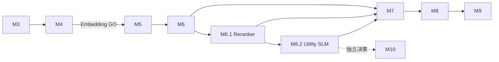

# Vault Coach 1.5 后续开发路线：逐步内置 AI 基础设施

## 1. 本轮规划依据与当前状态

直接依据：[[VC知识库总览/专题教程-内置LLM运行时/06-实现顺序|06-实现顺序]]。产品主线调整为：

> Embedding → Reranker → Utility SLM → 可选的主生成 LLM。用户选择知识范围，按需准备本地模型，再连接自己喜欢的主 LLM。

这里的“四个模型”是四类职责，不要求四个模型同时常驻，也不要求全部完成后才发布。首次准备需要下载授权；权重准备好且设备通过验证后才承诺离线推理。

2026-10-23 静态核对：根目录 manifest/package 仍为 1.5.2，最低 Obsidian 1.11.4，支持移动端声明；依赖中尚无 Transformers.js。M2/M2.1 的设置分层、范围选择和 UI 偏好已存在；M3 的新 provider/索引代际与统一 LocalAIRuntime 尚未实现。当前代码中 rewrite/memory 仍属于 ChatProvider，rerank 是可选远程调用或启发式降级。

此次只更新规划；文中的新路径、接口和测试是待实现设计，不代表已通过运行验证。旧 M3 中的历史测试记录保留原日期，不作为今天的验收结果。原 M4–M9 与总览保存在 [[历史规划-2026-10-23调整前/README|历史规划]]。

## 2. 实施顺序

保留已有文件名和 M7–M9 的编号以维持引用，在 M6 后插入 M6.1/M6.2。M10 为独立可选扩展。

| 顺序 | 文档 | 本阶段交付及依赖 |
| --- | --- | --- |
| 已有基线 | [[里程碑0-基线冻结与产品契约]]、[[里程碑1-产品定位与发现入口]]、[[里程碑2-默认体验与Advanced设置分层]]、[[里程碑2.1-设置页目录选择与信息层级优化]] | 保留当前成果与用户偏好，重新核对实际版本 |
| 共用设计 | [[01-LocalAIRuntime架构与跨里程碑契约]] | 四类职责、资源身份、降级、下载授权与生命周期 |
| M3 | [[里程碑3-EmbeddingProvider解耦与索引指纹]] | Embedding 解耦和安全代际；补齐 rerank/utility 的兼容接缝 |
| M4 | [[里程碑4-内置Embedding技术验证与多语言基准]] | 先验证运行地点、Worker/WASM 发布资产，再确定 Embedding 模型；建立后续两类模型评测协议 |
| M5 | [[里程碑5-内置Embedding运行时与模型缓存]] | 统一运行时的资源、缓存、任务状态，第一种真实能力为 Embedding |
| M6 | [[里程碑6-Worker化与可观测索引进度]] | Worker 生产化、调度、取消、索引进度；通过后内置 Embedding 可进入发布验收 |
| M6.1 | [[里程碑6.1-内置Reranker与检索质量验证]] | Cross-encoder adapter、候选预算、质量/延迟 Gate |
| M6.2 | [[里程碑6.2-UtilitySLM与辅助任务路由]] | 查询改写和记忆抽取本地化；结构化校验和失败隔离 |
| M7 | [[里程碑7-首次启动SetupWizard与首个成功动作]] | 同一向导按已通过 Gate 的能力提供准备和跳过 |
| M8 | [[里程碑8-迁移兼容与跨平台加固]] | 每个增量都经过旧用户/移动端/离线回归 |
| M9 | [[里程碑9-CICD发布与持续更新]] | 每个增量都用实际版本号通过发布门禁 |
| M10 可选 | [[里程碑10-可选内置主生成LLM技术验证]] | 独立生成模型实验；不阻塞前面三种能力交付 |

依赖和发布出口：



图中的多个 M7 入口代表重复执行验收，不能理解为 M7 必须等待所有模型完成。M6.1 NO-GO 后可保留启发式；M6.2 NO-GO 后可关闭改写或保留用户明确选择的外部辅助路径。只有完成相应门禁才在该设备上显示可用。

## 3. 增量交付与版本

| 增量 | 纳入功能 | 出口 |
| --- | --- | --- |
| A | M3–M6：内置 Embedding | M7 基础向导 + M8 + M9 |
| B | A + M6.1：内置 Reranker | 重新执行 M7–M9 的受影响部分 |
| C | B + M6.2：本地 rewrite/memory | 再执行 M7–M9 |
| D 可选 | M10：内置主生成 | 独立质量和平台证据，再进入 M7–M9 |

这是工程增量命名，不预先分配 1.5.3/1.5.4 等版本。发布前比较已发布 tag，选择递增版本，禁止将已存在的 1.5.2 改回旧计划中的 1.5.0。

## 4. 需要修正的产品假设

- Embedding/Reranker 是 encoder 类职责，Utility/Main Chat 是生成职责，输入输出与预算不能用一个通用 `generate()` 模糊处理。
- M6.1 完成只能证明召回和重排可本地执行。当前 rewrite 使用聊天模型，若配置云端，查询前处理仍会外发。完整本地检索前处理需要 M6.2 本地改写，或用户关闭改写。
- “只配一个主 LLM API”是减少配置项的目标。主回答、考试和目前的概念抽取仍可能向选定服务发送内容。
- “200M–600M”“三模型不到 1 GB”是探索范围与体积预算假设，不是质量或设备支持的结论；模型下载字节与峰值运行内存分开测量。
- 小输出不保证任务简单。中文改写忠实度、记忆无捏造和 JSON 校验必须单独评估。
- WebGPU → WASM 只在同一模型策略可用且预算允许时回退；若 dtype/模型改变导致 embedding 空间变化，必须走 M3 失效流程。
- 不在插件启动时自动下载。用户点击“准备本地搜索”并看到来源、大小、用途后，程序可自动完成后续步骤。

## 5. 实施与协作方式

每个步骤采用：行为刻画 → 最小端口 → adapter → consumer → 故障注入 → 实机验证。单次 PR 聚焦一个可验证边界；详细范围见各里程碑。不要求为纯文案或机械变更编写重复测试。

开始前记录工作区与基线：

```bash
git status --short
git rev-parse HEAD
node --version
npm --version
npm ci
npm run lint
npm test
npm run build
```

在自己的实现分支执行，保护用户未提交改动；当前文档编辑没有执行这些代码门禁。源文件路径以本文核对结果为起点，新建路径在各文档标注“拟新增”。

每个 PR 记录：问题、输入输出契约、数据影响、内部/外部依赖、验证命令和结果、设备证据、失败恢复、下一步输入。没有实际执行的项目写“未执行”，不能填 PASS。

## 6. 共用 Gate 与学习路线

| 阶段 | 工程技能 | 必须留下的证据 |
| --- | --- | --- |
| M3 | 依赖注入、contract tests、schema、崩溃恢复 | provider 与存储故障矩阵 |
| M4 | 基准、预登记、profiling、ADR | 锁定版本、语料、指标、GO/NO-GO |
| M5/M6 | 缓存、异步状态、Worker、调度 | 发布资产 smoke、取消、离线、内存与 trace |
| M6.1 | 排名评估、候选映射、截断预算 | NDCG/MRR、长文和多语言切片 |
| M6.2 | 结构化生成、忠实度、安全提交 | schema、语义失败与记忆事务证据 |
| M7/M8 | 状态机、迁移、端到端 UX | 新安装/旧用户、模型缺失、真机回归 |
| M9 | CI/CD、供应链、发布恢复 | tag/资产哈希、安装与升级记录 |

日志仅记录 opaque job/request ID、能力、阶段、数量、耗时和错误码，不记录笔记、问题、答案、记忆正文或凭据。OpenTelemetry SDK 是后续实现选项，trace/span 思想可以先通过轻量日志端口落地。

## 7. 文档权威与后续维护

本总览与 [[01-LocalAIRuntime架构与跨里程碑契约]] 规定新路线；每个里程碑规定具体实现与 Gate；历史目录只解释原决策。源想法文档保留原文，不将其中的版本宣传或大小估计直接转为默认配置。

完成时将对应 status 改为 implementation-complete 并填写实际记录。默认值切换按能力、按设备、按新旧安装分别决定。模型协议和运行时文档见共用契约末尾官方资料；具体 npm 版本由 M4 实验固定。
