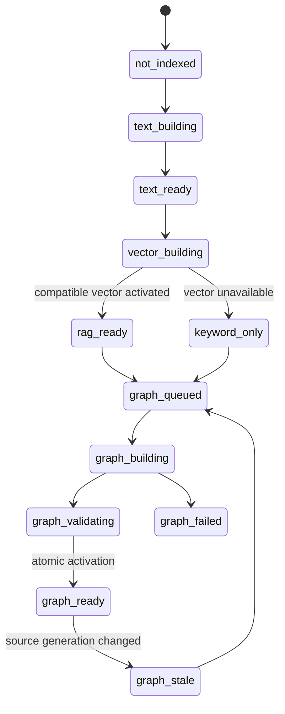
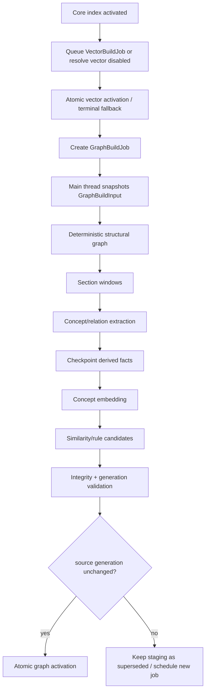

# GraphRAG：后台构建、检索融合与评测契约

## 1. 为什么需要这份契约

Vault Coach 已经有文本索引、向量索引、确定性结构图谱、可选语义概念图谱和 Learning Graph，但这些能力的“存在”不等于 GraphRAG 已经实现。当前 Ask 仍只从 keyword/vector/hybrid 通道取回 chunk；图谱主要服务可视化、掌握度、推荐和考试规划。

本文件固定两个跨里程碑边界：

1. 基础 RAG 先达到可用状态，图谱在独立后台作业中构建；
2. GraphRAG 只消费已激活、有证据且与当前索引代际兼容的图谱事实。

M6 实现第一条的基础设施，M6.3 实现第二条的问答与考试消费。本文是技术详解，不代表功能已实现。

## 2. 外部方法的可复用部分与不照搬部分

### 2.1 LightRAG

LightRAG 将实体/关系抽取、图结构与向量表示结合，并区分面向具体实体的 low-level retrieval 与面向主题关系的 high-level retrieval。其当前文件流水线还允许对单个文档跳过实体关系抽取，同时保留 chunk 向量索引供 naive/mix retrieval 使用；这一点证明基础 RAG 与图谱能力可以在产品状态上分离。

- [LightRAG 论文（ACL Anthology）](https://aclanthology.org/2025.findings-emnlp.568/)
- [LightRAG 文件处理流水线](https://github.com/HKUDS/LightRAG/blob/main/docs/FileProcessingPipeline.md)

Vault Coach 不直接复制 LightRAG 的服务端多进程拓扑，也不允许未审核模型关系直接成为学习事实。可复用的是：分阶段状态、增量处理、低层/高层查询区分、向量与图联合召回、失败可恢复和文档级处理身份。

### 2.2 Microsoft GraphRAG

Microsoft GraphRAG 的标准索引把 chunk、图抽取、claim、community、report 和多类 embedding 拆成工作流；查询侧区分 Basic、Local、Global 与 DRIFT。Local Search 将图实体关系和原始 text units 组合，Global Search 依赖 community report，成本和用途不同。

- [GraphRAG 索引架构](https://microsoft.github.io/graphrag/index/architecture/)
- [GraphRAG Query Engine](https://github.com/microsoft/graphrag/blob/main/docs/query/overview.md)
- [GraphRAG 项目说明](https://github.com/microsoft/graphrag)

Vault Coach 首版只实现 Basic + Local 风格的有界图召回，不实现 community report/global map-reduce。官方仓库也明确提示 GraphRAG 是研究项目且索引成本高，因此必须用本项目评测集验证，不能把外部结论直接当作产品收益。

## 3. 能力状态而不是一个 ready 布尔值



`text_ready` 表示 keyword RAG 可用；`rag_ready` 表示兼容向量代际也已激活；`graph_ready` 只增加图增强能力。任何图状态都不得把已经可用的基础检索退回 unavailable。

## 4. 四类身份与三个原子代际

### 4.1 CoreIndexGeneration

至少包含：

- source scope 与 source inventory hash；
- parser/chunker 版本；
- chunk identity/schema；
- keyword snapshot identity；
- createdAt 与完整性摘要。

CoreIndexGeneration 不冻结 embedding provider。改变 embedding 模型时，当前 keyword generation 仍可服务，只使引用它的 VectorGeneration 失效或重建。

### 4.2 VectorGeneration

至少包含：

- `vectorGenerationId`；
- `sourceCoreGenerationId`；
- embedding fingerprint、dimension、dtype 与 vector schema；
- included/failed chunk 摘要；
- active/staging 状态与完整性摘要。

只有所有向量能解析回 source Core 的 chunk、数量/维数/有限值/fingerprint 校验通过且 source Core 未改变时，才能原子激活。

### 4.3 GraphGeneration

至少包含：

- `graphGenerationId`；
- `sourceCoreGenerationId`；
- deterministic graph schema；
- extraction policy：provider/model/prompt/schema；
- concept embedding fingerprint；
- governance revision；
- included/skipped/failed section 清单摘要；
- active/staging 状态与完整性摘要。

图生成完成不等于可以激活。只有 `sourceCoreGenerationId` 仍等于当前 active core generation、所有证据 chunk 可解析、完整性通过并写完 manifest/shard 后，才能原子切换 active graph pointer。

### 4.4 TaskPolicyIdentity

查询策略另有身份：anchor、允许边类型、hop、候选预算、融合方式、rerank、上下文裁剪和考试证据策略。改变查询策略不重建图；改变抽取 prompt/schema 或 concept embedding 语义通常需要重建 GraphGeneration。

## 5. 后台 VectorBuildJob 与 GraphBuildJob 契约



### 5.1 Job 字段

```text
jobId
jobType = vector-build / graph-build
sourceCoreGenerationId
embeddingPolicyId / graphPolicyId
workerEpoch
phase
createdAt / startedAt / updatedAt
processed / total / failed / queued
checkpointId
terminalReasonCode
```

持久化的是作业事实和 checkpoint，不是 Promise、AbortController 或 Worker 对象。重启后按 generation 和 checkpoint 判断 resume/restart/supersede。VectorBuildJob 成功只激活 VectorGeneration；GraphBuildJob 成功只激活 GraphGeneration，两者都不能回写或替换 active CoreIndex。

### 5.2 主线程、Scheduler 与 Worker 分工

| 工作 | 所有者 |
| --- | --- |
| Vault/Obsidian API 读取、范围授权 | 主线程 adapter |
| 创建不可变 GraphBuildInput | 应用层协调器 |
| 纯确定性构图/大规模排序 | 先在主线程测量；出现 Long Task 后才迁 Graph Worker |
| Ollama/云端抽取 | 后台 scheduler + 异步 transport；不因“后台”额外创建 Worker |
| 内置 Utility 抽取 | LocalAIRuntime 的 utility role，通过共享 scheduler |
| concept embedding | embedding role，后台低优先级 |
| store 写入、完整性和 active pointer | 确定性应用服务 |

Worker 不能接收 Obsidian `App/Vault`、API key、全部设置或 store 实例。只传完成任务必要的文本窗口、稳定 ID、策略短 ID和可转移二进制。

### 5.3 调度

默认优先级：前台 Ask query embedding/rerank/rewrite > 当前考试交互 > 用户显式索引 > 后台图谱抽取/embedding > turn 后记忆。后台任务在 Section/batch 边界让出；有最大等待，不能永久饥饿。

## 6. GraphRAG 检索契约

### 6.1 输入

```text
originalQuery
optional faithfulRewrittenQuery
scope
activeCoreGenerationId
activeGraphGenerationId
policyId
budgets: anchors / hops / nodes / edges / chunks / tokens / timeout
```

### 6.2 算法

```text
baseline = keyword/vector/hybrid(query)
anchors = exactAliasMatch(query) ∪ conceptVectorTopK(query)
validatedAnchors = threshold + scope + generation checks
paths = boundedExpand(validatedAnchors, confirmedAllowedEdges, budgets)
graphChunks = resolveCurrentEvidenceChunks(paths)
fused = stableFuse(baseline, graphChunks)
ranked = optionalRerank(fused)
context = diversityAndTokenBudget(ranked)
```

不允许：

- 直接把不同通道不可比的 raw score 相加；
- 使用 pending/rejected relation；
- 用图节点描述替代来源 chunk 作为引用；
- 因 graph channel 失败而丢弃 baseline candidate；
- 在查询时写图、自动确认关系或改变用户治理决策。

### 6.3 路径与证据

每个 graph candidate 至少保留：

```text
chunkId + locator
anchorConceptIds
relationPathIds
hopCount
relationTypes
channel = graph
graphGenerationId
```

路径只解释“为什么找到该 Chunk”，不证明 Chunk 中的每一句话。最终答案仍以发送给模型的来源正文和引用为准。

## 7. 问答准确度契约

按问题类型决定图通道价值：

| 问题类型 | 默认策略 |
| --- | --- |
| 直接事实/文件定位 | baseline 优先，图只补充，不扩大过多上下文 |
| 概念解释 | 概念 anchor + 直接 evidence |
| 比较 | 两端概念分别取 evidence，再取已确认关系 |
| 先修/依赖/过程 | 允许关系方向约束的 1–2 hop |
| 跨 Section 多跳 | graph path 找候选，rerank 决定最终 chunk |
| 全库主题总结 | 首版不承诺；未来 community/global 独立 Gate |
| 无答案 | 不因为图连通而猜答案；保持拒答/无候选策略 |

## 8. 考试准确度契约

GraphRAG 对考试的价值不是“生成更难的问题”，而是让目标、题干、答案和评分证据更一致。

`ExamEvidencePack` 至少包含：

```text
planId / scopeSignature / graphGenerationId
targetConceptId
confirmedPrerequisiteIds
sourceChunkIds + locators
allowedQuestionIntents
forbiddenUnsupportedClaims
tokenBudget
```

规则：

- 每道题只有一个主要 target concept；比较题可以声明第二端点；
- 题干、参考答案和评分要点必须可追溯到 evidence pack；
- prerequisite 只能来自 effective confirmed relation；
- 相似关系可用于去重或发现候选，不可自动当先修关系；
- 证据不足时降低题数或回退普通范围出题；
- exam plan 和 evidence revision 在会话开始时冻结；
- 自由回答评价必须区分“来源事实错误”和“表达不完整”。

## 9. 评测设计

### 9.1 问答

| 层 | 指标 |
| --- | --- |
| 召回 | gold evidence Recall@K、candidate Recall@K、NDCG/MRR、graph path success |
| 上下文 | evidence precision、重复率、token 利用率、来源多样性 |
| 答案 | 要点覆盖、事实正确、引用 precision/recall、无依据陈述、无答案拒答 |
| 系统 | p50/p95、峰值内存、失败率、fallback 率、graph coverage |

### 9.2 考试

| 层 | 指标 |
| --- | --- |
| 规划 | 目标概念覆盖、先修选择准确率、薄弱概念命中 |
| 出题 | source-backed rate、重复率、歧义率、多答案率、难度分布 |
| 答案/评分 | 参考答案支持率、rubric 覆盖、客观题确定性、自由回答评分一致性 |
| 学习闭环 | assessment 到 concept 绑定准确率、错误掌握度写入率、回退率 |

所有比较使用相同知识库、相同主生成模型、相同候选/上下文预算或明确报告差异。至少比较 baseline、baseline+graph、baseline+graph+reranker。LLM-as-judge 只能作为辅助，必须保留 gold evidence、规则检查和人工抽样。

## 10. 隐私、日志与故障边界

- 语义图谱默认关闭；外部抽取必须有明确授权和可见发送范围；
- 本地失败不得自动外发正文；
- 日志只记录 job/generation/policy 短 ID、阶段、数量、耗时、预算和错误码；
- graph build 失败不改变 core RAG ready；
- active graph 不在 staging 构建期间原地修改；
- clear/delete 与查询必须有一致性边界，避免读取半删除状态；
- 用户关闭 View 只取消订阅；取消图谱任务、清缓存和插件 unload 是不同动作；
- 用户确认、拒绝、合并、alias 和手工关系属于治理事实，后台重建不得覆盖。

## 11. 实施顺序

1. M6：先激活 CoreIndex，再依次后台运行 VectorBuildJob 和 GraphBuildJob，并拆分 capability state、generation 与 scheduler；
2. M6.1：可选 reranker；
3. M6.2：可选忠实 query rewrite 和 utility 基础设施；
4. M6.3：只读 GraphRAG 检索、问答融合和考试 evidence pack；
5. 质量 Gate 通过后重新进入 M7–M9；
6. community/global/DRIFT 类能力如确有收益，再单独立项，不在首版预埋已实现声明。

