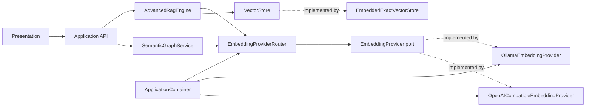

---
tags:
  - VaultCoach
  - v1.5
  - 里程碑3
  - EmbeddingProvider
  - 索引指纹
  - 架构重构
status: planned
updated: 2026-10-20
baseline: 1.5.2
depends-on:
  - 里程碑2.1-设置页目录选择与信息层级优化.md
next:
  - 里程碑4-内置Embedding技术验证与多语言基准.md
---

# 里程碑 3：Embedding Provider 解耦与索引指纹

> 本文以 Vault Coach 1.5.2 的实际代码为基线。它既是技术设计，也是新人开发手册。
> 请按 Step 0 到 Step 10 的顺序实施，不要先改 UI，也不要在一次提交中同时完成所有重构。

## 1. 里程碑目标与交付边界

### 1.1 用户目标

本阶段不直接增加新的 embedding 模型。用户可见的结果是：

1. Ollama 与 OpenAI-compatible embedding 继续可用；
2. 用户切换 provider、endpoint、模型或向量语义配置后，旧向量不会与新查询向量混用；
3. 向量不可用、已过期或重建失败时，Ask 仍能使用关键词检索；
4. 旧用户升级后保留原有设置、文本索引、对话、考试、掌握度和语义图谱治理决策；
5. 重建失败时，最后一个完整且兼容的向量代际不被半成品覆盖；
6. Ask 和语义概念图谱通过同一个 provider 选择入口生成 embedding。

### 1.2 工程目标

- 用领域层 `EmbeddingProvider` port 表达应用需要的 embedding 能力；
- 把 Ollama 与 OpenAI-compatible 网络细节放进 infrastructure adapter；
- 由 `ApplicationContainer` 统一创建和注入 provider；
- 用结构化 fingerprint 描述向量的语义兼容条件；
- 在持久化层保存完整 fingerprint，并在搜索前再次校验；
- 为全量构建提供 build then activate 的代际切换；
- 用同一套 contract tests 约束不同 provider；
- 将错误、诊断、用户文案和底层 cause 分开。

### 1.3 学习目标

新人完成本阶段后，应能解释并实践：

- 依赖反转：业务代码依赖能力接口，不依赖 HTTP 服务或第三方 SDK；
- composition root：具体实现只在应用启动装配处出现；
- contract test：多个 adapter 必须满足同一组可观察行为；
- schema 演进：区分用户事实、可再生派生数据和兼容读取；
- 崩溃安全发布：先完成并校验新代际，再切换可恢复的 active pointer；
- graceful degradation：向量失败只降低检索能力，不让整个 Ask 失效；
- 可观测性：日志能定位 provider、阶段和失败类别，同时不记录用户文本或凭据。

### 1.4 本阶段范围

本阶段不接入 Transformers.js、WebGPU、WASM、内置模型、模型缓存、远程向量数据库或 ANN 后端。它不修改持久化设置键，也不重写聊天、考试和 rerank provider。内置 embedding 属于 M4/M5，Worker 与更大规模的索引构建属于 M6。

## 2. 1.5.2 当前实现与问题定位

开始开发前，先理解真实调用链：

```text
SettingsRepository
        │
        ▼
ApplicationContainer
        ├── AdvancedRagEngine ── new LocalModelClient()
        │        ├── embedTexts() ── Ollama / OpenAI-compatible
        │        └── VectorStore ── manifest.json + shard-000001.bin
        │
        └── SemanticGraphService
                 └── SemanticEmbeddingGateway = 另一个 LocalModelClient
```

### 2.1 已确认的耦合点

| 当前位置 | 当前行为 | 风险 |
| --- | --- | --- |
| `src/model-client.ts` | 同时承担 chat、JSON、query rewrite、rerank、embedding | 任一 embedding 修改都会扩大回归面 |
| `src/rag-engine.ts` | 构造函数内部 `new LocalModelClient(...)` | 测试无法只注入 embedding fake，业务层了解具体 client |
| `src/rag-engine.ts` | 自己读取 `embeddingProvider` 和模型名 | provider 选择规则分散 |
| `src/rag-engine.ts` | 通过 `consumeOllamaEmbeddingCpuFallbackUsed()` 读取具体实现状态 | Ollama 诊断泄漏到业务接口 |
| `src/app/semantic-graph/semantic-graph-service.ts` | 定义另一套 `SemanticEmbeddingGateway` | Ask 与 graph 可能形成两套契约和签名规则 |
| `src/app/vault-coach-runtime.ts` | 用 `provider + baseUrl + model` 字符串判断兼容 | 未覆盖维数、归一化、pooling、预处理和实现版本 |
| `src/vector-store.ts` | schema v1 仅保存维数、记录和 shard | 无法证明向量由哪个语义配置生成 |
| `src/vector-store.ts` | 维数不一致时跳过单条记录 | 可能形成部分成功的混合索引 |
| `src/vector-store.ts` | 直接写 shard，再直接写 manifest | 中断时可能留下不匹配的文件 |
| `AdvancedRagEngine.rebuildVectorIndex()` | 构建前先 `clear()` | 新构建失败会丢掉最后一个可用索引 |
| `KnowledgeBaseSnapshot` | version 3 保存 `embeddingModel: string \| null` | 文本快照重复持有弱向量签名，容易与 vector manifest 分叉 |

### 2.2 必须保留的现有能力

- `retrievalPreference = auto` 在向量可用时解析为 hybrid，不可用时解析为 keyword；
- 向量请求失败时，本次 Ask 回退到 keyword；
- Ollama 优先使用 `/api/embed`，必要时兼容 `/api/embeddings`；
- Windows Ollama embedding GPU 错误可重试 CPU，并向用户提示；
- 文本索引与向量索引分别标记 dirty；
- M2.1 已保存的 provider、endpoint、模型和高级设置原样读取；
- 语义图谱默认关闭，模型派生事实与用户治理决策分开。

### 2.3 当前基线证据

本文修订时的已验证基线：

```text
branch: master
version: 1.5.2
lint: PASS
test: PASS, 59 files / 245 tests
build: PASS
```

开发者必须在自己的分支重新执行基线命令。以上结果只证明本文修订时的基线状态。

## 3. 目标架构与依赖规则

### 3.1 目标调用关系



依赖方向保持：

```text
presentation → app → domain ← infrastructure
                    ↑
             composition root 负责把两侧接起来
```

### 3.2 每一层知道什么

| 层 | 可以知道 | 不应知道 |
| --- | --- | --- |
| domain | embedding 请求、结果、fingerprint、错误类别、向量存储契约 | Obsidian、URL、API key、Ollama 路径、设置页 |
| app | 当前用例、provider 路由、兼容状态、fallback、构建编排 | HTTP 响应 JSON、Authorization header、文件真实路径 |
| infrastructure | HTTP、Ollama/OpenAI 响应、Vault adapter、manifest/shard 格式 | Ask UI 文案、业务页面、用户操作流程 |
| presentation | 状态、动作、脱敏错误摘要 | provider 实例、磁盘文件、原始 HTTP cause |
| composition root | 所有具体实现的创建与注入 | 业务判断 |

### 3.3 三个单一来源

1. provider 选择只有一个来源：`EmbeddingProviderRouter`；
2. 向量兼容性只有一个来源：持久化 manifest 中的完整 fingerprint；
3. 索引激活只有一个来源：active generation pointer。

`AdvancedRagEngine`、`SemanticGraphService`、Runtime 和设置页不得分别拼接签名字符串。

### 3.4 用户事实与派生数据的边界

| 数据 | 分类 | 不兼容时的动作 |
| --- | --- | --- |
| 设置 | 用户偏好 | 兼容迁移并保留 |
| Markdown/PDF | 用户源事实 | 不修改 |
| 对话、考试、Assessment | 用户学习数据 | 不删除 |
| M3 governance decisions | 用户决策事实 | 保留审计记录 |
| 文本 chunk / keyword index | 可再生派生数据 | 只在来源或解析设置变化时失效 |
| RAG vectors | 可再生派生数据 | fingerprint 不兼容时标 stale |
| semantic embeddings / similarity candidates | 可再生模型数据 | 失效并重算，不清空整个语义图谱 |

## 4. 核心契约设计

### 4.1 Provider ID 命名

当前 `src/app/config/settings-types.ts` 已有名为 `EmbeddingProvider` 的字符串联合类型。引入接口后会产生同名歧义。将设置值类型改名为 `EmbeddingProviderId`，持久化字段仍叫 `embeddingProvider`：

```ts
// 定义在 domain/embedding，由 settings 以 type-only import 复用。
export type EmbeddingProviderId = "ollama" | "openai-compatible";

export interface VaultCoachSettings {
    embeddingProvider: EmbeddingProviderId;
}
```

这是 TypeScript 类型重命名，不是设置 schema 变更。M5 接入内置模型时再扩展 ID 联合类型。

### 4.2 Provider port

新建 `src/domain/embedding/embedding-provider.ts`：

```ts
export type EmbeddingPurpose = "document" | "query" | "graph";

export interface EmbeddingPreprocessingDescriptor {
    document: string;
    query: string;
    graph: string;
}

export interface EmbeddingProviderDescriptor {
    providerId: EmbeddingProviderId;
    endpointIdentity: string;
    model: string;
    revision: string;
    outputDtype: "float32";
    pooling: string;
    normalization: string;
    preprocessing: EmbeddingPreprocessingDescriptor;
    implementationVersion: number;
}

export interface EmbeddingFingerprint extends EmbeddingProviderDescriptor {
    dimension: number;
}

export interface EmbeddingRequest {
    texts: readonly string[];
    purpose: EmbeddingPurpose;
    signal?: AbortSignal;
}

export interface EmbeddingDiagnostics {
    providerId: EmbeddingProviderId;
    transport: "ollama-modern" | "ollama-legacy" | "openai-compatible";
    latencyMs: number;
    attempts: number;
    cpuFallbackUsed: boolean;
    revisionVerified: boolean;
}

export interface EmbeddingBatch {
    vectors: readonly Float32Array[];
    fingerprint: EmbeddingFingerprint;
    diagnostics: EmbeddingDiagnostics;
}

export interface EmbeddingProvider {
    readonly id: EmbeddingProviderId;
    describe(): EmbeddingProviderDescriptor;
    embed(request: EmbeddingRequest): Promise<EmbeddingBatch>;
}
```

契约说明：

- `describe()` 是本地、无网络、无副作用操作，插件启动不会因模型服务离线而阻塞；
- endpoint identity 是去除 userinfo、query、fragment 并统一尾部斜线后的 canonical endpoint；它只在本地 manifest 中比较，不进入普通日志和 UI；
- `preprocessing` 保存三种 purpose 的完整规则，因此 document/query 可使用不同前缀并保持同一空间 fingerprint；
- 远程协议无法稳定报告 revision 时使用明确值 `unreported`，并令 `revisionVerified = false`；
- fingerprint 能阻止已知配置混用。远端在相同模型名下静默替换权重仍是协议限制，状态页与实施记录要说明；
- `texts` 为空时抛出 `invalid-request`；
- 成功结果与输入一一对应，不返回部分成功。

M3 的现有 adapter 可先使用以下明确值：`outputDtype = "float32"`、`pooling = "provider-defined"`、`normalization = "consumer-l2-v1"`，三种 preprocessing 都是 `identity-v1`。这些值描述当前可证明的行为；M5 引入 E5 类前缀、明确 pooling 或量化输出时再更新相应字段与 `implementationVersion`。

### 4.3 Fingerprint 比较规则

新建 `src/domain/embedding/embedding-fingerprint.ts`，只放纯函数：

```ts
export function canonicalizeEmbeddingFingerprint(
    fingerprint: EmbeddingFingerprint,
): string;

export function areEmbeddingFingerprintsEqual(
    left: EmbeddingFingerprint,
    right: EmbeddingFingerprint,
): boolean;

export function isFingerprintCompatibleWithDescriptor(
    stored: EmbeddingFingerprint,
    current: EmbeddingProviderDescriptor,
): boolean;

export function getEmbeddingFingerprintDisplayId(
    fingerprint: EmbeddingFingerprint,
): string;
```

实现要求：

1. 按固定字段顺序构造 plain object，不依赖对象插入顺序；
2. 完整 canonical JSON 是兼容判断依据，短 hash 只用于日志和 UI；
3. `dimension` 必须是正整数；
4. 任一语义字段变化都判为不兼容；
5. device、latency、batch size、CPU fallback 不进入 fingerprint；
6. API key、用户文本、原始 endpoint 不进入 fingerprint；
7. `stableSemanticHash` 只有 32 bit，可用于显示 ID，不能替代完整结构比较。

### 4.4 结构化错误

在 domain 定义稳定错误类别，adapter 将底层异常转换为这些类别：

```ts
export type EmbeddingErrorCode =
    | "invalid-request"
    | "auth"
    | "network"
    | "timeout"
    | "cancelled"
    | "unsupported-model"
    | "malformed-response"
    | "dimension-mismatch"
    | "fingerprint-mismatch"
    | "unknown";

export class EmbeddingError extends Error {
    readonly code: EmbeddingErrorCode;
    readonly providerId: EmbeddingProviderId;
    readonly causeValue?: unknown;
}
```

`message` 面向开发诊断，UI 使用 i18n 映射后的安全摘要。响应 body、Authorization header和请求文本不得直接进入错误消息。

### 4.5 Provider Router

新建 `src/app/embedding/embedding-provider-router.ts`。Router 只负责选择，不负责 HTTP 或存储：

```ts
export interface EmbeddingProviderFactoryMap {
    ollama(): EmbeddingProvider;
    "openai-compatible"(): EmbeddingProvider;
}

export class EmbeddingProviderRouter {
    getActiveProvider(): EmbeddingProvider;
    getActiveDescriptor(): EmbeddingProviderDescriptor;
}
```

`ApplicationContainer` 注入 factory map。app 层无需导入 infrastructure adapter，测试也能替换为 fake。

Router 可以缓存当前 provider，但缓存 key 必须来自 provider ID、canonical endpoint、model 和实现版本。API key 通过 getter 在请求时读取，不能进入缓存 key 或 descriptor；provider、endpoint 或 model 改变时创建新 adapter。

### 4.6 Adapter 行为

Ollama adapter 保持 1.5.2 的兼容顺序：

```text
/api/embed
  ├── 成功 → 校验并返回
  ├── 特定 GPU 后端错误 → num_gpu: 0 重试
  └── 接口不支持 → /api/embeddings 逐条兼容
                         └── 特定 GPU 后端错误 → CPU 重试
```

OpenAI-compatible adapter 需要：

- 请求 `/embeddings`；
- 按响应 index 恢复输入顺序；
- 响应条数、维数、有限数校验失败时整批失败；
- 401/403 映射为 `auth`，模型不存在映射为 `unsupported-model`；
- API key 只在 transport 调用边界读取，不进入设置导出、fingerprint 或日志。

Obsidian `requestUrl` 不保证能中断已经发出的请求。本阶段采用协作式取消：发请求前、响应后和 batch 之间检查 signal；取消后的结果不落盘、不激活。文档和 UI 不宣称网络请求可立即取消。

## 5. 向量索引格式与可恢复切换

### 5.1 构建流程

```text
读取当前 active generation
        ↓
在内存中生成并验证全部向量
        ↓
写入新的 generation 目录
        ↓
重新读取并校验 manifest + shard
        ↓
最后切换 active pointer
        ↓
清理更旧的 generation
```

### 5.2 建议目录

```text
knowledge-index/vectors/
├── active.json
├── active.json.bak
└── generations/
    ├── <generation-id>/
    │   ├── manifest.json
    │   └── shard-000001.bin
    └── <previous-generation-id>/
        ├── manifest.json
        └── shard-000001.bin
```

`generation-id` 是本地构建 ID，不包含模型名、路径或用户内容。

active pointer 的切换顺序为：写 `active.json.next`、回读校验、把旧 `active.json` 移到 `.bak`、把 `.next` 移到 `active.json`。若第二次 rename 失败，立即用 `.bak` 恢复；启动时若 active 缺失或损坏，也先校验 `.bak`。部分 Vault adapter 不承诺覆盖已有目标文件的原子 rename，因此本文把整体保证称为“崩溃可恢复”，不能在实施记录中夸大为跨文件事务。

### 5.3 Manifest v2

```ts
export interface EmbeddedVectorManifestV2 {
    schemaVersion: 2;
    backend: "embedded-exact";
    generationId: string;
    dimension: number;
    fingerprint: EmbeddingFingerprint;
    vectorCount: number;
    shardId: "shard-000001.bin";
    shardByteLength: number;
    records: PersistedVectorRecord[];
    createdAt: number;
}
```

最低完整性检查：

- `fingerprint.dimension === manifest.dimension`；
- `records.length === vectorCount`；
- `shardByteLength === vectorCount * dimension * 4`；
- 实际读取字节数等于 `shardByteLength`；
- 所有 `chunkId` 唯一；
- manifest schema 与 backend 受支持；
- active pointer 指向的 generation 存在且完整。

### 5.4 VectorStore 契约调整

修改 `src/domain/retrieval/retrieval-types.ts`：

```ts
export interface VectorStore {
    initialize(): Promise<void>;
    replaceAll(
        records: readonly VectorRecord[],
        fingerprint: EmbeddingFingerprint,
    ): Promise<VectorStoreStats>;
    upsert(
        records: readonly VectorRecord[],
        fingerprint: EmbeddingFingerprint,
    ): Promise<void>;
    remove(chunkIds: readonly string[]): Promise<void>;
    search(
        queryVector: Float32Array,
        queryFingerprint: EmbeddingFingerprint,
        options: VectorSearchOptions,
    ): Promise<VectorStoreHit[]>;
    inspect(): Promise<VectorStoreInspection>;
    clear(): Promise<void>;
    getStats(): Promise<VectorStoreStats>;
    close(): Promise<void>;
}
```

其中 inspection 使用存储层事实，不混入用户设置：

```ts
export interface VectorStoreInspection {
    status: "absent" | "ready" | "legacy" | "corrupt";
    fingerprint: EmbeddingFingerprint | null;
    stats: VectorStoreStats;
    reasonCode?: "unsupported-schema" | "missing-file" | "invalid-manifest" | "invalid-shard";
}
```

关键不变量：

- `replaceAll` 全部成功或 active generation 不变；
- `upsert` 的 fingerprint 与 active generation 完全相等，否则整批拒绝；
- `search` 在 dot product 前比较 query fingerprint；
- 维数不一致抛出结构化错误，不跳过记录继续；
- `VectorStore` 不调用 provider，只验证和存储调用方提供的事实。

`VectorStoreInspection` 只返回 `absent | ready | legacy | corrupt`、可选 fingerprint 和脱敏完整性原因。Runtime 根据 inspection 与当前 descriptor 计算 `VectorCompatibilityStatus`，不得越过 Store 直接读取 manifest 文件。

### 5.5 RAG 构建事务

一次构建固定一个 provider descriptor。第一批建立 `buildFingerprint`，后续批次必须完全相同；全部输入必须得到向量；所有向量通过有限数和维数校验后，才调用 `replaceAll`。任何失败都丢弃本次构建结果，active generation 不变。构建成功后再更新 `VectorIndexStats` 和 dirty 状态。

查询阶段若 `VectorStore.search()` 抛出 `fingerprint-mismatch` 或 `dimension-mismatch`，RAG 在回退 keyword 前必须通过注入的 `onVectorIncompatible(reasonCode)` 窄回调通知 `KnowledgeIndexCoordinator`：将 vector compatibility 设为 stale、`vectorStats.ready` 设为 false，并发布一次状态变更。否则本次查询虽然回退成功，下一次仍会反复尝试已知不兼容的索引。

如果超大 Vault 的内存峰值成为问题，M6 再将 staging writer 移入 Worker 或分片流。M3 先保证正确性，并记录性能数据。

## 6. 兼容状态、迁移与降级

### 6.1 状态模型

```ts
export type VectorCompatibilityStatus =
    | "absent"
    | "compatible"
    | "stale"
    | "corrupt";
```

| 状态 | vectorReady | Ask 行为 | 用户动作 |
| --- | ---: | --- | --- |
| absent | false | keyword | 构建索引 |
| compatible | true | 按偏好使用 vector/hybrid | 无 |
| stale | false | keyword | 重建向量 |
| corrupt | false | keyword | 恢复或重建 |

构建状态继续使用现有 `KnowledgeIndexBusyState` 表达。compatibility、dirty 和 busy 是三个正交维度：构建新 generation 时，旧 active generation 可以继续保持 `compatible`；新 generation 激活后再发布新的兼容状态和统计。

启动检查分两层：

1. 启动时用 active fingerprint 与当前 provider descriptor 比较不含 dimension 的字段，不访问网络；
2. 查询时用 provider 返回的完整 query fingerprint 精确比较，再进入 `VectorStore.search()`。

### 6.2 旧 RAG 向量迁移

1.5.2 的 vector manifest schema 为 1，没有完整 fingerprint。升级后：

- 文本 `KnowledgeBaseSnapshot` 继续读取；
- schema v1 向量标记 stale，不参与搜索；
- 插件启动阶段不做同步全量重建；
- Auto 策略回退 keyword；
- 新 generation 成功激活后再清理旧 v1 文件；
- 不为旧向量伪造 fingerprint。

`KnowledgeBaseSnapshot` 建议升级为 version 4：`embeddingModel` 改为可选 legacy 字段；新代码不再把它当兼容依据。`vectorStats` 可以继续写入以支持旧版本读取和诊断，但它只是缓存；启动后必须用 active manifest 的 inspection 覆盖，不能据此把向量判为 ready。

### 6.3 旧语义图 embedding 迁移

`SemanticEmbeddingRecord.modelSignature` 目前只有 `provider:model`。迁移时：

- 新记录增加完整 `embeddingFingerprint`；
- 旧 embedding 视为 stale，不加入 `ConceptSimilarityIndex`；
- 基于旧 embedding 且尚未确认的 similarity candidates 不再作为当前自动候选；
- extraction、concept、model/rule candidates 和 governance decisions 保留；
- 已确认的旧 similarity candidate 继续按用户确认事实投影；拒绝与撤销记录继续保留审计语义；
- 新 fingerprint 进入 similarity candidate 的 algorithm signature。

这部分必须单独写迁移测试。禁止使用 `semanticGraphStore.clear()`，因为该 store 中同时存在用户决策事实。

### 6.4 设置兼容

M3 不提高 settings schema version，除非真的新增持久化设置字段。类型名改为 `EmbeddingProviderId` 不需要 schema 迁移。

继续保留 `embeddingProvider`、`embeddingModel`、`cloudEmbeddingBaseUrl`、`cloudEmbeddingModel`、`llmBaseUrl`、`enableVectorRetrieval`、未知字段 passthrough、保存队列和失败回滚规则。

## 7. 涉及文件与职责

### 7.1 新建文件

| 文件 | 职责 |
| --- | --- |
| `src/domain/embedding/embedding-provider.ts` | port、request/result、descriptor、fingerprint、diagnostics |
| `src/domain/embedding/embedding-fingerprint.ts` | 规范化、校验、完整比较、短显示 ID |
| `src/domain/embedding/embedding-error.ts` | 稳定错误类型与分类 |
| `src/app/embedding/embedding-provider-router.ts` | 根据已验证设置选择 provider |
| `src/infrastructure/embedding/embedding-http-transport.ts` | 可替换的 HTTP transport 边界 |
| `src/infrastructure/embedding/ollama-embedding-provider.ts` | Ollama modern/legacy/CPU fallback adapter |
| `src/infrastructure/embedding/openai-compatible-embedding-provider.ts` | OpenAI-compatible adapter |
| `tests/domain/embedding/embedding-fingerprint.test.ts` | fingerprint 纯函数测试 |
| `tests/domain/embedding/embedding-provider-contract.ts` | 可复用 contract suite |
| `tests/infrastructure/embedding/ollama-embedding-provider.test.ts` | Ollama transport 与 contract |
| `tests/infrastructure/embedding/openai-compatible-embedding-provider.test.ts` | OpenAI transport 与 contract |
| `tests/app/embedding/embedding-provider-router.test.ts` | provider 选择规则 |
| `tests/vector-store.test.ts` | manifest v2、代际切换、损坏恢复 |
| `tests/rag-engine.test.ts` | fake provider、fingerprint 与 fallback |

### 7.2 修改文件

| 文件 | 修改重点 |
| --- | --- |
| `src/app/config/settings-types.ts` | 设置值类型改名，不改磁盘键 |
| `src/model-client.ts` | 移走 embedding HTTP 实现和 CPU fallback 状态 |
| `src/rag-engine.ts` | 注入 provider/router，按 purpose 调用，不判断 provider |
| `src/app/semantic-graph/semantic-graph-service.ts` | 删除本地 gateway，复用 provider，处理新旧 embedding |
| `src/domain/semantic-graph/semantic-graph-types.ts` | semantic embedding 增加版本化 fingerprint |
| `src/domain/retrieval/retrieval-types.ts` | VectorStore 接受 fingerprint，扩展兼容状态 |
| `src/vector-store.ts` | manifest v2、generation、完整性验证、崩溃可恢复激活 |
| `src/persistent-store.ts` | exists/rename/backup/generation 文件操作 |
| `src/infrastructure/storage/storage-types.ts` | snapshot v4 兼容读取 |
| `src/app/application-container.ts` | 唯一装配 provider、router 与 adapter 的地方 |
| `src/app/vault-coach-runtime.ts` | 启动兼容检查、迁移、dirty 和诊断 |
| `src/app/application-api.ts` | 只暴露状态、统计和重建动作 |
| `src/app/index/index-types.ts` | 索引状态契约 |
| `src/i18n.ts` | stale/corrupt/rebuild/provider 错误文案 |
| `tests/app/vault-coach-runtime.test.ts` | 旧 snapshot、stale、失败保留 active、fallback |
| `tests/app/semantic-graph/semantic-graph-service.test.ts` | shared provider、旧 embedding 失效、决策保留 |
| `tests/architecture/import-boundaries.test.ts` | 禁止越层依赖具体 adapter |

## 8. 开发前依赖

### 8.1 内部依赖

新人开始前至少阅读：

1. `src/model-client.ts` 中全部 embedding 方法及 fallback；
2. `src/rag-engine.ts` 的构造函数、`rebuildVectorIndex`、`syncVectorIndex`、`searchVector`、`buildChunkEmbeddings`；
3. `src/vector-store.ts` 的 initialize/upsert/search/persist；
4. `src/app/vault-coach-runtime.ts` 的 restore、dirty、rebuild 和 snapshot；
5. `src/app/application-container.ts` 的对象装配；
6. `src/app/semantic-graph/semantic-graph-service.ts` 的 `refreshEmbeddings`；
7. `src/app/config/settings-repository.ts` 的保存队列和未知字段 passthrough；
8. `tests/architecture/import-boundaries.test.ts` 的依赖约束。

### 8.2 外部依赖

本阶段不新增 npm 运行时依赖。使用现有 Node.js LTS、npm、TypeScript、Vitest、esbuild、Obsidian `requestUrl` 与 Vault adapter，以及 Web 标准 `AbortSignal`、`Float32Array`、`URL`。

### 8.3 分支和提交约束

```bash
git switch master
git pull --ff-only
git switch -c feature/v1.5-m3-embedding-provider
```

功能分支不修改版本号或创建 release tag。每个 Step 结束后保持 lint、相关测试和类型检查可通过。

## 9. 详细实施顺序

### Step 0：冻结基线并建立变更清单

#### 本步目的

区分重构前已有问题和 M3 引入的回归，同时记录所有 embedding 调用点。

#### 内部依赖

- `package.json` scripts；
- 当前 `master`；
- `model-client.ts`、`rag-engine.ts`、`semantic-graph-service.ts`、`vault-coach-runtime.ts`。

#### 外部依赖

- npm；
- Git；
- Node.js LTS。

#### 开发动作

```bash
git status --short --branch
npm run lint
npm test
npm run build
rg -n "embedTexts|EmbeddingGateway|embeddingProvider|embeddingModel|consumeOllama" src tests
```

在 PR 描述或实施记录中保存分支、commit、测试数量、构建结果和尚未完成的真实 Obsidian 验证。

#### 完成 Gate

- [ ] 工作区修改来源清楚；
- [ ] lint/test/build 基线通过，或已有失败被单独记录；
- [ ] 所有调用点已列出，semantic graph 已纳入；
- [ ] 本步没有修改生产代码。

#### 失败处理

基线失败时先建立独立修复提交。不要把既有失败混入 Provider 重构提交。

#### 建议提交

本步不提交代码，只更新开发记录。

### Step 1：先写行为刻画与 ADR

#### 本步目的

固定 1.5.2 需要保留的 provider 行为，并把 fingerprint 决策写成可评审记录。

#### 内部依赖

- `LocalModelClient.embedTexts()` 当前分支顺序；
- `requestUrl` 的现有请求/响应结构；
- 当前 Ollama CPU fallback 判定；
- Auto 检索 fallback。

#### 外部依赖

- Vitest mock；
- CI 不启动 Ollama，不访问公网。

#### 涉及文件

- 新建 adapter 测试文件；
- 可在本目录新建 `ADR-M3-Embedding指纹与索引代际.md`，或把结论填写到本文实施记录。

#### 开发动作

先用 mock transport 刻画：

1. modern Ollama 成功；
2. modern 不支持后切 legacy；
3. 特定 GPU 错误触发一次 CPU retry；
4. 普通 500 不无限重试；
5. OpenAI response 按 index 恢复顺序；
6. 空响应、数量不符、NaN、Infinity、维数不一致整批失败；
7. pre-aborted signal 不发请求；
8. API key、输入文本不出现在错误摘要。

ADR 至少回答：

- 哪些字段进入 fingerprint；
- endpoint 如何脱敏；
- revision 不可得时如何表示；
- 完整 JSON 与短 hash 各自用途；
- 为什么旧 schema v1 vectors 必须 stale；
- 为什么 device 和 CPU fallback 不进入 fingerprint；
- semantic graph 旧 embedding 如何失效并保留 decisions。

#### 完成 Gate

- [ ] 测试只使用 fake transport；
- [ ] 当前实现能通过应保留的行为测试，差异已明确记录；
- [ ] ADR 不再使用“模型名相同即兼容”的模糊规则；
- [ ] 测试不依赖真实网络、当前时间或随机顺序。

#### 失败处理

现有行为难以单测时，先提取最小 transport seam，再写测试。暂不改业务编排。

#### 建议提交

`test: characterize current embedding provider behavior`

### Step 2：建立纯领域契约与 fingerprint 测试

#### 本步目的

先建立不依赖 Obsidian 的稳定语言，再迁移具体实现。

#### 内部依赖

- Step 1 ADR；
- `domain/retrieval` 的现有类型风格；
- TypeScript strict 与 `noUncheckedIndexedAccess` 约束。

#### 外部依赖

- TypeScript 标准库；
- Vitest。

#### 涉及文件

- `src/domain/embedding/*`；
- `src/app/config/settings-types.ts`；
- `tests/domain/embedding/*`。

#### 开发动作

1. 新建 port、fingerprint 与 error；
2. 把设置字符串联合类型改名为 `EmbeddingProviderId`；
3. 编写纯函数校验；
4. 创建可复用 fake：

```ts
export class FakeEmbeddingProvider implements EmbeddingProvider {
    readonly requests: EmbeddingRequest[] = [];

    constructor(
        readonly id: EmbeddingProviderId,
        private readonly fingerprint: EmbeddingFingerprint,
    ) {}

    describe(): EmbeddingProviderDescriptor {
        const { dimension: _dimension, ...descriptor } = this.fingerprint;
        return descriptor;
    }

    async embed(request: EmbeddingRequest): Promise<EmbeddingBatch> {
        this.requests.push({ ...request, texts: [...request.texts] });
        return createDeterministicBatch(request.texts, this.fingerprint);
    }
}
```

5. 测试每个 fingerprint 字段单独变化都会不兼容；
6. 测试不同对象创建顺序得到同一 canonical JSON；
7. 测试短 ID 不参与权威比较；
8. 测试 fingerprint 序列化不含 secret、原始 endpoint 和文本。

#### 完成 Gate

- [ ] domain 文件没有导入 `obsidian`、settings、adapter 或 `model-client`；
- [ ] port 不暴露 URL、header、Ollama options 或 Transformers 类型；
- [ ] 指纹字段有中文注释解释语义；
- [ ] `npm test -- tests/domain/embedding` 通过；
- [ ] `npm run build` 通过。

#### 失败处理

若 domain 需要读取设置，说明边界放错了。设置到 descriptor 的转换应位于 app/router 或 composition root。

#### 建议提交

`refactor: define embedding provider and fingerprint contracts`

### Step 3：实现 adapter 与共享 contract suite

#### 本步目的

把网络协议从 `LocalModelClient` 迁出，同时保持当前用户行为。

#### 内部依赖

- Step 2 port；
- Step 1 行为测试；
- 现有 `LocalModelClient` embedding 私有方法。

#### 外部依赖

- Obsidian `requestUrl`；
- Ollama `/api/embed`、`/api/embeddings` 当前响应格式；
- OpenAI-compatible `/embeddings` 当前响应格式。

#### 涉及文件

- `src/infrastructure/embedding/*`；
- `src/model-client.ts`；
- `tests/infrastructure/embedding/*`。

#### 开发动作

1. 定义极窄的 `EmbeddingHttpTransport`，测试注入 fake，生产实现包装 `requestUrl`；
2. 实现共享结果校验器：数量、顺序、非空、有限数、同维数；
3. 搬迁 Ollama modern/legacy/CPU fallback；
4. 搬迁 OpenAI-compatible embedding；
5. 将 provider-specific 响应转换成统一 `EmbeddingBatch`；
6. 给两种 adapter 运行同一个 contract suite：

```ts
embeddingProviderContract({
    name: "ollama",
    create: () => createOllamaProviderWithFakeTransport(),
});

embeddingProviderContract({
    name: "openai-compatible",
    create: () => createOpenAiProviderWithFakeTransport(),
});
```

7. adapter 测试通过后，删除 `LocalModelClient.embedTexts()` 及其 embedding 私有方法和状态；
8. 如需短暂保持编译，可增加短生命周期 compatibility adapter，并在下一步删除。

#### 完成 Gate

- [ ] 两种 provider 通过同一 contract；
- [ ] CPU fallback 次数受限且进入 diagnostics；
- [ ] malformed batch 不返回部分结果；
- [ ] `LocalModelClient` 不再保存 embedding CPU 状态；
- [ ] 日志不含请求文本、API key、完整响应 body；
- [ ] CI 无真实网络请求。

#### 失败处理

某 provider 无法满足公共契约时，先核对协议能力与响应解析。禁止在 RAG 或 graph 中新增 provider-specific 绕过。

#### 建议提交

`refactor: extract ollama and openai embedding adapters`

### Step 4：加入 Router 并在 Composition Root 装配

#### 本步目的

让具体 provider 的创建只有一个位置，并为 Ask 与 graph 提供同一选择结果。

#### 内部依赖

- Step 2 port；
- Step 3 adapters；
- `ApplicationContainerDependencies`；
- 当前 settings getter 与 cloud secret getter。

#### 外部依赖

- 无新增依赖。

#### 涉及文件

- `src/app/embedding/embedding-provider-router.ts`；
- `src/app/application-container.ts`；
- router tests；
- architecture tests。

#### 开发动作

1. Router 根据当前 settings 返回 active provider；
2. endpoint/model/provider 改变后创建新 adapter，不能复用旧配置实例；
3. API key 更新可以重建 adapter，但不进入 fingerprint；
4. Container 创建 transport、adapter factory 与 router；
5. 将 `KnowledgeIndexCoordinator` 的创建提前，并以 `onVectorIncompatible` 窄回调注入 RAG；
6. Container 把同一个 router 实例注入 RAG 与 semantic graph；
7. architecture test 禁止普通 app/domain 文件导入具体 adapter，`application-container.ts` 作为明确 composition root 例外；
8. `ApplicationContainerServices` 不向 presentation 暴露 provider 实例。

#### 完成 Gate

- [ ] provider 选择只存在于 router；
- [ ] 两个 consumer 收到同一 router 实例；
- [ ] 测试可注入 fake factory；
- [ ] 不需要全局 monkey patch；
- [ ] architecture test 通过。

#### 失败处理

出现循环依赖时，检查共享类型是否错误放在 app 或 presentation。共享能力契约应回到 domain。

#### 建议提交

`refactor: compose embedding providers through one router`

### Step 5：改造 RAG 与 Semantic Graph 消费端

#### 本步目的

删除业务层对 `LocalModelClient` embedding 和设置分支的依赖。

#### 内部依赖

- Step 4 router；
- `AdvancedRagEngine` 构建/搜索链；
- `SemanticGraphService.refreshEmbeddings()`；
- 现有 keyword fallback。

#### 外部依赖

- 无。

#### 涉及文件

- `src/rag-engine.ts`；
- `src/app/semantic-graph/semantic-graph-service.ts`；
- `src/domain/semantic-graph/semantic-graph-types.ts`；
- 相应测试。

#### 开发动作

1. `AdvancedRagEngine` 构造函数接收 `EmbeddingProviderRouter` 或更窄的 resolver port；
2. 文档 chunk 使用 `purpose: "document"`；
3. 查询使用 `purpose: "query"`；
4. concept 使用 `purpose: "graph"`；
5. `buildChunkEmbeddings()` 要求每批数量严格一致，并固定一次构建的 fingerprint；
6. `searchVector()` 把 query fingerprint 传给 VectorStore；
7. fingerprint 或 dimension 不匹配时调用 `onVectorIncompatible`，再走现有 keyword fallback；
8. 删除 `getActiveEmbeddingModel()` 与 `consumeOllamaEmbeddingCpuFallbackUsed()`；
9. 用通用 `EmbeddingDiagnostics` 聚合构建和查询信息；
10. 删除 `SemanticEmbeddingGateway`；
11. semantic embedding 保存完整 fingerprint，旧记录按 6.3 处理；
12. graph embedding 失败只关闭 similarity 能力，规则/模型候选和用户决策继续可用。

#### 完成 Gate

- [ ] `rg -n "LocalModelClient|embeddingProvider|cloudEmbeddingModel|embeddingModel" src/rag-engine.ts src/app/semantic-graph/semantic-graph-service.ts` 无具体选择逻辑；
- [ ] fake provider 能断言三种 purpose；
- [ ] Ask 与 graph 的 fingerprint 规则一致；
- [ ] graph 失败不影响 M2、extraction 和 governance；
- [ ] RAG 向量失败仍回退 keyword。

#### 失败处理

consumer 需要 adapter 私有字段时，应扩展通用 diagnostics 或 descriptor，保持 consumer 不含 provider 分支。

#### 建议提交

`refactor: inject embedding port into rag and semantic graph`

### Step 6：实现 Vector Manifest v2 与代际切换

#### 本步目的

从数据层阻止混用，并让失败构建不会破坏 active index。

#### 内部依赖

- Step 2 fingerprint；
- Step 5 RAG build fingerprint；
- 当前 `EmbeddedExactVectorStore`；
- `VaultCoachPersistentStore`。

#### 外部依赖

- Obsidian Vault adapter 的 read/write/readBinary/writeBinary/rename/remove；
- `Float32Array` 字节布局。

#### 涉及文件

- `src/domain/retrieval/retrieval-types.ts`；
- `src/vector-store.ts`；
- `src/persistent-store.ts`；
- `tests/vector-store.test.ts`。

#### 开发动作

1. 增加 manifest v2 解析器，不用类型断言直接信任 JSON；
2. 写 generation 目录与 shard；
3. 写 manifest；
4. 从磁盘重新读取并完整校验；
5. 通过 `active.json.tmp → active.json` 切换 pointer，并保留 `.bak`；
6. 只有激活成功后才更新内存 records；
7. 保留最近一个 previous generation，清理更旧代际；
8. `upsert/remove` 也产生新 generation，不就地覆盖 active shard；
9. `search` 先比较完整 fingerprint，再检查维数，再计算点积；
10. 将“维数不同跳过记录”改为整批失败；
11. 注入写 shard、写 manifest、校验、切 pointer 和取消等故障点。

#### 完成 Gate

- [ ] 每个故障点之后 active generation 仍可读取；
- [ ] active pointer 损坏时可从 `.bak` 恢复或安全标记 corrupt；
- [ ] fingerprint mismatch 时 `search` 在 dot product 前失败；
- [ ] 不完整 generation 永不激活；
- [ ] schema v1 被识别为 stale；
- [ ] 测试不依赖真实 Vault。

#### 失败处理

测试 adapter 缺少 rename 时，先扩展 fake 文件操作能力。不要退回“先 clear 再写”。

#### 建议提交

`feat: persist fingerprinted vector generations atomically`

### Step 7：接入 Runtime 恢复、迁移和 dirty 状态

#### 本步目的

让索引兼容状态进入插件生命周期，而不是只存在于 VectorStore 内部。

#### 内部依赖

- Step 6 store 状态；
- `KnowledgeIndexCoordinator`；
- `restoreKnowledgeBaseSnapshot()`；
- `persistKnowledgeBaseSnapshot()`；
- retrieval mode resolver。

#### 外部依赖

- 无网络依赖；启动兼容检查必须离线完成。

#### 涉及文件

- `src/app/vault-coach-runtime.ts`；
- `src/app/index/index-types.ts`；
- `src/infrastructure/storage/storage-types.ts`；
- runtime tests。

#### 开发动作

1. snapshot version 升到 4，并兼容读取 v1-v3；
2. 恢复文本 snapshot 后，从 VectorStore 读取 active manifest；
3. 用 provider descriptor 判断 absent/compatible/stale/corrupt；
4. stale/corrupt 时设置 `vectorDirty = enableVectorRetrieval`，文本保持 ready；
5. 移除 `getEmbeddingIndexSignature()`；
6. 全量重建开始时保留 active generation；
7. 成功激活后才把 `vectorDirty` 设为 false；
8. 失败或取消时保留旧代际；旧代际与当前 provider 不兼容时仍不可查询；
9. `markVectorIndexDirty()` 不再 fire and forget 清存储，避免异步 clear 与搜索竞争；
10. provider/model/endpoint 设置变化后调用统一的 `recheckVectorCompatibility()`；如果尚未构建新索引且 active 又与当前 descriptor 匹配，可以恢复 compatible；
11. 关闭 vector retrieval 时保留 active generation，重新开启后先做 compatibility 检查再决定是否重建；
12. 保持 Auto → Keyword fallback；
13. 通用 diagnostics 决定是否显示 Ollama CPU fallback 提示，RAG 不再暴露 Ollama 专用方法。

#### 完成 Gate

- [ ] 插件启动不访问模型服务；
- [ ] v3 文本 snapshot 能恢复；
- [ ] v1 vector manifest 不参与搜索；
- [ ] stale 只影响向量；
- [ ] 重建失败后 dirty 状态真实；
- [ ] 半成品统计不写进 snapshot；
- [ ] Runtime 单测覆盖旧 snapshot、取消和恢复。

#### 失败处理

恢复逻辑只自动处理可再生 vector generation。发现用户数据删除路径时立即停止并重新核对数据所有权。

#### 建议提交

`feat: migrate legacy vectors to safe stale state`

### Step 8：暴露状态、诊断和安全文案

#### 本步目的

让用户理解当前使用 keyword 的原因，并让开发者能定位问题。

#### 内部依赖

- Step 7 兼容状态；
- `KnowledgeIndexViewState`；
- 当前通知和 i18n；
- M2.1 设置页状态项。

#### 外部依赖

- Obsidian Notice / Settings UI；
- 不新增遥测。

#### 涉及文件

- `src/app/application-api.ts`；
- `src/i18n.ts`；
- 必要的 settings/view/controller 文件；
- presentation tests。

#### 开发动作

1. `KnowledgeIndexViewState` 增加 vector compatibility status；
2. 同时返回 `vectorEnabled`，避免 presentation 从设置对象推断运行能力；
3. stale 显示 “Semantic index needs rebuilding”，并提供现有重建动作；
4. corrupt 显示可恢复说明，不展示内部路径或堆栈；
5. Ask 保持展示实际模式，例如 `Auto → Keyword`；
6. 日志只记录 operation、provider ID、fingerprint 短 ID、batch size、耗时和 error code；
7. 日志不记录用户文本、chunk 内容、API key、Authorization 和完整 endpoint；
8. 设置页继续说明本地 Ollama 与用户配置远程 endpoint 的数据流。协议名称不能用来断言数据驻留位置。

#### 完成 Gate

- [ ] presentation 只读取 API DTO；
- [ ] 用户能理解回退原因和下一步动作；
- [ ] 中英文文案都有覆盖；
- [ ] 截图或日志证据不含敏感数据；
- [ ] 不新增遥测或后台网络请求。

#### 失败处理

UI 需要读取 provider 对象或 manifest 时，应扩展只读 Application API DTO，不跨层访问。

#### 建议提交

`feat: expose vector compatibility and rebuild guidance`

### Step 9：清理旧分支并加架构护栏

#### 本步目的

完成迁移，防止未来代码重新绕过 port。

#### 内部依赖

- Step 3 到 Step 8 全部完成；
- architecture tests。

#### 外部依赖

- ripgrep；
- ESLint。

#### 开发动作

```bash
rg -n "embedTexts|SemanticEmbeddingGateway|getEmbeddingIndexSignature|consumeOllamaEmbeddingCpuFallbackUsed" src tests
rg -n "embeddingProvider|cloudEmbeddingModel|embeddingModel" src/rag-engine.ts src/app/semantic-graph
rg -n "ollama|openai-compatible" src/domain src/rag-engine.ts src/app/semantic-graph
```

允许出现 provider ID 的位置包括 settings 类型/校验、router、infrastructure adapters、composition root 和 provider contract tests。业务 consumer 不应出现 provider-specific 分支。

更新 architecture test：

- domain 禁止导入 app/infrastructure/presentation/obsidian；
- app 普通模块禁止导入具体 embedding adapter；
- presentation 禁止导入 vector store、manifest 和 provider adapter；
- `application-container.ts` 是具体实现装配的明确例外。

#### 完成 Gate

- [ ] 旧 embedding gateway 和弱签名函数已删除；
- [ ] 旧行为由新 contract tests 覆盖；
- [ ] 没有 compatibility shim 长期留在生产路径；
- [ ] lint 与 architecture tests 通过。

#### 失败处理

不要为通过搜索检查而改字符串或隐藏导入。应检查依赖方向并移动职责。

#### 建议提交

`refactor: enforce embedding dependency boundaries`

### Step 10：全量回归、真实 Obsidian 验证与记录

#### 本步目的

证明代码、迁移、故障恢复和用户体验共同成立。

#### 内部依赖

- 完整实现；
- 旧版 fixtures；
- 测试 Vault；
- 本文完成标准。

#### 外部依赖

- Obsidian desktop；
- 可用 Ollama 测试服务；
- 可选 OpenAI-compatible 测试服务；
- 若项目声明移动端兼容，需要 iOS/Android 实机或明确记录待验证。

#### 涉及文件

- 本里程碑修改的全部 source 与 test 文件；
- 本文第 16 节实施记录；
- 如用户行为或数据流改变，同步更新 README 和当前架构/API 文档。

#### 开发动作

##### 自动验证顺序

```bash
npm run lint
npm test
npm run build
git diff --check
git status --short
```

局部调试命令：

```bash
npm test -- tests/domain/embedding
npm test -- tests/infrastructure/embedding
npm test -- tests/vector-store.test.ts
npm test -- tests/rag-engine.test.ts
npm test -- tests/app/vault-coach-runtime.test.ts
npm test -- tests/app/semantic-graph/semantic-graph-service.test.ts
```

##### 手工验证顺序

1. 用 1.5.2 建立包含 vector 的测试 Vault，备份插件派生目录；
2. 安装 M3 build，确认旧设置与文本索引读取正常；
3. 确认旧 vector 显示 stale，Ask 自动使用 keyword；
4. 用 Ollama 重建，确认成功后切换到 hybrid；
5. 构建中停止 Ollama，确认旧 active generation 未损坏；
6. 切换 embedding model，确认旧 vector 立即不可查询；
7. 切换回来后仍先按当前 active fingerprint 判断；除非明确实现了匹配代际选择，否则完成重建后才恢复 hybrid，不能静默激活任意历史目录；
8. 修改 manifest dimension，确认在搜索前被拒绝；
9. 损坏 active pointer，确认恢复 previous 或安全进入 corrupt；
10. 开启 semantic graph，确认 graph 与 Ask 使用相同 provider descriptor；
11. 切换 provider，确认旧 semantic embeddings 失效而 decisions 保留；
12. 检查日志没有文本、路径、key 和 Authorization；
13. 重载插件并重复状态检查；
14. 在窄窗口和目标移动端检查提示文案。

#### 完成 Gate

- [ ] 自动命令全部通过；
- [ ] Ollama 主路径与 fallback 有证据；
- [ ] OpenAI-compatible 用受控服务完成一次手工验证，或明确记录未验证；
- [ ] 升级、失败、取消、损坏、切模型场景已逐项记录；
- [ ] 未验证平台没有被写成已确认支持；
- [ ] PR 可由不了解实现的评审者根据证据复现。

#### 失败处理

自动检查失败时从第一个失败命令开始修复，避免用后续成功输出覆盖前面的失败。真实 provider、移动端或故障注入环境暂不可用时，将对应项保留为未验证并写清复现前提；这些缺口存在时不得把整个里程碑标记为完成，也不得创建正式版本 tag。

#### 建议提交

`docs: record milestone 3 validation evidence`

## 10. 自动测试设计

### 10.1 Fingerprint 单元测试

- 相同字段、不同对象创建顺序：兼容；
- provider、endpoint identity、model、revision 任一变化：不兼容；
- dimension、dtype、pooling、normalization 任一变化：不兼容；
- document/query/graph 任一预处理规则变化：不兼容；
- implementation version 变化：不兼容；
- device、latency、attempts 变化：不影响 fingerprint；
- 非法 dimension、空 model、空 endpoint identity：校验失败；
- canonical JSON 不含 secret 或用户文本。

### 10.2 Provider contract

每个 adapter 必须通过：

- 输入输出数量和顺序一致；
- vectors 非空、有限、同维数；
- 空输入明确失败；
- pre-abort 不调用 transport；
- 响应后 abort 不返回可落盘结果；
- malformed response 整批失败；
- 非 2xx 分类稳定；
- diagnostics 不含文本；
- 同一 adapter 配置返回稳定 descriptor。

### 10.3 VectorStore 测试

- 完整 generation 可重载；
- shard 写失败不切 active；
- manifest 写失败不切 active；
- pointer 写失败仍能读取 previous；
- byte length 不符进入 corrupt；
- 重复 chunkId 拒绝；
- fingerprint mismatch 拒绝 upsert/search；
- dimension mismatch 在 dot product 前拒绝；
- schema v1 返回 stale；
- clear 只删除 vector 派生数据。

### 10.4 Runtime 测试

- v3 snapshot + schema v1 vectors：文本 ready，vector stale；
- compatible v2 manifest：vector ready；
- provider settings 改变：vector stale；
- vector disabled：不自动构建；
- rebuild 失败：dirty 保持 true，active 不变；
- rebuild 成功：dirty 变 false，stats 来自新 active；
- Auto 在 stale/corrupt 时解析为 keyword；
- 插件启动不调用 HTTP transport。

### 10.5 Semantic graph 测试

- purpose 为 graph；
- 旧 `modelSignature` 记录不进入 similarity index；
- 新 embedding 保存完整 fingerprint；
- provider 变化只失效 embedding/similarity 派生层；
- extraction、concept 和 decisions 保留；
- embedding 失败后规则与模型候选仍可用；
- 旧 confirmed/rejected decision 审计记录仍存在。

## 11. 故障注入与调试训练

### 11.1 新人必须完成的五个练习

1. fake provider 在第 N 个 batch 抛 `network`，确认 active generation 不变；
2. fake provider 在第二批改变 dimension，确认整次构建失败；
3. 手工改 manifest fingerprint，确认 Ask 在向量计算前回退；
4. 在 active pointer 写入前模拟异常，重启后确认 previous 可恢复；
5. 使用 `git bisect` 在小提交中定位一次 contract regression。

### 11.2 调试顺序

```text
设置是否正确迁移
  ↓
Router 选择哪个 provider
  ↓
Provider descriptor / batch fingerprint 是否稳定
  ↓
Adapter 请求与响应是否满足 contract
  ↓
RAG build fingerprint 是否固定
  ↓
VectorStore 是否写完并校验 generation
  ↓
active pointer 是否切换
  ↓
Runtime 是否更新 compatibility / dirty
  ↓
Presentation 是否显示真实状态
```

不要从 UI 症状直接猜 HTTP 原因，也不要通过清空全部插件数据掩盖迁移 bug。

### 11.3 推荐诊断字段

```text
operation=vector-build
provider=ollama
fingerprint=8-char-display-id
purpose=document
batchSize=8
attempts=2
cpuFallback=true
durationMs=1234
result=success|failed|cancelled
errorCode=network
```

日志不得包含 query、chunk、文件路径、API key、Authorization 和完整 endpoint。

## 12. 软件工程与架构注意事项

### 12.1 先维护不变量，再追求复用

最重要的不变量是“一个 active index 只对应一个完整 fingerprint”。任何批次都不能绕过检查。

### 12.2 Port 由调用方需求定义

port 使用 Vault Coach 的业务语言。Ollama response、OpenAI SDK 类型和未来 Transformers pipeline 都留在 adapter 内部。第三方协议改变时，只修改 adapter 和 contract fixture。

### 12.3 Composition root 的职责

`ApplicationContainer` 负责创建具体 adapter 并注入业务服务。RAG、graph 和 View 不自行实例化 provider。

### 12.4 完整 fingerprint 与短 hash 分工

完整结构用于正确性，短 hash 用于可观测性。32 bit hash 不作为兼容判断依据。

### 12.5 失败保持单调安全

失败后系统保持原能力或降级到 keyword，不能进入看似 ready、实际混用的状态。更新顺序固定为：

```text
验证数据 → 持久化 staging → 校验 staging → 激活 → 更新内存状态 → 发布 UI 事件
```

### 12.6 注释规范

企业级注释解释：

- 边界或校验存在的原因；
- 当前代码维护的不变量；
- 失败时保留的数据；
- 不能删除的兼容行为；
- 用户事实与派生数据的区别。

不要写“调用函数”“设置变量”这类重复代码表面的注释。公开 port、manifest 和迁移分支必须有中文契约注释。

### 12.7 测试替身边界

fake provider、fake transport 和 fault injector 只放在 tests 或测试 helper。生产代码通过接口注入，不通过环境变量暗开测试分支。

### 12.8 性能预算

- provider 按 batch 调用，不逐 chunk 建连接；
- canonicalization 不复制向量数据；
- 查询只比较一次 fingerprint；
- active generation 最多保留当前和上一个完整版本；
- M3 不在 UI 主线程加入大型模型计算；
- `replaceAll` 内存峰值不可接受时，先记录数据，交给 M6 Worker/流式 staging，保持原子性。

### 12.9 隐私与安全

- endpoint identity 先去除 userinfo、query、fragment，并规范尾部斜线；该 canonical 值仅落在本地 manifest，日志和 UI 只使用短显示 ID；
- secret getter 只在请求边界使用；
- vault 内容不进入异常、fingerprint 或遥测；
- 本阶段不新增网络目标；
- 远程 OpenAI-compatible 的数据流由用户显式配置并在设置页说明。

## 13. PR 与评审策略

推荐提交顺序：

1. `test: characterize current embedding provider behavior`
2. `refactor: define embedding provider and fingerprint contracts`
3. `refactor: extract ollama and openai embedding adapters`
4. `refactor: compose embedding providers through one router`
5. `refactor: inject embedding port into rag and semantic graph`
6. `feat: persist fingerprinted vector generations atomically`
7. `feat: migrate legacy vectors to safe stale state`
8. `feat: expose vector compatibility and rebuild guidance`
9. `refactor: enforce embedding dependency boundaries`
10. `docs: record milestone 3 validation evidence`

每个提交都应可构建。某一步必须短暂保留 compatibility shim 时，在下一提交删除，并在 commit message 中说明生命周期。

评审重点：

- 是否存在第二套 provider 选择；
- 是否存在无 fingerprint 的 vector 写入入口；
- 是否在激活前完成磁盘回读校验；
- 是否把 derived data 与 user facts 混在清理逻辑中；
- 是否有真实网络测试进入 CI；
- 是否把 fallback 描述成向量成功；
- 是否在日志中泄露用户内容。

## 14. 手工验证矩阵

| 场景 | 预期文本索引 | 预期向量状态 | 实际检索 | 数据要求 |
| --- | --- | --- | --- | --- |
| 1.5.2 升级，旧 v1 vectors | ready | stale | keyword | 设置和用户数据保留 |
| 新安装，尚未构建 | ready/待建 | absent | keyword | 启动时不下载或联网 |
| Ollama 构建成功 | ready | compatible | hybrid/vector | active 指向新 generation |
| OpenAI-compatible 构建成功 | ready | compatible | hybrid/vector | secret 不进入 manifest |
| 切换模型 | ready | stale | keyword | 旧 generation 不被误用 |
| 切换 endpoint | ready | stale | keyword | endpoint 身份变化可检测 |
| 第 N 批网络失败 | ready | 旧状态 | keyword 或旧兼容 vector | 不激活半成品 |
| 用户取消 | ready | 旧状态 | keyword 或旧兼容 vector | staging 可清理 |
| shard 损坏 | ready | corrupt | keyword | 不阻断插件启动 |
| active pointer 损坏 | ready | recover/corrupt | 安全降级 | 尝试 previous/backup |
| query dimension 改变 | ready | stale/error | keyword | dot product 前拒绝 |
| semantic graph provider 改变 | 不受影响 | RAG 独立判断 | Ask 正常 | decisions 保留，graph embedding 重算 |
| vector retrieval 关闭 | ready | 不使用 | keyword | 不删除其他用户数据 |

## 15. 完成标准

### 15.1 架构

- [ ] `AdvancedRagEngine` 不创建或导入具体 embedding client；
- [ ] `SemanticGraphService` 不保留第二套 embedding gateway；
- [ ] Ask 与 graph 共享 router、port 和 fingerprint 规则；
- [ ] 具体 adapter 只在 infrastructure 与 composition root 出现；
- [ ] architecture tests 固化依赖方向。

### 15.2 数据正确性

- [ ] active vector generation 保存完整 fingerprint；
- [ ] build/query/graph 的 purpose 和预处理进入统一语义描述；
- [ ] fingerprint 不匹配时不执行向量相似度；
- [ ] 维数不一致整批失败；
- [ ] schema v1 vectors 被安全标记 stale；
- [ ] semantic graph decisions 不因 embedding 迁移丢失。

### 15.3 故障恢复

- [ ] 全量重建不先 clear active；
- [ ] shard/manifest/pointer 任一步失败都不激活半成品；
- [ ] 取消不会留下 ready 假状态；
- [ ] active 损坏可恢复 previous 或安全降级；
- [ ] keyword 在 vector stale/corrupt/failed 时可用。

### 15.4 兼容与体验

- [ ] 旧设置键和值保持；
- [ ] 旧文本 snapshot 可读；
- [ ] 对话、考试、Assessment、Mastery 和治理决策不被清理；
- [ ] 用户能看到 vector 失效原因与重建动作；
- [ ] 插件启动不隐式访问模型服务；
- [ ] 没有新增隐藏网络请求或遥测。

### 15.5 验证

- [ ] `npm run lint` 通过；
- [ ] `npm test` 通过；
- [ ] `npm run build` 通过；
- [ ] `git diff --check` 通过；
- [ ] Ollama 手工路径已验证；
- [ ] OpenAI-compatible 手工路径已验证或明确记录缺口；
- [ ] 升级、切模型、失败、取消、损坏场景有证据；
- [ ] Desktop/Mobile 的实际验证范围被准确记录。

## 16. 实施记录模板

完成每个 Step 后填写，不要等到 PR 结束再凭记忆补写。

### 16.1 基线

```text
branch:
base commit:
Node/npm:
Obsidian version:
OS:
lint:
tests:
build:
```

### 16.2 ADR 结论

```text
Provider port 最终签名：
Fingerprint 字段：
Endpoint identity 规则：
Revision 策略：
权威比较方式：
短 ID 算法与用途：
设备是否影响语义：
协作式取消限制：
```

### 16.3 存储与迁移

```text
Vector manifest schema：
Snapshot version：
Generation 目录：
Active pointer 切换方式：
Backup/恢复方式：
v1 vector 处理：
旧 semantic embedding 处理：
用户事实保留检查：
```

### 16.4 Contract 与故障注入

```text
Ollama contract：
OpenAI-compatible contract：
第 N 批失败：
维数变化：
shard 写失败：
manifest 写失败：
pointer 写失败：
取消：
损坏恢复：
```

### 16.5 自动验证

```text
npm run lint：
npm test：
测试文件/用例数：
npm run build：
git diff --check：
```

### 16.6 手工验证

```text
1.5.2 升级：
Ollama modern：
Ollama legacy：
Ollama CPU fallback：
OpenAI-compatible：
切换 provider/model/endpoint：
失败后 active generation：
semantic graph decisions：
Desktop：
iOS：
Android：
日志隐私抽查：
```

### 16.7 遗留问题

```text
未验证平台：
远端 revision 无法证明的场景：
内存峰值：
准备交给 M4/M5/M6 的事项：
回滚方案：
```

## 17. 本次文档修订记录

- 2026-10-20：按 Vault Coach 1.5.2 当前代码重新核对里程碑 3；
- 将原来的七步设计提纲扩展为 Step 0 到 Step 10 的新人实施流程；
- 补充每一步的内部依赖、外部依赖、涉及文件、开发动作、完成 Gate、失败处理和提交建议；
- 明确 `LocalModelClient`、RAG、semantic graph、Runtime、VectorStore 和 snapshot 的现有耦合；
- 将 build then swap 细化为 vector generation + active pointer；
- 补充旧 vector、旧 semantic embedding 与用户治理决策的迁移边界；
- 增加 contract test、故障注入、调试路径、隐私日志和真实 Obsidian 验证矩阵；
- 文档修订前已在 `master` 1.5.2 执行 lint、245 项测试和 production build，均通过；这只证明修订时基线正常，不代表 M3 已实现。
