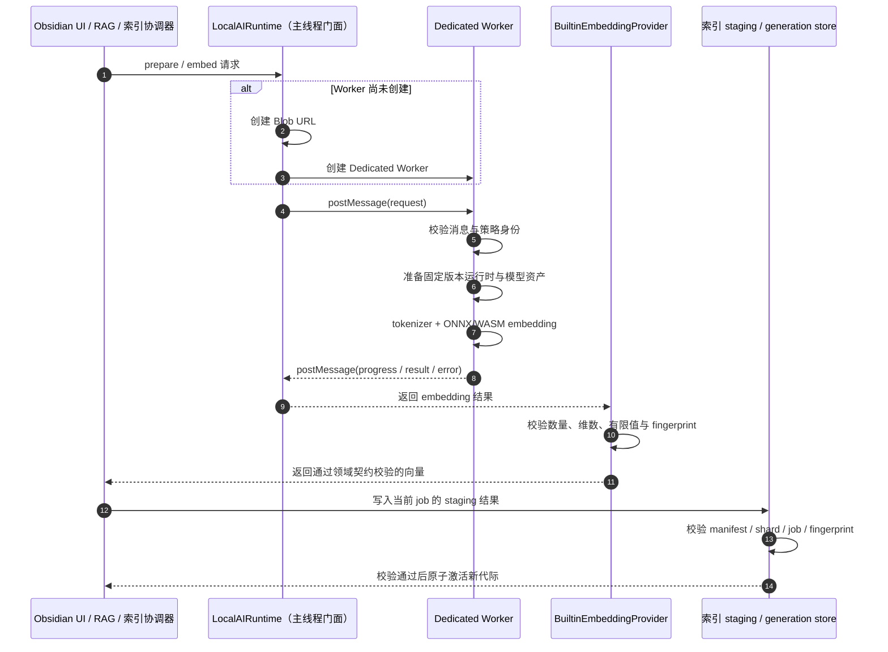
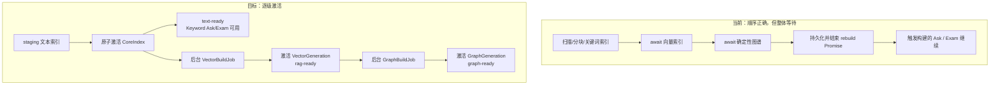
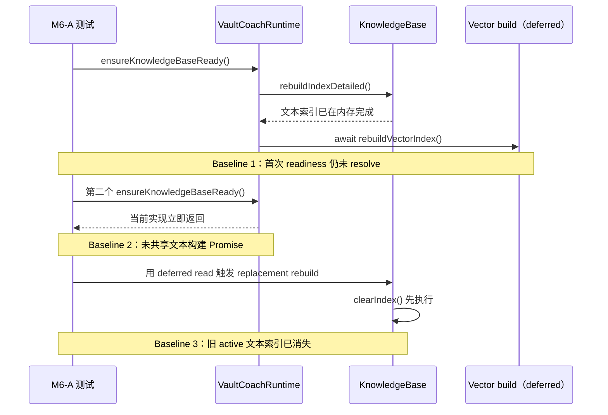
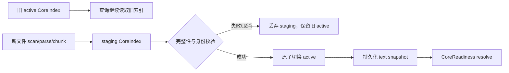
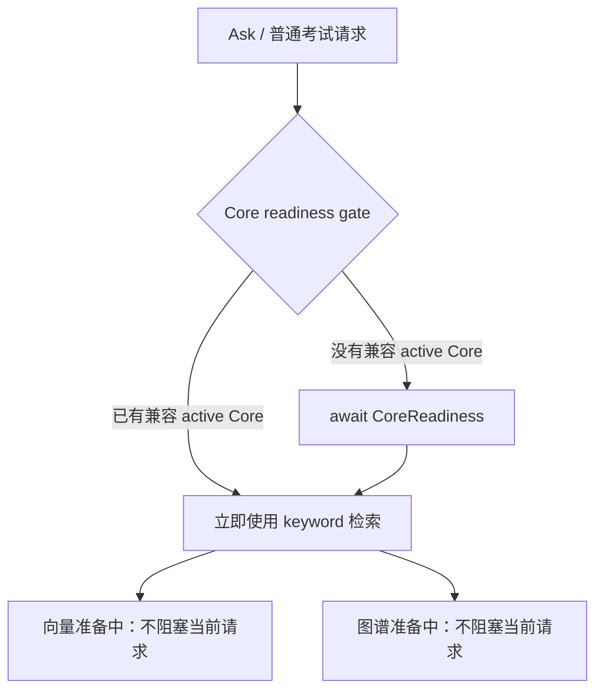
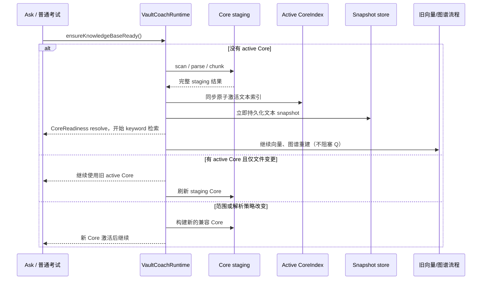

# 里程碑 6：统一 Worker、资源调度与可观测索引

## 0. 开发前背景：这里的 Worker 是什么

### 0.1 概念与边界

Worker 可以理解为*浏览器运行时*提供的一个**独立 JavaScript 执行上下文**：主线程把一项工作通过**消息**交给它，它在不占用 *UI 主线程*执行栈的情况下完成计算，再把结果通过**消息**返回。Vault Coach 此处使用的是 **Dedicated Web Worker**，即
- 由插件当前运行实例创建并**专用**的后台执行单元。

这里的 Worker 不是：

- Cloudflare Worker：运行在云端边缘平台，用于处理网络请求；
- Service Worker：主要拦截请求、管理离线缓存和 Web 应用生命周期；
- Node.js `worker_threads`：Node 运行时的线程 API；
- 独立 sidecar、守护进程或服务器：本里程碑不引入额外进程，也不把 Vault 内容上传到云端。

Dedicated Worker 与*主线程*之间存在明确的隔离边界。它不能直接操作 DOM（**Web DOM**（全称 **Document Object Model**，即**文档对象模型**）是==浏览器为网页提供的一个**编程接口（API）**== 它将 HTML 或 XML 网页文档表示为一棵**树状结构**（对象树），让 JavaScript 等编程语言可以动态地访问、修改、添加或删除网页的结构、样式和内容），也不能直接拿到 Obsidian 的 `App`、`Vault`、View 或插件实例；

主线程和 Worker 不能共享普通 JavaScript 对象。双方只能通过 `postMessage` 发送*可结构化克隆的数据*，或显式转移 `ArrayBuffer` 等 transferable 对象的所有权。因此，Worker 不是“把一个现有函数换个地方调用”这么简单，而是一个需要协议、校验、生命周期和故障处理的本地执行边界。

### 0.2 Worker 起什么作用

Obsidian 的界面、用户输入、View 更新以及大部分插件 API 都运行在**主线程**。模型初始化、tokenizer、ONNX/WASM 推理和大批量 embedding 都可能形成**长任务**；如果这些计算直接占用**主线程**，滚动、输入、切换页面和取消操作就可能出现明显卡顿。

Worker 的核心作用是把**适合隔离的重计算**移出 UI 主线程，使界面仍有机会处理交互和绘制。它还提供一个清晰的资源所有权边界：
- 模型 pipeline、tensor、session 和推理队列由 Worker 持有；
- 插件卸载或硬取消时，可以终止整个 Worker，统一**释放**该执行上下文中的资源和未完成请求。

但 Worker 不会自动让所有代码并行，也不保证任务总耗时一定缩短。创建 Worker、序列化消息、复制数据、转移 buffer、模型切换和垃圾回收都有成本；Worker 内部如果采用单队列，推理任务仍然会按策略排队。当前文件发现、笔记读取、PDF 解析、分块和索引持久化也不会因为 embedding 已在 Worker 中运行就自动迁出主线程，必须通过 **trace** 分别定位和治理。

### 0.3 Worker 怎么起作用

当前项目中的基本调用链可以概括为：



其工作机制包含以下几个关键环节：

1. **请求关联**：主线程为请求*分配 ID*，并在 pending map 中保存对应的 Promise；Worker 返回消息后按 ID 找回调用方。M6 进一步加入 `jobId`、`workerEpoch`、`role` 和 `policyId`，防止取消、重建或切换策略后的迟到结果污染当前状态。
2. **消息隔离**：跨边界输入按 `unknown` 解析并做运行时校验，不把 Obsidian 对象、API key、完整设置或原生 `Error` 直接传入 Worker。错误只返回稳定错误码、可恢复性和安全消息。
3. **数据传递**：小型控制消息使用结构化克隆；向量和 WASM 等大块二进制数据优先使用 `ArrayBuffer` transfer，避免不必要的深拷贝。被转移的 buffer 会从发送方 detach，发送方不能继续复用。
4. **串行化与调度**：当前 Worker 已串行处理消息；M6 在此基础上增加显式 scheduler，用优先级、公平性、模型租约和 batch 边界协调前台查询与后台整库索引，而不是让多个角色各自创建 pipeline、争抢内存。
5. **取消与恢复**：soft cancel 停止提交新 batch，并忽略已经取消任务的迟到结果；hard cancel 通过 `terminate()` 终止当前 Worker，使该 epoch 的全部 pending 请求失败。后续任务创建新 epoch，旧 Worker 的消息不得更新新状态。
6. **生命周期清理**：插件 unload 时取消任务、拒绝 pending、释放模型资源、终止 Worker，并撤销 Blob URL；关闭一个 View 只取消 UI 订阅，不应误杀由应用层拥有的索引任务。

### 0.4 M5 已有基线与 M6 的新增职责

> [!important] 当前起点
> M5 已经实现首个内置 Embedding 的生产 Worker 基线：`LocalAIRuntime` 创建 Blob Worker，Worker 内完成固定资产校验、模型加载和真实 WASM 推理，插件卸载时会终止 Worker。M6 不是从零验证“Worker 能不能运行”，而是把已有单角色、基础消息和状态处理提升为可扩展、可恢复、可观测的生产级执行系统。真实 Obsidian 冷/暖缓存、移动端和性能预算仍需按各自 Gate 单独验证。

| 维度 | M5 已有基线 | M6 要补齐 |
| --- | --- | --- |
| 执行位置 | Embedding 已在 Dedicated Worker 内运行 | 保持真实 Worker 路径，并验证发布安装与目标设备 |
| 消息 | 基础 `id/type/payload` 和进度/结果/错误 | 版本化 envelope、严格 validator、job/epoch/role/policy 身份 |
| 并发 | Worker 内基础串行队列 | 前台优先、后台公平、batch 让出和单活跃模型租约 |
| 取消 | Abort 后主线程拒绝请求；unload 可终止 Worker | soft/hard cancel 语义、迟到结果隔离、崩溃后统一拒绝 pending |
| 结果 | 返回并校验 embedding 数量、维数和有限值 | `ArrayBuffer` transfer、指纹/请求身份复核、staging 代际安全激活 |
| 进度 | 模型准备阶段的基础进度 | 发现、读取、分块、准备、embedding、持久化到 ready 的真实全链路进度 |
| 可观测性 | 局部状态与错误 | job/request/epoch 关联的 span、耗时、错误码、主线程长任务与内存证据 |
| 多角色 | 当前只实现 Embedding | 为 reranker/utility 提供共享协议、缓存注册和调度能力；未实现操作明确返回 unsupported |

### 0.5 对 Vault Coach 当前项目的意义

- **保持 Obsidian 可交互**：整库 embedding 时尽量避免模型推理阻塞编辑、滚动和 View 更新，这是 Worker 化最直接的用户价值。
- **守住本地优先边界**：模型和笔记文本在本机浏览器运行时内处理；Worker 是本地隔离单元，不等于云服务，也不会天然产生外发。
- **形成统一模型资源层**：Embedding、后续 Reranker 和 Utility 可以复用同一套下载校验、缓存、加载、调度和释放机制，而不复制三套生命周期代码。
- **保证索引正确性**：Worker 只负责执行，不拥有索引业务真相；`jobId + epoch + policyId + fingerprint` 与 staging generation 共同阻止取消任务、旧模型或崩溃恢复后的结果错误激活。
- **让故障可恢复**：模型推理失控、Worker crash 或硬取消时，可以整体终止执行单元，明确拒绝所有 pending，并在下一次用户任务中干净重建。
- **让性能问题可定位**：M6 把“感觉不卡”变成可检查的初始化、tokenizer、推理、transfer、持久化、GC 和主线程 Long Task 证据，从而区分 Worker 内瓶颈与仍留在主线程的文件/PDF/索引瓶颈。
- **为移动端和后续角色建立约束**：单 Worker、单活跃模型和显式资源租约是一条保守的跨桌面/移动端路线；是否开放更多实例必须以设备内存、延迟和稳定性证据决定。

## 1. 目标与边界

基于 M5 已接通的真实 Embedding 生产 Worker，加固索引闭环，并把当前串行的“文本/向量索引 → 确定性图谱 → 可选语义图谱”拆成三个可独立激活、可独立失败的阶段：

1. **CoreIndexGeneration**：扫描、分块、关键词索引原子激活后达到 `text-ready`，立即允许基础 Ask/普通考试；
2. **VectorBuildJob / VectorGeneration**：Core 激活后在后台构建兼容向量，成功后达到 `rag-ready`，失败时继续 keyword；
3. **GraphBuildJob / GraphGeneration**：向量能力进入终态后低优先级构建确定性/语义图谱，独立报告 queued/running/ready/stale/failed/cancelled。

M6 负责生产级 Worker 消息、资源调度、取消/崩溃恢复、可恢复后台作业、三类 generation 的身份与全链路可观测性。M6 **不把图谱接入问答召回或考试生成**；实际 GraphRAG 查询、融合和质量 Gate 留给 [[里程碑6.3-GraphRAG问答与考试增强]]。技术边界见 [[02-GraphRAG后台构建、检索融合与评测契约]]。

通过 M6-B 的 CoreIndex Gate 后即可进入 keyword-first 的 M7 验收，不等待 reranker、utility 或图谱完成；增量 A 的内置 Embedding 发布仍需通过 M6-C 和受影响的 M6-E/M7–M9 门禁。文件发现、PDF parser、Vault 读取和持久化不会因模型 Worker 化自动迁出主线程，trace 发现的瓶颈要单列处理。

### 1.1 当前代码已经做到什么、还缺什么

2026-11-01 代码核对结论：如果按“子系统是否存在”估算，当前约完成 65%–70%；如果按“用户能否先用关键词、其余阶段在后台连续完成”估算，约完成 45%–50%。这些百分比是用于排期的工程判断，不是发布质量指标。

| 目标 | 当前已实现 | 仍缺失 |
| --- | --- | --- |
| 快速文本/关键词索引 | `KnowledgeBase` 已独立完成扫描、解析、分块和倒排索引；`isReady()` 不要求向量存在 | 全量重建开头会清空 active 文本索引；没有 staging/active 代际；文本完成后没有立即持久化和发布 `text-ready` |
| 向量未完成时提供查询 | retrieval resolver 和 RagEngine 已在向量 unavailable/failed 时回退 keyword | 首次 Ask/Exam 的 `ensureKnowledgeBaseReady()` 仍等待整个 `rebuildKnowledgeBase()`；触发本轮构建的请求通常要等向量和确定性图谱结束 |
| 后台 Embedding | 内置 Embedding 已在 Dedicated Worker 中运行；向量存储有 fingerprint 和 replaceAll | Worker 只隔离计算，应用层仍 `await rebuildVectorIndex()`；没有持久化 VectorBuildJob、独立取消、checkpoint 和前台请求优先调度 |
| 增量向量更新 | 变更文件会触发向量同步，失败时保留 keyword 路径 | 当前任意 changed/removed chunk 都会全量重建向量；没有按 chunk 的 staging writer |
| 最后构建图谱 | 确定性图谱在向量之后构建；图失败不清除文本索引；语义图谱已有手动/自动入口和分批保存 | 确定性图谱仍在同一索引 Promise 中；语义 coordinator 只保存进程内 busy/progress/controller；没有持久化 GraphBuildJob/generation 激活 |
| GraphRAG | 已有确定性图、effective semantic graph 和来源证据基础 | Ask 不读取图谱；正式接入留给 M6.3 |

当前与目标调用链的差别：



并发情况下“刚好能查到内存中的关键词结果”不算完成。只有明确的 generation、ready 事件、持久化恢复和自动化测试共同通过，才算阶段能力已交付。

### 1.2 本里程碑固定实施顺序

后续实现按下表依次进行；前一个 PR 的 Gate 未通过，不开始后一个生产功能 PR。文档/测试准备可以并行，但不能用后续阶段掩盖前一阶段缺陷。

| 顺序 | 实施包 | 独立交付结果 |
| --- | --- | --- |
| M6-A | 冻结 baseline 与阶段测试 | 证明当前首次查询被全流程阻塞，并固定 keyword/vector/graph 现有降级行为 |
| M6-B | CoreIndex staging、原子激活与 `text-ready` | 扫描完成后立即持久化；Ask 和普通考试只等待文本 ready；重建时旧 active 继续服务 |
| M6-C | Worker 协议、scheduler 与后台 VectorBuildJob | 向量排队/运行不阻塞 keyword；完成后独立激活 `VectorGeneration` 并切换 hybrid |
| M6-D | 后台 GraphBuildJob | 默认在向量任务终态后低优先级启动；图失败、取消或过期不影响 Core/Vector ready |
| M6-E | 取消、恢复、可观测性与真机 Gate | 三阶段可独立取消/恢复；迟到消息不能污染 active generation；形成发布证据 |

M6-B 是本轮最高优先级，也是最小可独立发布的用户价值。M6-C 未完成时仍可发布稳定 keyword；M6-D 未完成时不阻塞基础 RAG。确定性结构图技术上只依赖 CoreIndex，未来可依据 trace 与向量并行，但首版按“文本 → 向量 → 图谱”的单向顺序降低状态组合复杂度。

## 2. 依赖与文件

内部：M3 generation store，M4/M4.1 资产方案，M5 runtime/cache/loader，现有 KnowledgeIndexCoordinator、KnowledgeGraphService、SemanticGraphService。

外部：Web Worker、ArrayBuffer transfer、经 M4 验证的 WASM/WebGPU、实际移动端。M6 不新增 sidecar，也不引入云端作业服务。

| 文件 | 状态 | 工作 |
| --- | --- | --- |
| `src/infrastructure/local-ai/local-ai-worker-protocol.ts` | 拟新增 | discriminated union、运行时 validator |
| `src/infrastructure/local-ai/local-ai-worker-client.ts` | 拟新增 | pending map、epoch、超时、取消、释放 |
| `src/infrastructure/local-ai/local-ai.worker.ts` | 已有，待扩展 | 从 Embedding 执行宿主扩展为受版本化协议和调度约束的共享宿主 |
| `src/app/local-ai/local-ai-scheduler.ts` | 拟新增 | 优先级、公平性、实例预算、角色切换 |
| `src/domain/index-lifecycle/index-generation.ts` | 拟新增 | Core/Vector/Graph generation 身份、引用、兼容与激活条件 |
| `src/app/index/index-progress.ts` | 拟新增 | CoreIndex 阶段、数量、单位与 job ID |
| `src/app/index/knowledge-index-coordinator.ts` | 已有，待扩展 | CoreIndex 所有权、进度订阅、取消与 ready 发布 |
| `src/domain/index-jobs/vector-build-job.ts` | 拟新增 | 持久化向量作业状态、source Core、embedding policy、checkpoint 和终态 |
| `src/app/index/vector-build-coordinator.ts` | 拟新增 | Core 激活后排队、恢复、supersede 和 VectorGeneration 激活 |
| `src/domain/graph-jobs/graph-build-job.ts` | 拟新增 | 持久化 job 状态、phase、checkpoint、终态原因 |
| `src/app/graph/graph-build-coordinator.ts` | 拟新增 | 排队、恢复、supersede、GraphGeneration staging/activation |
| `src/infrastructure/storage/json-graph-build-job-store.ts` | 拟新增 | 保存作业事实和 checkpoint；不保存 Promise/AbortController |
| `src/app/semantic-graph/semantic-index-coordinator.ts` | 已有，待迁移 | 从仅内存 busy/progress 接入 GraphBuildJob；保留语义容量 Gate |
| `src/app/vault-coach-runtime.ts`、`src/knowledge-base.ts`、`src/rag-engine.ts` | 已有 | 从发现、分块、embed、persist 上报事实 |
| `src/app/application-api.ts`、`src/app/application-container.ts` | 已有 | status/subscribe/cancel 与 dispose |
| `src/presentation/components/index-progress.ts` | 拟新增 | 分别展示“检索可用”和“图谱后台构建”，提供恢复动作 |
| `esbuild.config.mjs` | 已有 | M4 验证方案正式化，兼顾现有 PDF.js 补丁 |
| `tests/infrastructure/local-ai/*`、`tests/app/local-ai/*` | 拟新增 | fake Worker/clock/调度测试 |

不要并存 embedding-worker-protocol 和三角色各一套重复协议；共享 envelope，payload 按角色严格区分。GraphBuildJob 是应用层作业，不等于 Worker request；一个 graph job 可以跨多个 Worker 请求、HTTP 调用和持久化 checkpoint。

## 3. 协议约束

所有请求/响应包含 `v, requestId, jobId, workerEpoch, role, policyId`。操作至少包括 prepare、embed、cancel、dispose；rerank/utility 类型可定义能力协商但未实现时返回 unsupported-operation。

Embedding 结果包含 count、dimension、fingerprint、ArrayBuffer；必须验证 `count * dimension * 4 === byteLength`。之后还需验证有限数、请求数量与身份，不能只验证 buffer 长度。后续 rerank 是稳定 candidate ID/score 列表，utility 是已标记 schema 的结果，两者不伪装成向量。

边界输入按 unknown 解析。不要跨线程传 API key、全部插件设置、Obsidian App、Vault 实例或原生 Error；错误传 code/recoverable/safeMessage。原文只限完成任务必要的文本 batch，不写日志。

作业与 Worker 使用不同身份：

- `CoreIndexGeneration` 只冻结 source/scope、parser/chunker、chunk schema 与 source inventory；不因 embedding provider 改变而使 keyword 失效；
- `VectorGeneration` 引用 `sourceCoreGenerationId`，并冻结 embedding fingerprint、维数、dtype 和向量存储 schema；
- `GraphGeneration` 引用 `sourceCoreGenerationId`，并冻结抽取策略、concept embedding fingerprint 与治理 revision；
- `VectorBuildJob` 携带 `jobId/sourceCoreGenerationId/embeddingPolicyId/workerEpoch/checkpointId/phase`；
- `GraphBuildJob` 携带 `jobId/graphPolicyId/workerEpoch/checkpointId/phase`；
- Worker request 仍使用 `requestId`，一次作业可以发出多个 request；
- source/provider/policy 改变后旧作业可结束清理，但不得激活。

## 4. 按步骤实施

### Step 0：冻结 baseline，并先写阶段交付测试（M6-A）

内部依赖：现有 `KnowledgeBase`、`VaultCoachRuntime`、retrieval resolver、fake embedding/graph service。外部依赖：Vitest fake timers/deferred Promise。

保留现有“向量 unavailable/failed 时回退 keyword”“图谱失败时文本保持可用”“Worker request 可取消”的回归测试；以下是 M6-A → M6-B 的目标验收矩阵。M6-A 先为其中的核心阻塞边界写通过的 baseline 测试，M6-B 再把对应断言翻转为目标行为：

1. 文本扫描完成、向量 deferred 未结束时，触发本轮构建的首次 Ask 已返回 keyword 结果；
2. 文本激活后、向量构建中重启插件，能恢复新的 keyword 索引；
3. 新 CoreIndex staging 构建中，查询仍读取上一代 active，而不是空索引或半写入数据；
4. 向量失败/取消只使当前 VectorGeneration 失败，不把 CoreIndex 标为 unavailable；
5. 图谱作业 running/failed 时，Ask 和普通考试不等待图谱；
6. 没有 active CoreIndex 时，多个并发请求只等待同一个文本构建任务，不重复扫描也不提前空查询。

M6-A 的提交不把未实现目标留成失败的默认测试套件。它先以**通过的 baseline 测试**固定当前阻塞和清空行为，并在测试名称/本节中明确这些断言将在 M6-B 翻转；目标验收断言随 M6-B 同一 PR 变绿。这样 CI 始终可信，也不会将“当前行为”误报为目标已完成。

#### M6-A 实施记录（2026-11-01）

实现思路：不修改生产索引逻辑；使用 deferred Promise 人为暂停向量构建或文本读取，观察 runtime 的真实 Promise 边界和 active 文本状态。测试覆盖三个已确认缺口：首次 `ensureKnowledgeBaseReady()` 等待向量、第二个并发 readiness 调用未加入首个文本任务、以及全量重建在读取新文本前清空旧索引。



本实施包最初新增 `tests/app/vault-coach-runtime.test.ts` 中的 `M6-A staged index baseline`：三项 baseline 都通过，证明测试能稳定抓住当时现状：

- [x] Core 文本已建好但 vector deferred 时，首个 readiness 仍被阻塞；
- [x] 无 active Core 时，第二个 readiness 调用没有 join 首个文本构建；
- [x] replacement rebuild 在文本读取完成前清空旧 active 索引。

M6-B 开始时按以下顺序翻转：先保留旧 active，再让并发调用 join Core task，最后让首次 readiness 在 `text-ready` 而非 vector 完成时 resolve。性能时间字段的实际采集留给 M6-E 的 trace/真机 Gate；M6-A 只固定可重复的逻辑边界。

Gate：baseline 测试能稳定复现当前缺口，且未把“偶然并发可查”当成通过；定义首次 keyword ready、完整向量和完整图谱的测量字段，实际时序采集留待 M6-E。

### M6-B 实现概念：Promise、deferred、CoreIndex 与 readiness gate

#### 1. Promise 在这里具体表示什么

JavaScript 的 `Promise<T>` 可以理解为一个“未来会得到 `T` 的结果凭证”：

- `pending`：任务仍在执行，调用方可以 `await`，但不会得到结果；
- `fulfilled`：任务成功完成，`await` 获得结果；
- `rejected`：任务失败，`await` 抛出错误。

因此，`rebuildKnowledgeBase()` 返回的 `Promise<void>` 表示“整轮知识库重建最终结束”，而不是“文本索引已经可以查询”。在 M6-B 之前，调用方误把这个整轮 Promise 当成唯一 ready 信号，导致向量构建较慢时 keyword 查询也被拖住。M6-B 新增的 `CoreReadiness` 是另一个更早完成的 Promise，专门表示“兼容的文本 CoreIndex 已激活并持久化”。

#### 2. deferred Promise 是什么，测试为什么需要它

`deferred Promise` 不是 JavaScript 的新类型，而是一种测试控制模式：Promise 先创建，但把 `resolve` 暴露给测试，稍后由测试手动决定它何时完成。

```ts
let resolve!: (value: Result) => void;
const promise = new Promise<Result>((nextResolve) => {
    resolve = nextResolve;
});

// 任务仍然 pending；测试可以先观察 readiness 是否已释放
resolve(result); // 在需要时模拟向量任务完成
```

M6-B 测试用 deferred Promise 把向量构建“故意暂停”，然后验证文本 snapshot 已落盘时 `CoreReadiness` 是否已经 resolve。这样测试的是明确的时序契约，而不是依赖某台机器上向量恰好快或慢。`tests/app/vault-coach-runtime.test.ts` 中的 `createDeferred()` 就是这个测试工具；它不应被误解为生产 Worker 调度器。

#### 3. CoreIndex 是什么

`CoreIndex` 是回答和考试最小可用的文本索引代际，不等同于完整 GraphRAG。它至少包含：

- 通过当前 scope 发现并读取的文件清单 `files`；
- 解析、分块后的文本 `chunks`，其中包含稳定 chunk ID 和来源定位信息；
- source inventory、parser/chunker identity 等用于判断兼容性的来源事实；
- 能立即支持 keyword/BM25 类检索的内存结构和持久化 snapshot。

它不要求 embedding、reranker 或知识图谱已经完成。向量和图谱是引用某个 `CoreIndexGeneration` 的派生代际：CoreIndex 先可用，VectorGeneration 和 GraphGeneration 随后异步追赶。这样才能保证“词法检索先可用”不是一个 UI 假状态，而是有完整来源和 chunk 事实支撑的查询能力。

#### 4. active、staging 与原子激活

- `active CoreIndex`：当前查询真正读取的完整索引；
- `staging CoreIndex`：正在扫描、解析、分块的新索引，尚未对查询可见；
- 原子激活：staging 的完整性、scope 和身份校验通过后，在一个同步切换点把它设为 active。



关键点是：构建过程中不能把半成品写进 active，也不能先执行 `clearIndex()` 再慢慢填充。否则查询可能看到缺文件、缺 chunk 或来源代际混杂的索引。M6-B 的 staging 实例让失败和取消都只影响候选代际。

#### 5. readiness gate 是什么

`readiness gate` 是进入某个功能前必须满足的“就绪闸门”。它不是一个总开关，而是按能力拆开的等待边界：



因此，M6-B 的 gate 只等待 `CoreIndex`，不等待向量或图谱。普通文件变更且旧 Core 仍兼容时，gate 允许旧 active 继续服务，同时后台刷新 staging；scope、parser 或 chunker 身份变化时，旧 Core 不再被视为兼容，gate 才会等待新 Core。这一边界同时保护了响应速度和答案来源的一致性。

### Step 1：实现 CoreIndex staging、原子激活与早期持久化（M6-B1）

内部依赖：M3 store、existing coordinator、document parser/index。外部依赖：Vault adapter。

全量重建不得先 `clearIndex()` 破坏 active generation。扫描、解析和分块写入 staging；完整性、scope、source inventory、parser/chunker identity 校验通过后，原子切换 active CoreIndex。构建失败或取消时丢弃 staging，上一代 active 继续服务。

CoreIndex 阶段为：

```text
not-indexed → discovering → reading → chunking → persisting-text → text-ready
```

激活后立即持久化 chunks/files/source inventory、设置 `textDirty=false`、发布 `text-ready`，不等待 embedding 或图谱。provider/模型改变不使关键词代际失效；scope、parser/chunker 或 source inventory 改变才创建新 Core generation。

Gate：重建期间旧索引可查询；新文本完成后即使向量永不 resolve，也能重启恢复并继续 keyword；查询永远不读半写入 staging。

### Step 2：改变 Ask/Exam 的 readiness gate 和 UI 状态（M6-B2）

`ensureKnowledgeBaseReady()` 改为“确保存在兼容 active CoreIndex”，只在没有可用文本代际时等待 Core 构建；不得等待 VectorBuildJob 或 GraphBuildJob。已有 active 但来源变更时，默认继续使用旧代际并标记 refreshing；如果安全策略判定 scope/domain 已改变而不能使用旧代际，则等待新 Core，而不是空查询。

能力状态拆分为：

```text
Core:   not-indexed / building / text-ready / refreshing / failed
Vector: disabled / queued / building / rag-ready / stale / failed / cancelled
Graph:  disabled / queued / building / graph-ready / stale / failed / cancelled
```

UI 首先显示“关键词检索可用”，再分别显示“语义检索准备中”和“图谱后台构建中”。一个总百分比不能跨未知总量阶段伪装连续进度。取消图谱或向量的按钮不能撤销 active CoreIndex。

Gate：首次 Ask/普通考试在 `text-ready` 后继续；向量和图谱 deferred 时不阻塞；诊断中能看到实际使用 keyword/hybrid 及降级原因。

#### M6-B 实施记录（2026-11-01）

本次实现刻意只改变 **CoreIndex 的可用性边界**，不提前伪造 M6-C 的持久化 `VectorBuildJob`：

1. `VaultKnowledgeBase.rebuildIndexDetailed()` 和 `syncChangedFiles()` 改为在独立 staging 实例中解析；只有完整成功才在同一 JS turn 复制为 active 索引，因此读取方只会看到旧完整索引或新完整索引。
2. Runtime 在 Core 激活后立即将旧向量状态标为不可用于检索、持久化文本 snapshot/source inventory、设置 `textDirty=false`，然后 resolve `CoreReadiness`。
3. `ensureKnowledgeBaseReady()` 在没有 active Core 时只等待 `CoreReadiness`；它不会等待后续的向量或图谱。普通 Vault 文件变更且已有 active Core 时，继续服务旧 Core 并启动刷新；范围、parser/chunker 等设置变化仍要求新 Core 完成，避免跨范围回答。
4. 原有向量和确定性图谱流程仍在完整 rebuild Promise 中继续运行；它们不再阻塞 Ask/普通考试，但也还没有 checkpoint、独立取消或重启恢复。这些属于 M6-C/M6-D，不能在本次标记为已完成。



测试已从历史 baseline 翻转为 `M6-B CoreIndex readiness`：

- [x] vector deferred 时，首个 readiness 在文本 snapshot 落盘后 resolve；
- [x] 两个冷启动 readiness 共同等待同一个 Core task；
- [x] replacement rebuild 读取新文件时仍可读取旧 active 文本索引；
- [x] 文本 snapshot 在 vector 完成前已经持久化，恢复路径不会依赖本轮 embedding 完成。

本次没有更改默认检索模式：向量被标为 stale/absent 时 resolver 仍按既有契约选择 keyword；向量成功后的 `rag-ready` 状态、真实后台 job、进度与恢复由 M6-C 完成。

### Step 3：加固 Worker 协议并实现最小 scheduler（M6-C1）

内部依赖：M5 runtime adapter、registry/status。外部依赖：Vitest fake timers、M4 设备预算、Worker/CSP/ORT。

建立版本化 envelope 和 pending map；覆盖乱序、重复、未知 version/type、错误 policyId、过期 epoch。每个请求最多 settle 一次，完成后移除 timeout 和 AbortSignal listener。在现有 Blob Worker/固定 WASM 资产路径上补齐 client、epoch、错误码和资源释放；干净发布 Vault 仍须完成一次真实 embed。

先实现单活跃模型和最小优先级：前台 Ask query embedding > 当前考试交互 > 用户显式向量任务 > 后台图谱 embedding。后台在 batch/Section 边界让出并有最大等待；批大小由 token/字符和设备证据决定。

Gate：前台请求不会被整库 embedding 长期阻塞；取消排队任务后不启动推理；Worker crash 拒绝全部 pending；unsupported operation 不使 Worker 崩溃。

### Step 4：实现后台 VectorBuildJob 和 VectorGeneration（M6-C2）

CoreIndex 激活后创建 VectorBuildJob，但调用 Core 重建的 Promise 在排队成功后即可返回，不再 `await` 整库 embedding。作业状态为：

```text
idle → queued → preparing-model → embedding → persisting-vector
     → validating → rag-ready / stale / failed / cancelled / superseded
```

每个 batch 前后检查 job/sourceCoreGenerationId/epoch/fingerprint。向量写入 staging，只有数量、chunk identity、维数、有限值、fingerprint 与 source Core 全部通过才原子激活 VectorGeneration。旧向量只有在仍引用当前 active Core 且 fingerprint 兼容时可继续服务；否则立即标 stale，查询使用 keyword。

首个可交付版本允许 changed/removed chunk 后在后台全量重建，但必须保留 Core 可用并记录成本；随后在同一阶段增加按 chunk 的 staging writer/checkpoint，避免单文件修改永久触发整库 embedding。Vector 失败不得自动调用云端或启动错误空间的旧向量。

Gate：`text-ready` 后 keyword 立即可用；向量完成后无重启切换到 hybrid；向量失败/取消/重启不污染 active Core 或错误激活 partial vector。

### Step 5：实现可恢复的后台 GraphBuildJob（M6-D）

首版按产品顺序在向量能力确认为 disabled，或 VectorBuildJob 进入任一终态（ready/failed/cancelled）后排队图谱；向量失败时图谱仍可使用 CoreIndex 构建，不把 embedding 成功设为硬依赖。GraphBuildJob 状态为：

```text
idle → queued → snapshotting → structural → extracting
     → concept-embedding → candidate-building → validating
     → graph-ready / stale / failed / cancelled / superseded
```

主线程读取 Vault 和 Obsidian metadata，创建只含稳定 ID、Section 窗口、Chunk locator、source generation 与策略身份的不可变输入。确定性结构图先继续使用纯构建器；只有 trace 证明存在 Long Task 时才迁移 Graph Worker。远程/Ollama 抽取是异步 transport，不因“后台”就额外创建 Worker；未来内置抽取才使用 utility role。

语义抽取沿用显式开关、容量门禁和分批 checkpoint。每个 checkpoint 保存一致来源事实、processed/failed/queued 数和 source generation，不保存控制器或 Worker 实例。重启后按 job + generation 决定 resume/restart/supersede。

只有完整性通过、证据 chunk 属于 active Core、`sourceCoreGenerationId` 未变化时才激活 GraphGeneration。旧 active graph 在 staging 期间保持不变；不兼容图可显示 stale，但不得进入 M6.3 GraphRAG。

Gate：Core/Vector ready 与 Graph ready 相互独立；图失败不影响 Ask baseline；旧作业、迟到 checkpoint 和待确认关系不能覆盖 active generation 或用户治理事实。

### Step 6：取消、崩溃和清理（M6-E1）

内部依赖：协议、scheduler、staging。外部依赖：Worker termination。

soft cancel 停止新 batch/Section 并忽略已取消结果；若底层推理不能立即停止，准确展示“正在停止”。hard cancel 终止 Worker，拒绝该 epoch 全部 pending；清资源后下一次用户任务才重建，避免 crash loop。取消 CoreIndex staging、VectorBuildJob 与 GraphBuildJob 是三个动作；停止向量或图谱不能撤销已经可用的 active CoreIndex。

清缓存、清基础索引、清图谱、重置用户图谱治理分别处理。插件 unload 中断运行实例、断订阅、释放 tensor/session/worker/URL，并持久化可恢复作业事实；关闭 View 只解除 UI 订阅，任务由应用层拥有。

Gate：取消后没有迟到 ready/持久化/记忆/图谱激活；重开 View 可看到当前真实任务；重启后不会恢复旧 Promise，却能根据 checkpoint 安全恢复。

#### M6-E1 实施记录（2026-11-02）

本次将用户动作和插件生命周期拆成两个明确语义：

1. 用户点击停止仍执行 soft cancel，Core、Vector、Graph 使用各自 AbortSignal；已经激活的 CoreIndex 不回滚。
2. 插件 unload 对 VectorBuildJob/GraphBuildJob 执行 `suspend`，只中止当前进程调用栈，不把可恢复作业错误写成用户主动 `cancelled`。重启后校验 generation/policy，再以持久化输入创建新 job 重排。
3. 新增命令面板入口“强制停止内置 AI Worker”。hard cancel 会拒绝活动和排队中的本地 AI 请求、终止 Worker、释放消息处理器与 Object URL；模型缓存和 active CoreIndex 保留，下一次任务按需创建新 epoch/Worker。
4. 语义抽取在异步模型调用返回后再次检查 AbortSignal；取消结果不再被统计为普通 Section 失败，也不会写入迟到 checkpoint。VectorJob 的 supersede 所有权同步修正，旧 job 的 waiter 不再收到替代 job 状态。
5. Local AI dispose 改为幂等，并阻止 dispose 后重新创建 Worker；运行时 unload 会等待已拥有的派生任务完成 suspend 收尾后再释放 Worker。

自动化测试覆盖 soft cancel、hard cancel、活动/排队请求拒绝、Worker 懒重建、迟到抽取结果丢弃、Vector/Graph supersede 状态归属、unload 保留非终态 job 以及重启重排；70 个测试文件、301 项测试、lint、TypeScript、生产构建和 release asset 校验通过。这里尚未宣称完成 M6-E2：完整结构化 trace、Long Task/内存采样、真实发布 Worker 离线 smoke 和桌面/iOS/Android 设备 Gate 仍待后续阶段。

### Step 7：接入日志与性能证据（M6-E2）

内部依赖：轻量事件端口、job/request/epoch。外部依赖：DevTools performance/memory。

分别记录：

```text
core-index.rebuild → text.persist → core.activate
vector-job.run → embedding.batch → vector.activate
graph-job.run → graph.snapshot → concept.extract → concept.embed → graph.activate
```

后续 M6.1/M6.2/M6.3 复用同一事件 envelope。SDK 未引入时先用无正文结构化日志，不把“设计了 trace”写成已部署遥测。

分别采集文件发现、PDF/parser、初始化、tokenizer、推理、网络等待、transfer、checkpoint、持久化、GC 和主线程长任务。输出节流但不丢终态；日志只含 job/generation/role/policy 短 ID、数量、耗时、预算和错误码，不含笔记、query、题目或答案正文。

Gate：达到 M4 预登记预算；性能不达标时找真实瓶颈，不以循环动画掩盖。

#### M6-E2 实施记录（2026-11-02）

已加入本地、只读、有界的索引生命周期 trace 基础设施：

1. `application.index.getTraceEvents()` 暴露最近 256 条内存事件；事件不持久化、不联网，不包含笔记/query/题目/答案正文或 Vault 文件路径。
2. job、Core generation 和 policy 原始身份在进入 trace 前统一转换为不可逆 8 位短摘要。Embedding policy 中可能存在的 endpoint/model 信息不会原样进入诊断。
3. 已接入 `core-index.rebuild/sync`、`text.persist`、`core.activate`、`vector-job.run`、`embedding.batch`、`vector.activate`、`graph-job.run`、`graph.snapshot`、`concept.extract`、`concept.embed` 和 `graph.activate`。每个 span 记录 started/terminal、持续时间、安全错误码和可选计数；Graph checkpoint 保留 processed/failed/queued 数。
4. Chromium/桌面运行时支持 `PerformanceObserver(longtask)` 时记录主线程 Long Task；支持非标准 `performance.memory` 时在初始化、Core/Vector/Graph 终态及 unload 采集 JS heap。iOS/Android 或其他不支持的平台明确降级为空采样，不伪造零 Long Task 或零内存。
5. trace 快照是深拷贝，span 只允许 settle 一次，超过上限淘汰最旧事件；取消、stale、superseded、suspended 与普通 failed 使用不同终态。

自动化测试只证明 envelope、隐私字段、计时、边界容量、平台降级和生命周期接线正确；72 个测试文件、307 项测试、lint、TypeScript、生产构建和 release asset 校验通过。M4 预算是否达标、真实发布 Worker 离线加载、GC/原生内存，以及桌面/iOS/Android 的性能结果仍必须在相应设备上采集后填写，不能由单元测试替代。

## 5. 必测场景

| 场景 | 预期 |
| --- | --- |
| 首次构建：文本完成、向量 deferred | 触发构建的 Ask/普通考试已用 keyword；现有整轮 rebuild 流程可继续等待向量，但不再阻塞该请求 |
| 新 Core staging 中发起查询 | 读取旧 active Core；没有旧 active 时等待同一个 Core task，不返回半索引 |
| 文本激活后、向量完成前重启 | 恢复 `text-ready`，keyword 可用；VectorJob 按 identity resume/restart |
| 第三批 embed 失败 | staging 不激活，旧兼容代际或 keyword 可用 |
| 文本索引已激活、向量仍构建 | Ask 使用 keyword；UI 显示向量仍在准备 |
| CoreIndex ready、GraphJob 仍运行 | 基础 Ask/普通考试可用；图谱状态单独展示 |
| GraphJob 第三批抽取失败 | 保存有效 checkpoint、标记可重试；不改变 CoreIndex ready |
| 图谱构建中 Vault 再次变化 | 旧 job superseded；不得激活到新 CoreGeneration |
| 插件重启时 GraphJob 有 checkpoint | 不恢复旧 Promise；校验身份后 resume/restart |
| 关闭语义图谱或撤销外部发送授权 | 不创建新抽取；正在排队任务取消或失效 |
| 中途改 provider/scope | 旧指纹任务不能激活 |
| UI 关闭再开 | 继续订阅同一 job，不重复建索引 |
| Worker crash | 所有 pending 得到失败；无悬挂 promise |
| A epoch 迟到消息 | B epoch 状态不受影响 |
| WebGPU lost | 按 M5 同策略有限回退；变 dtype 则拒绝旧空间 |
| 转移 ArrayBuffer 后再次访问 | 测试识别 detached buffer，生产不复用 |
| 一角色清缓存、另一角色活跃 | 租约与引用关系保护无关资源 |
| unload/reload | 监听、Worker、URL 和 timer 数恢复 |

## 6. 交付、下一步与记录

- [ ] 发布形态真实 Worker 推理和离线加载通过。
- [x] 全量文本重建不先清空 active；Core staging/active 原子切换有故障测试。
- [x] 首次 Ask/普通考试只等待 `text-ready`；Core rebuild 在 VectorBuildJob 持久化为 queued 后返回，向量与后续图谱不再阻塞基础查询。
- [x] 文本激活后立即持久化；向量过程中重启仍可恢复 keyword 索引。
- [x] VectorGeneration manifest 与持久化 VectorBuildJob 独立引用 Core generation；更换 embedding 只使向量作业/代际失效，不使 keyword 失效。
- [x] Worker 使用版本化 envelope、request/job/epoch/policy 身份和受控错误；过期 epoch、crash pending rejection、非法消息与 transferable 向量 buffer 有自动化测试。
- [ ] scheduler 预算、公平性、role 切换有证据。
- [x] `text-ready/rag-ready/graph-ready` 分开；基础 RAG 不等待图谱。
- [x] GraphBuildJob 可 checkpoint、恢复、取消、supersede，且不覆盖用户治理事实。
- [ ] 进度真实；取消/crash/迟到消息不污染 CoreIndex 或 GraphGeneration。
- [ ] plugin unload 幂等，用户事实保留。
- [ ] 真机性能记录注明未验证平台。
- [ ] 可以交付增量 A 的 M7–M9。
- [ ] M6.1/M6.2 收到角色化协议、缓存注册方式与资源预算。
- [ ] M6.3 收到 Core/Vector/Graph generation、GraphBuildJob、只读 active graph 和降级状态契约。

```text
Commit / M4 ADR / 模型策略：
Worker 交付与协议版本：
Scheduler / batch / timeout：
索引正确性与故障测试：
CoreIndex / VectorGeneration / GraphGeneration schema：
GraphBuildJob / checkpoint / restart：
Trace / 主线程长任务 / 内存：
桌面、iOS、Android 分别结果：
增量 A 发布候选状态：
```

2026-10-23：从 embedding 专属 Worker 调整为共享宿主和角色调度；规划完成不等于 Worker 已实现。

2026-10-31：补充 Worker 背景，并按当前代码同步 M6 起点：M5 已完成单角色生产 Worker 基线；M6 聚焦协议、调度、取消/恢复、全链路进度和可观测性，规划项仍不等于已经实现或通过真机 Gate。

2026-11-01：将基础 RAG ready 与后台图谱作业拆成两个生命周期；新增 CoreIndexGeneration、GraphGeneration 和可恢复 GraphBuildJob 交接，GraphRAG 查询与考试增强留给 M6.3。

2026-11-01：根据“关键词先可用 → 后台向量 → 后台图谱”的产品流程重新排序 M6：先交付 CoreIndex staging/`text-ready` 和 readiness gate，再加 VectorBuildJob，最后接 GraphBuildJob；补充当前实现完成度、阻塞点、PR 顺序与首次查询验收测试，并将 VectorGeneration 从 CoreIndexGeneration 中独立出来。

2026-11-01：完成 M6-B：全量与增量文本索引均通过 staging 后原子激活；`CoreReadiness` 在文本 snapshot 已持久化时释放 Ask/普通考试，文件变更期间复用旧 active Core。向量与图谱仍沿用现有整轮流程，独立可恢复 job 留待 M6-C/M6-D。

2026-11-02：完成 M6-C 首个可交付版本：新增共享 Worker v1 envelope、epoch/pending/timeout/取消清理和单活跃模型优先级 scheduler；Embedding 结果改为经过 count/dimension/有限值校验的 transferable `ArrayBuffer`。新增持久化 `VectorBuildJob`、确定性 Core generation 身份和 VectorGeneration 的 `sourceCoreGenerationId`；全量与增量 Core 激活后只等待 job 排队落盘，向量在后台通过 staging generation 校验后切换为 `rag-ready`，失败、取消、provider/Core 变化继续使用 keyword。Worker crash、过期 epoch、前台 query 越过排队后台 batch、取消排队任务、旧 Core 防激活和 Runtime keyword→hybrid 时序均有自动化回归；69 个测试文件、287 项测试、lint、TypeScript、生产构建和 release asset 校验通过。

本次未宣称完成 M6-D/M6-E：确定性/语义图谱仍由 VectorJob 终态后的兼容后台 continuation 驱动，尚无持久化 GraphBuildJob；向量首版仍按 batch 全量重建，尚未实现 chunk checkpoint/staging writer；真实发布 Worker 的离线 smoke、设备预算、公平性老化策略、hard cancel、完整 trace 与桌面/iOS/Android Gate 仍待后续验证。

2026-11-02：完成 M6-D 首个可交付版本：新增持久化 `GraphBuildJob` 和独立 `GraphGeneration` 身份，VectorJob 进入任一终态后由 Runtime 排队全量或增量图谱作业；结构图 staging 在激活前校验 `sourceCoreGenerationId + graphPolicyId`，旧 active graph 在构建失败、取消、过期或被新作业替换时保持可读。语义图谱沿用显式开关、自动同步与容量门禁，并将 extraction 的 processed/failed/queued 进度投影到作业 checkpoint；重启不恢复旧 Promise，而是校验持久化身份后用同一 durable 输入安全重排。图谱状态已独立暴露为 queued/running/graph-ready/stale/failed/cancelled/superseded，失败只标记图谱需要重试，不回滚已可用的 Core/Vector。自动化回归覆盖旧 Core 防激活、激活钩子失败保留旧图、checkpoint、重启重排、取消、supersede 状态归属，以及 Runtime 的 Generation 身份和失败降级；70 个测试文件、294 项测试、lint、TypeScript、生产构建和 release asset 校验通过。

M6-D 不改变语义治理模型：确认、拒绝、手工关系与撤销仍保存在既有 append-only 决策事实中，GraphBuildJob 只记录派生进度，不把治理事实复制进 checkpoint。当前“恢复”粒度是依据持久化输入重跑安全阶段，而不是从某个远程抽取调用的中间指令续跑。M6-E 仍需完成真实进度/trace、hard cancel、迟到结果全链路证明、插件 unload 资源计数、发布形态离线 smoke，以及桌面/iOS/Android 的性能与内存 Gate；M6-C 的向量 chunk checkpoint/staging writer 也仍未完成。
