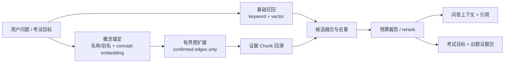

# 里程碑 6.3：GraphRAG 问答与考试增强

## 1. 目标与边界

在 M6 已将基础文本/向量索引与后台图谱作业解耦之后，把**当前有效且有来源证据的图谱事实**接入问答和考试。目标不是给产品贴上 GraphRAG 标签，而是在固定样本上证明：图谱通道能提高多跳问题、跨 Section 关系问题和先修知识考试规划的准确度，同时不降低直接事实问题、引用正确性和基础 RAG 可用性。

当前差距必须先写清：

- Ask 目前只使用 keyword/vector/hybrid 召回和 rerank，尚未读取知识图谱；
- 确定性结构图谱与语义概念图谱已经存在，但主要服务 Learning Map、掌握度、推荐和自适应考试规划；
- 语义关系候选需要用户确认后才进入 effective graph；待确认、已拒绝和来源失效的关系不得进入 GraphRAG；
- 图谱构建失败、未启用或代际不兼容时，问答和普通考试必须继续使用基础文本/向量路径。

首版范围：有界的 local/entity graph retrieval、与现有 chunk 召回融合、问答上下文组装、考试目标与证据扩展、离线评测和可见降级。暂不实现 Microsoft GraphRAG 式全库 community report/global map-reduce，也不在查询时让模型自由生成新的图边。

详细算法、身份和评测契约见 [[02-GraphRAG后台构建、检索融合与评测契约]]。

## 2. 依赖与交付关系

| 依赖 | 必须提供 | 缺失时处理 |
| --- | --- | --- |
| M3/M5 | chunk 身份、embedding fingerprint、原子向量代际 | 不允许用不兼容向量空间解析 query 或 concept |
| M6 | `CoreIndexGeneration`、`GraphGeneration`、后台 GraphBuildJob、取消/恢复/进度 | 先完成基础索引与图谱生命周期解耦 |
| M6.1（可选） | 稳定候选 ID、Cross-encoder rerank 与候选预算 | 未通过 Gate 时使用现有启发式或稳定融合排序 |
| M6.2（可选） | 忠实查询改写及本地 Utility 调度 | 未通过 Gate 时直接使用原问题；不阻塞 GraphRAG |
| 当前图谱 | 确定性图、effective semantic graph、证据 chunk、用户决策 | 只有通过完整性与来源校验的事实可参与检索 |
| 当前考试 | AdaptiveExamPlan、mastery、confirmed prerequisite、source chunk 约束 | 保留现有确定性规划作为 baseline 和降级路径 |

M6.3 通过后作为独立增量重新执行 M7–M9。它不是增量 A 的发布阻断项；GraphRAG NO-GO 时保留后台图谱、Learning Map 和现有基础 RAG。

## 3. 目标架构



查询期间不修改图谱。图谱检索只读取与当前 `CoreIndexGeneration` 兼容的 active `GraphGeneration`；staging、partial、stale、failed generation 均不能进入正式检索。

## 4. 文件与职责

以下是建议落点，评审可调整路径，但边界不能并回 `rag-engine.ts` 或 UI：

| 文件/模块 | 工作 |
| --- | --- |
| `src/domain/graph-retrieval/graph-retrieval-types.ts`（拟新增） | graph query、anchor、path、evidence chunk、诊断与失败原因 |
| `src/domain/graph-retrieval/graph-retrieval-policy.ts`（拟新增） | hop、节点/边/chunk/token 预算，允许关系类型与稳定策略版本 |
| `src/app/retrieval/graph-retrieval-service.ts`（拟新增） | query 概念锚定、有界扩展、证据回溯与输出校验 |
| `src/app/retrieval/retrieval-fusion-service.ts`（拟新增） | keyword/vector/graph 候选去重、RRF 或经评测的融合、渠道诊断 |
| `src/app/exam/graph-exam-context-service.ts`（拟新增） | 把考试目标、先修关系和来源 chunk 组装成受控证据包 |
| `src/rag-engine.ts` | 消费融合后的候选；保留来源 locator，不直接遍历图或读取 store |
| `src/exam/exam-engine.ts`、`src/app/exam/adaptive-exam-planner.ts` | 接收图增强证据包；生成与评分接口不拥有图谱存储 |
| `src/app/application-container.ts` | 注入读取端口、融合服务与策略；不创建第二套图谱实例 |
| `src/app/config/settings-*`、`src/settings.ts` | `disabled/auto/on` 路由、预算和诊断；默认切换由 Gate 决定 |
| `tests/app/retrieval/*`、`tests/app/exam/*`、`benchmarks/graphrag/*`（拟新增） | 契约、故障、固定语料和端到端质量证据 |

## 5. 按步骤实施

### Step 0：冻结 baseline 与评测集

在改检索前保存同一版本知识库上的基础 RAG 与当前考试结果。样本至少分为：直接事实、同义表达、跨 Section、多跳关系、比较/因果、无答案；考试至少覆盖概念定义、区别、应用、先修诊断、薄弱知识复习和无足够证据。

每个样本保存 gold evidence chunk、允许答案要点、禁止事实和适用知识范围。训练/调参样本与最终 Gate 样本分开；不得只用主观“回答更丰富”决定成功。

### Step 1：建立只读图检索快照

定义 `GraphRetrievalSnapshot`：包含 active graph generation、对应 core generation、概念/别名、已确认关系、结构边以及到 chunk 的证据映射。读取时检查 schema、generation、source inventory、embedding fingerprint 和用户治理 revision。

pending/rejected candidate、没有有效 chunk 的概念、越出当前知识范围的节点全部过滤。上一代图可供 Learning Map 显示为 stale，但不能静默参与当前 GraphRAG。

### Step 2：实现概念锚定

首版同时使用两种低风险入口：

1. 规范化名称/别名的精确或受控词法命中；
2. query embedding 与 concept embedding 的 Top-K 相似度匹配。

合并后保留 anchor 原因、分数和策略版本。查询改写只能提供候选 query，不能删除原问题中的实体、否定、范围和时间条件。零 anchor 时直接走基础 RAG，不为“必须走图”而猜概念。

### Step 3：有界图扩展并回到来源 Chunk

只遍历 allowlist 关系，首版默认最多 1 hop；2 hop 只对预登记的多跳问题类型开放。每次扩展受节点数、边数、每节点邻居数、证据 chunk 数和 token 总量约束。

关系本身不是回答证据。每个 graph candidate 必须回溯到当前文本索引中的 chunk，并保留 `conceptId/relationId/path/chunkId/locator`。断裂端点、循环、重复路径和无证据关系被丢弃并记录原因码。

### Step 4：融合基础召回与图召回

先按 chunk ID 去重，再比较至少三种冻结策略：

- baseline：keyword/vector/hybrid；
- baseline + graph，使用稳定 RRF；
- baseline + graph + M6.1 reranker。

不同通道原始分数不可直接相加；若不用 RRF，必须先定义可解释的归一化和缺失分数策略。最终上下文保留通道贡献和图路径诊断，但发送给主模型的正文仍只来自来源 chunk。

### Step 5：接入问答模式

GraphRAG 只扩展检索上下文，不替换 ChatProvider。prompt 明确区分“来源正文”和“图路径提示”，要求回答中的事实由 chunk 支持；图路径可帮助组织多跳关系，但不能成为无文本证据的引用。

无答案、图谱未就绪、超预算、图检索超时或完整性失败时回退 baseline。UI 只在诊断区域显示 `graph-used/graph-unavailable/graph-stale`，不得让用户把“使用图谱”误解为答案已经正确。

### Step 6：接入考试模式

保留现有 mastery + confirmed prerequisite 的确定性计划，图谱只增强目标选择和证据覆盖：

- 为目标概念收集直接证据、已确认先修概念和受控邻居；
- 先按 source chunk 预算形成 `ExamEvidencePack`，再调用问题生成器；
- 每道题绑定目标 concept、来源 chunk 和预期考查要点；
- 比较题必须有两个端点各自的文本证据；先修题必须来自 confirmed prerequisite；
- 不从待确认关系、相似度候选或图路径描述直接生成答案；
- 一个证据包不足以支持题干和答案时，减少题数而不是补写常识。

客观题继续走确定性评分；自由回答的参考答案、评分要点和反馈必须绑定生成时的 evidence pack。图谱或 mastery revision 改变后，旧考试会话仍按冻结 plan 评分，不在中途换题意。

### Step 7：质量、性能与产品 Gate

问答分别报告：candidate Recall@K、gold evidence Recall@K、NDCG/MRR、引用 precision/recall、答案要点覆盖、无依据陈述率、无答案拒答、p50/p95 延迟和图谱覆盖率。直接事实与多跳问题分开，禁止用总体平均掩盖直接事实退化。

考试分别报告：目标概念覆盖、先修选择准确率、source-backed question rate、答案可由证据支持率、重复题率、歧义/多答案率、难度分布偏差和人工审核通过率。至少保留一组不使用图谱的同模型 baseline。

具体阈值在实验前填写。没有 gold evidence、只有 LLM-as-judge、或只展示少量成功案例时，状态保持 experimental。

## 6. 必测故障与一致性场景

| 场景 | 预期 |
| --- | --- |
| Core generation 已更新、Graph generation 仍旧 | 基础 RAG 可用；GraphRAG 禁用并显示 stale |
| 图谱后台任务失败 | 不影响 Ask baseline、普通考试和旧有效图的受控读取 |
| 待确认关系命中 query | 不进入正式图扩展和考试先修规划 |
| 图路径存在但证据 chunk 已删除 | 丢弃路径；不得引用旧正文 |
| query 无概念 anchor | 直接 baseline，不调用无界图遍历 |
| 图召回超预算或超时 | 返回已校验的基础候选；不输出 partial graph facts |
| 前台 Ask 与后台图构建竞争 | 前台优先；后台在 batch 边界让出且不永久饥饿 |
| 考试生成期间图谱更新 | 当前会话继续使用冻结 plan/evidence revision |
| 用户关闭语义图谱或外部发送授权 | 不创建新抽取任务；现有 GraphRAG 路由按策略关闭 |

## 7. 验收、回退与记录

- [ ] GraphRAG 不改变基础 RAG 的 ready 条件；图谱不可用时降级稳定。
- [ ] 所有图候选最终映射到当前有效 chunk 和 locator。
- [ ] pending/rejected/stale/越界事实不能进入问答或考试。
- [ ] 问答多跳证据召回和答案准确度达到预登记门槛，直接事实不显著退化。
- [ ] 考试题、参考答案和评分要点均有冻结来源证据。
- [ ] 前台延迟、后台资源与移动端预算通过 Gate。
- [ ] 进入 M7–M9 的受影响验收；失败时可关闭 GraphRAG 而不删除图谱或用户决策。

```text
实现 commit / PR：
Graph retrieval policy / generation schema：
评测集版本与 gold evidence：
问答 baseline / GraphRAG 指标：
考试 baseline / GraphRAG 指标：
延迟、内存、移动端结果：
GO / NO-GO 与默认路由：
回退与遗留问题：
```

当前：仅完成规划，未实现 GraphRAG 检索、未运行质量实验，也未改变产品默认值。

